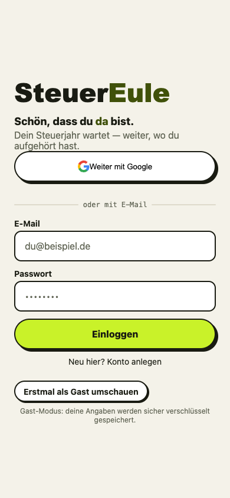
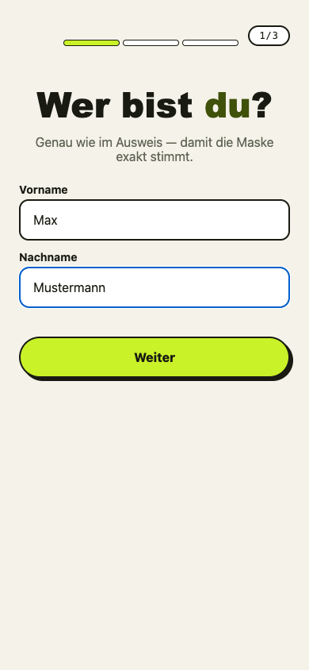
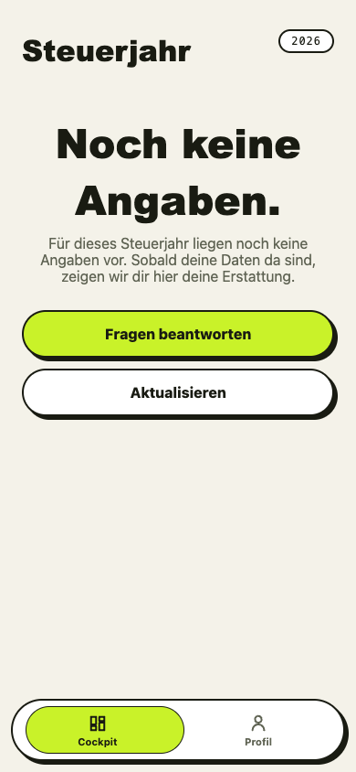
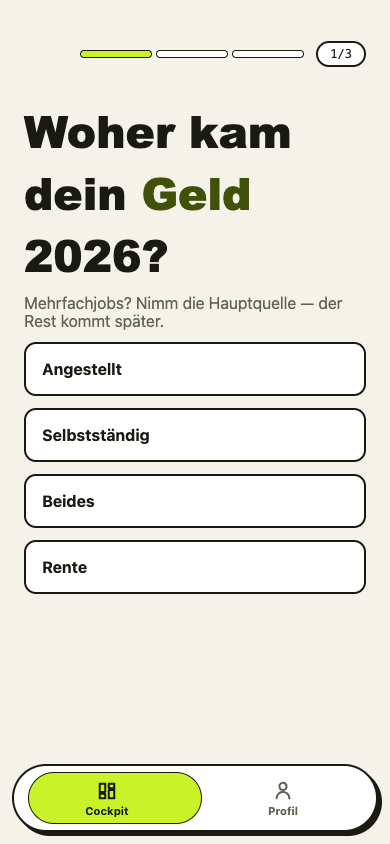
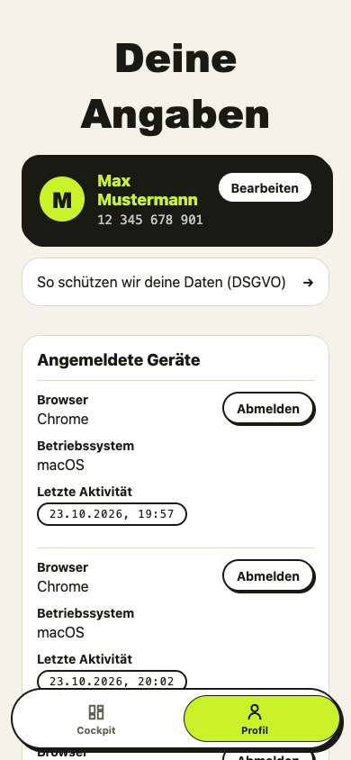
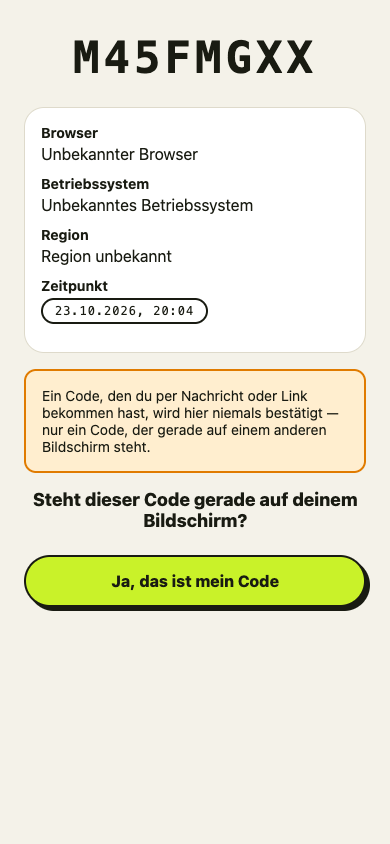

# Steuereule 🦉

**Die Steuer-App, die dir nichts verspricht, was sie nicht liefert** — Erstattungs-Schätzung mit
ehrlichen Zuständen, ein Interview als Einstieg und deine Daten verschlüsselt in der EU-Cloud.
Gebaut als Monorepo: eine Expo-/React-Native-Web-App, eine NestJS-API und ein geteilter
fachlicher Kern — entwickelt von einer dokumentierten AI-Crew (siehe
[CONTRIBUTORS.md](CONTRIBUTORS.md)) unter einem ebenso dokumentierten Prozess (siehe
[docs/process/](docs/process/)).

> **Status:** aktive Entwicklung Richtung 1.0. Der Plan steht in
> [docs/roadmap-1.0.md](docs/roadmap-1.0.md) — Phasen, Tracks und eine Definition of Done
> auf vier Ebenen.

---

## Screenshots

| | |
|---|---|
|  |  |
|  |  |
|  |  |

---

## Was die App heute kann

- **Gast-Browsing ohne Konto** — jeder Besucher bekommt eine anonyme Session; nichts geht
  verloren, wenn daraus später ein echtes Konto wird (atomare Gast→Konto-Übernahme).
- **Cockpit** — die Erstattungs-Schätzung als *Spanne* (nie ein Punktwert) plus die Zahl der
  offenen Punkte, mit ehrlichen Lade-/Leer-/Fehlerzuständen.
- **Interview (Minimal-Gate)** — drei Fragen, eine pro Screen; die Antworten werden
  server-seitig validiert und feldverschlüsselt gespeichert, nie im Browser.
- **Profil** — deine Steuer-ID wird **feldverschlüsselt** (AES-256-GCM) serverseitig abgelegt;
  jeder Zugriff landet in einem unveränderlichen Audit-Log, das nur du in deinem Export siehst.
- **Konto & Geräte** — Registrierung/Login per E-Mail, Google-Sign-in (Plumbing nachgewiesen,
  echte Credentials noch offen, #170), QR-Gerätefreigabe für den Desktop-Login ohne Passwort,
  Sitzungen einzeln widerrufbar.
- **DSGVO** — Export (JSON/PDF) nach Art. 15/20 und Konto-Löschung nach Art. 17 inklusive des
  Pflicht-Export-Angebots vor der Löschung.

**Was bewusst noch fehlt** (und deshalb auch nirgends versprochen wird): die echte
ELSTER-Übermittlung wartet auf das Hersteller-Zertifikat, 2FA/Passkeys, Apple Sign-In und die
Expo-SecureStore-Hälfte sind geplant — der Status jedes einzelnen Punkts steht im
[Requirements-Register](docs/requirements/register.md).

## Architektur im Überblick

| Baustein | Was | Wie |
|---|---|---|
| `apps/mobile-web` | Die App (Expo + React-Native-Web) | TanStack Query, i18n (de/en), Funke-Design-System |
| `apps/api` | REST-API (`/v1/*`) | NestJS + Fastify, better-auth, Prisma auf Postgres |
| `packages/core` | Geteilter fachlicher Kern (UI-frei) | Determinismus-Grenze: KI schlägt vor, legt nie selbst an |
| `packages/ui` · `tokens` | Design-System & Token-Pipeline | Style Dictionary |
| `packages/api-client` | Typisierter API-Client | OpenAPI-generiert (orval) |
| `e2e/` | Echte-Browser-Gates | Playwright gegen den realen Stack |

Die Architektur ist in [arc42](docs/arc42/README.md) dokumentiert und jede Entscheidung in den
ADR-Logs ([Engineering](docs/adr/), [Produkt](finanzo-funke-design-system/project/research/adr/)).

## Lokal starten

**Produktionsnaher Stack (Postgres + echte Container-Images):**

```
cp .env.example .env
docker compose -f docker-compose.yml -f docker-compose.prod.yml up --build
```

API: `http://localhost:3000` · Web-App: `http://localhost:8080`

**Entwicklung mit Hot-Reload:** `docker compose up -d` (nur Postgres), dann `pnpm install`,
`pnpm --filter @steuereule/mobile-web start` (Expo/Metro) und die API über
`pnpm --filter @steuereule/api start` (Build + Node) — Details stehen im Kopf-Kommentar von
`docker-compose.yml`.

### Drei Dinge vor dem ersten Klick — nichts davon ist kaputt

- **Die Datenbank startet leer.** Absicht: „sauberes Blatt, echte Anmeldung". Es gibt nichts zum
  Einloggen, bis du ein Konto registrierst oder als Gast weitersurfst.
- **Der Google-Button rendert, aber ein Klick schlägt fehl.** Der lokale Stack nutzt die
  Dev-Platzhalter-Credentials (`.env.example` erklärt, warum). Echter Google-Login braucht echte
  Credentials — #170, offen.
- **PDF-Export funktioniert** (das DSGVO-Export-Screen bietet PDF; der API-Container bringt das
  Headless-Chromium dafür mit) — bewiesen in CI auf Linux/amd64.

> **Apple Silicon (arm64) — inzwischen gemessen, nicht mehr „unverified".** Der komplette
> Produktions-Shape-Stack (Postgres, Migrationen, API- und Web-Container inklusive Chromium-PDF)
> wurde am 2026-10-23 auf einem Apple-Silicon-Mac gebootet und gefahren: `/v1/health/ready` 200,
> Registrierung → Onboarding → Interview → Profil → QR-Gerätefreigabe funktionieren gegen die
> Container. Die Screenshots oben stammen aus genau diesem Lauf. Was weiterhin fehlt: dieselbe
> Abnahme als **CI-Gate** — lokal bewiesen, in CI (noch) nicht.

## Qualität & Prozess

- **Definition of Done auf vier Ebenen** — Ticket, REQ, Phase, 1.0 ([ADR-0036](docs/adr/0036-definition-of-done.md));
  jede PR trägt eine abhakbare DoD-Checkliste inklusive Security/Performance-Posture-Zeile.
- **Tiered Testing** — Unit, Integration (echtes Postgres), Acceptance (echter Socket), echte
  Browser-Gates in CI; „grün" braucht eine Tier-Angabe.
- **Jede Architektur-Entscheidung ist ein ADR** — Engineering und Produkt führen getrennte Logs,
  die sich gegenseitig referenzieren statt duplizieren.

## Roadmap

Der Weg zu 1.0: Foundation-Konsolidierung → zwei Vertikalen parallel (Angestellte ∥
Grenzgänger-CH) → Verbreiterung (Belege, Günstigerprüfung, Bescheidprüfung, Eulen-KI) →
Go-Live. Vollständig mit Entscheidungsprotokoll: [docs/roadmap-1.0.md](docs/roadmap-1.0.md).

## Lizenz

Siehe [LICENSE](LICENSE).
