<p align="center">
  
</p>

# Steuereule 🦉

<p align="center">
  <b>Advisory over form-filling: The deterministic, privacy-first tax platform for employees, families, and cross-border workers.</b><br>
  Every amount comes from a pure-TypeScript calculation engine, never from a language model. Sensitive fields are encrypted with AES-256-GCM.
</p>

<p align="center">
  <a href="https://demo.steuereule.de"></a>
  <a href="docs/arc42/README.md"></a>
  <a href="docs/adr/"></a>
  
  
  
</p>

<p align="center">
  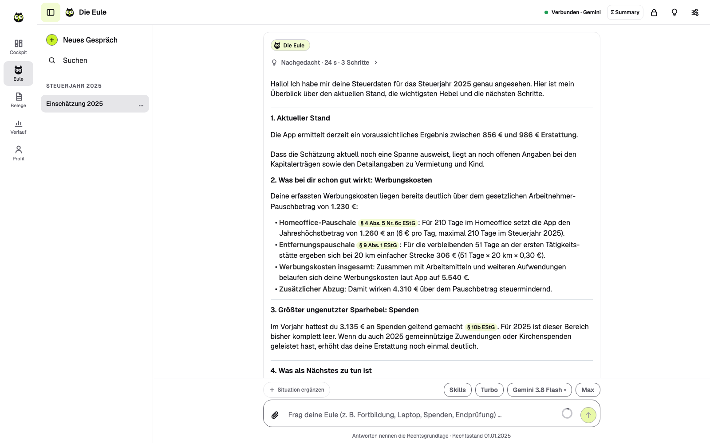
</p>
<p align="center"><sub><b>The owl speaks first.</b> Open a conversation and she analyses your return before you ask. Every euro in the text comes from the deterministic engine, not the language model.</sub></p>

<p align="center">
  <a href="#-meet-the-owl">Meet the Owl</a> •
  <a href="#-codebase-tour-for-engineers">Codebase Tour</a> •
  <a href="#-engineering-highlights">Engineering Highlights</a> •
  <a href="#-high-throughput-benchmarks">Performance</a> •
  <a href="#-architecture--system-design">Architecture</a> •
  <a href="#-production-sre--reliability">SRE & Security</a> •
  <a href="#-domain-capabilities">Domain Capabilities</a> •
  <a href="#-quickstart-in-60-seconds">Quickstart</a> •
  <a href="#-license">License</a>
</p>

---

## 🦉 Meet the Owl

The owl is a tax advisor in a chat, built like Claude: the conversation is the main surface, the return stays one click away. She works for the user's money, cites the law, and never writes into the return on her own.

- **She opens the conversation.** With enough on file she analyses the case unasked: where the refund stands, what already counts, where money is still lying around. With gaps she says what she knows and asks for the rest as a round of tappable answers. With nothing on file she offers to start the interview. She only opens again when the case changed ([ADR-0067 §11](docs/adr/0067-owl-projects-conversations-notes-context.md)).
- **Figures from the engine, words from the model.** The estimate, the commute and home-office allowances and the work expenses are computed by [`@steuereule/core`](packages/core/) before the model is asked; they are the only amounts she may name. Every answer is checked without a model, and an opening that names an amount the app did not compute is written again.
- **`/grill-me`.** The Berater-Interview skill asks in rounds, each with tappable answers and her recommendation; the answers become drafts the user approves.
- **Drafts, not writes.** Everything she prepares is a draft with its computed effect on the refund; nothing reaches the return without a click (or Turbo, visible and undoable).
- **Thinking shown.** "Nachgedacht · 24 s · 3 Schritte" opens to the steps she took and what each tool found.
- **Tax years as projects.** Conversations live in their year, side by side, with the household's situation and the year's notes as shared context; nothing that names a person reaches the model.

| Empty chat, case unchanged | `/grill-me`: an interview round | On a phone |
|:---:|:---:|:---:|
| 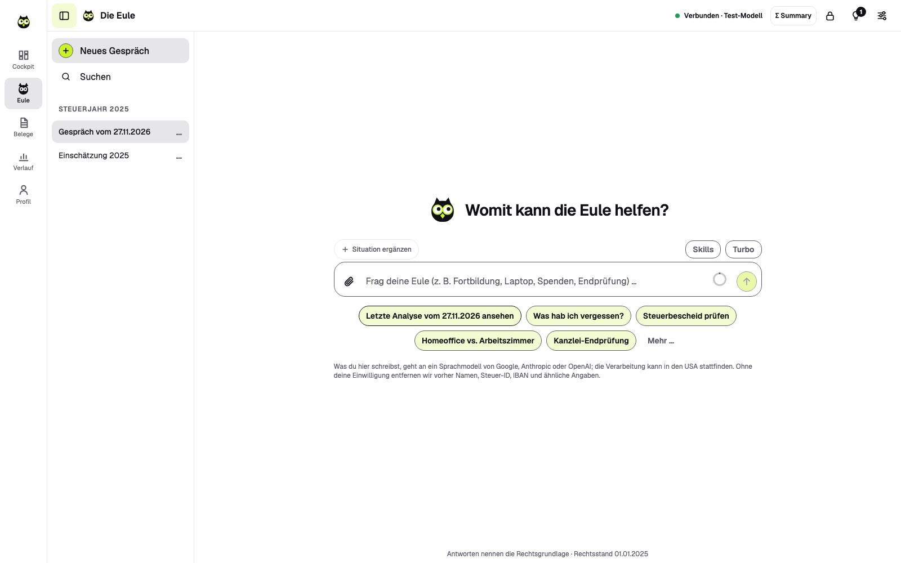 | 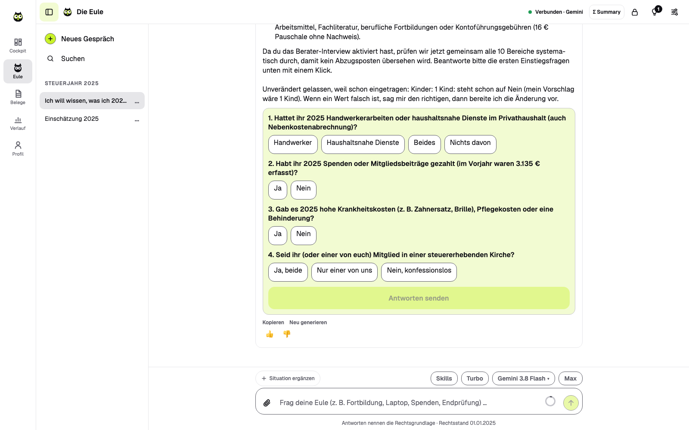 | 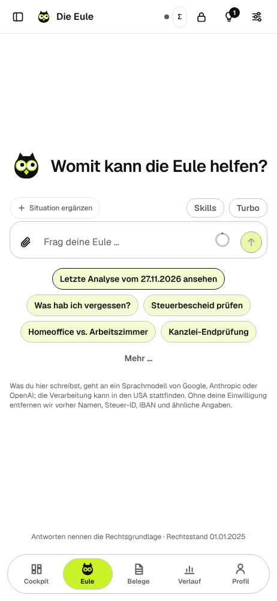 |
| *Nothing changed since her last analysis: a link to it instead of a new one.* | *A round of questions with tappable answers.* | *Same chat, same rules, at 390 px.* |

---

## 🧭 Codebase Tour for Engineers

*If you are reviewing this repository and only have 3 minutes, inspect these high-signal implementation files:*

| File | Focus Area | Why It Matters |
|:---|:---|:---|
| [`packages/core/src/math/tarif.ts`](packages/core/src/math/tarif.ts) | **Pure Deterministic Math** | Pure TypeScript implementation of the German progressive income tax formula (§ 32a EStG) and splitting tariff. No dependencies, no I/O. One call takes about 65 nanoseconds on a laptop (`pnpm --filter @steuereule/core bench`). |
| [`packages/core/src/interview/matrix-fuzzing.test.ts`](packages/core/src/interview/matrix-fuzzing.test.ts) | **Combinatorial Fuzzing & Invariants** | Exhaustively traverses all **144 permutations** of the interview state machine and proves mathematical boundary invariants up to €100M (non-negativity, tariff monotonicity, absence contradiction gates). |
| [`apps/api/src/prisma/encrypted-prisma.provider.ts`](apps/api/src/prisma/encrypted-prisma.provider.ts) | **Field Encryption** | Server-side **AES-256-GCM** encryption of the fields marked `@encrypted`, as a Prisma extension. Old keys stay readable through a list of decryption keys ([ADR-0008](docs/adr/0008-profile-persistence-encryption.md)). |
| [`apps/api/src/health/health.controller.ts`](apps/api/src/health/health.controller.ts) | **SRE Health Probes** | Cloud-native `/v1/health/live` and `/v1/health/ready` probes; readiness checks that the database pool answers. |

---

## ⚡ Product Mission

Traditional tax software presents dense tabular forms without proactive guidance, while commercial tax accountants often reduce their service to mechanical data entry. Meanwhile, many consumer apps market deceptive fixed returns that fail under scrutiny by tax authorities.

**Steuereule changes this with software-driven advisory:**
1. **Intelligent Advisory:** Instead of blank forms, Steuereule conducts an adaptive interview, deriving legal deductions (home office lump sums, commute deductions, childcare, education costs) directly cited with the governing statutory paragraph (§ EStG).
2. **Deterministic Engine vs. AI Hallucination:** All financial computations are executed strictly by a pure, deterministic calculation kernel ([`@steuereule/core`](packages/core/)). AI assists solely in narrative explanation and contextual suggestions; it is strictly prohibited from mutating financial figures ([ADR-0038](docs/adr/0038-calculation-core-and-ai-port.md)).
3. **Transparent Range over Deceptive Promises:** Potential refunds are displayed as an honest, uncommitted range until every relevant legal variable is confirmed ([ADR-0032](docs/adr/0032-nothing-on-screen-promises-what-the-slice-does-not-deliver.md)).
4. **Verifiable Paper Trail:** Outputs are calibrated directly onto official Federal Ministry of Finance (BMF) tax forms down to the millimeter, making every figure auditable by tax professionals.

---

## 📸 Interactive Walkthrough & Preview

| Honest Refund Range Cockpit | 1-Question-per-Screen Interview | Privacy-First Onboarding |
|:---:|:---:|:---:|
| 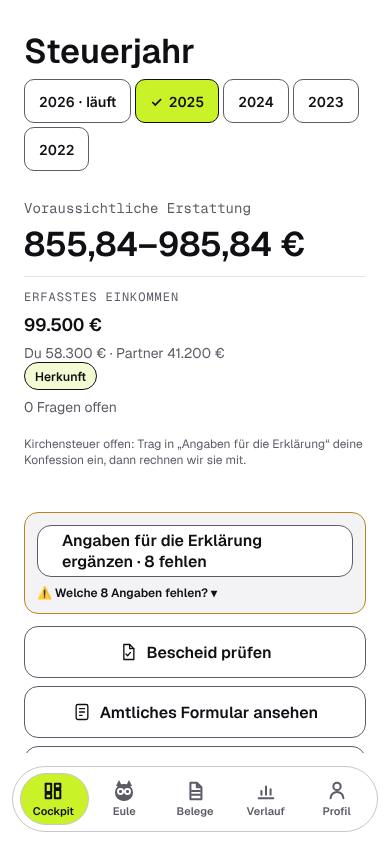 | 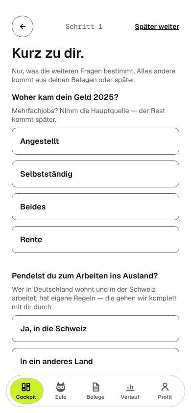 |  |
| *Transparent refund range, zero ungrounded guarantees.* | *Focused, rapid quiz interface free of tax jargon.* | *Data-parsimonious, field-encrypted, GDPR-compliant.* |

| Device Management | Passwordless QR Handoff | Guest Mode & Instant Login |
|:---:|:---:|:---:|
| 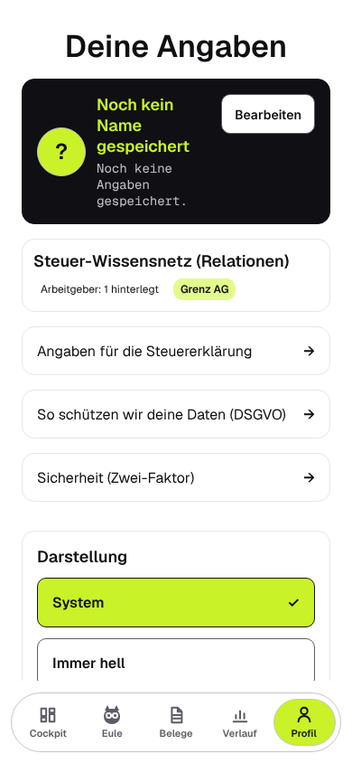 | 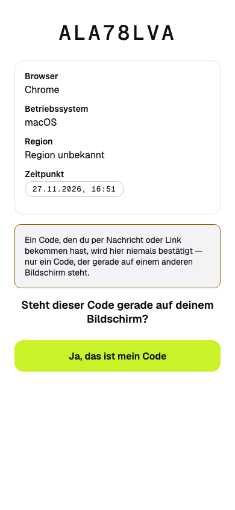 | 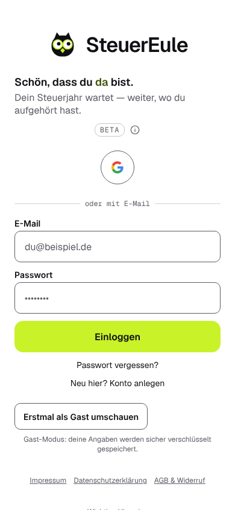 |
| *Active session overview with individual remote revoke.* | *Seamless desktop login via mobile camera verification.* | *Zero-friction guest exploration without forced signup.* |

**One look at every width, light and dark.** White ground, hairlines and lime as the single accent in light mode; graphite with cards one step lighter in dark mode. Beyond the phone the tabs become a rail on the left edge.

| Desktop: the rail with the brand | Tablet: the narrow rail | Dark mode |
|:---:|:---:|:---:|
| 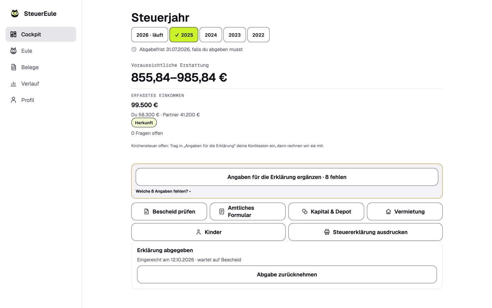 | 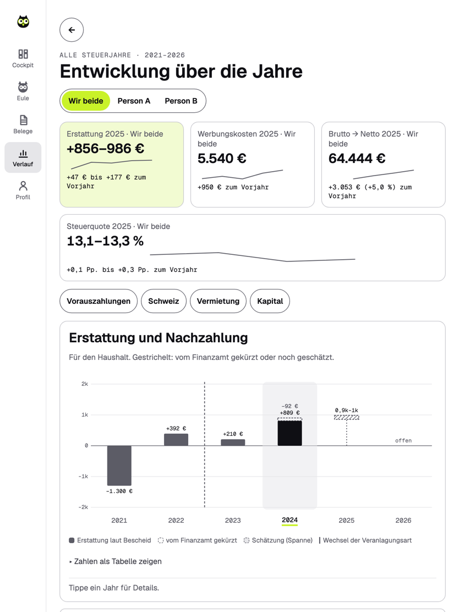 | 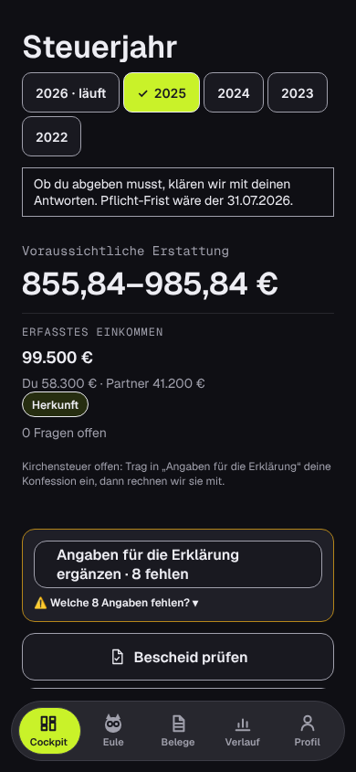 |
| *Same tabs, same roles, more room.* | *Icon over label; the screen keeps the width.* | *Follows the system, or fixed in the profile.* |

<p align="center">
  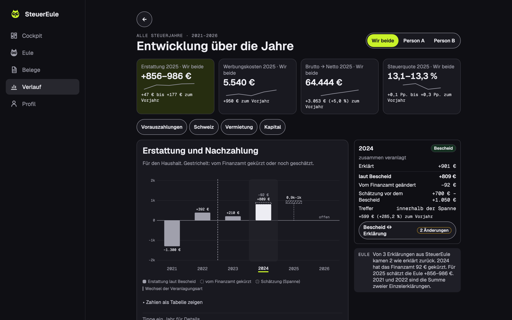
</p>
<p align="center"><sub><b>No red, no green for money.</b> A back payment is the bar below the baseline; dashed means cut by the tax office or still an estimate.</sub></p>

---

## 🛠️ Engineering Highlights

* **Purely Deterministic Calculation Core ([`packages/core`](packages/core/)):**
  Financial calculation logic (§ 32a EStG income tax brackets, solidarity surcharge, child allowances, split-tariff formulas) is encapsulated in an isolated, pure-TypeScript engine completely free of UI, database, or I/O dependencies. 155 test files check it against statutory values (count as of 2026-11-22).
* **Separation of AI & Calculation ([ADR-0038](docs/adr/0038-calculation-core-and-ai-port.md)):**
  Large language models offer advice, summarize legal paragraphs, and propose interview topics, but have zero write access to calculation state. A user must explicitly accept a suggestion before parameters feed into the deterministic core.
* **Field-Level Encryption:**
  Fields marked `@encrypted` in the Prisma schema, such as tax identification numbers and amounts, are encrypted server-side with **AES-256-GCM** before they reach PostgreSQL. Receipt files are encrypted with a key per user, so deleting the key destroys the file even in old backups ([ADR-0059](docs/adr/0059-document-keystore-crypto-shredding.md)).
* **Rigorous Architecture Discipline:**
  More than **100 Architecture Decision Records ([docs/adr/](docs/adr/))** record decisions with their alternatives. The architecture is documented along **arc42** in [`docs/architecture.md`](docs/architecture.md), including its known debts.
* **Contract-First API Design:**
  The REST API (NestJS + Fastify) generates an OpenAPI specification that compiles into end-to-end typed TypeScript SDKs via Orval, guaranteeing compile-time type safety across frontend and backend boundaries.
* **Automated Hardened CI/CD ([`.github/workflows/`](.github/workflows)):**
  Separate pipelines, each with its own entry in the Actions sidebar: `Quality` (quality.yml), `Security` (security.yml), `Build & E2E` (ci.yml), `Load` (load.yml, many-user load test: small on every PR, full size nightly) and `AI eval (nightly)` (ai-eval-nightly.yml). Together they enforce synthetic linting (`oxlint`), strict TypeScript checking, security vulnerability scanning (`trivy`, `semgrep`, `gitleaks`), Docker Compose deployment validation, and Playwright end-to-end browser testing. Infrastructure is managed via OpenTofu for deployment to **Google Cloud Run** ([`infra/gcp`](infra/gcp/)).

---

## ⚡ High-Throughput Benchmarks

The tariff functions have a Vitest benchmark (`pnpm --filter @steuereule/core bench`). It runs locally, not in CI. One run on a developer laptop:

```text
 ✓ src/math/tarif.bench.ts (4)
   ✓ Tarif & Tax Engine Throughput Benchmark
     · incomeTax (§ 32a EStG Grundtarif single)      16,484,019 ops/sec  (mean: 0.060 µs)
     · splittingTariff (§ 32a Abs. 5 married)         10,654,069 ops/sec  (mean: 0.093 µs)
     · solidaritaetszuschlag (Surcharge)              32,839,177 ops/sec  (mean: 0.030 µs)
     · full calculation loop (100 income tiers)          222,094 loops/sec (>22.2M evaluations/sec)
```

* **Scale-to-Zero Cloud Run Friendly:** Instant cold-start and sub-microsecond latency permit running under minimal CPU resource quotas.

---

## 🛡️ Production SRE & Reliability

* **Cloud-Native Health Probes:** Granular `/v1/health/live` and `/v1/health/ready` endpoints allow container orchestrators (Google Cloud Run / Kubernetes) to differentiate process liveness from downstream database pool readiness.
* **Graceful Termination:** Process lifecycle hooks (`app.enableShutdownHooks()`) capture `SIGTERM` and `SIGINT` signals, ensuring in-flight transactions drain cleanly before container teardown.
* **Adaptive Connection Pooling:** Dynamic pool sizing (`withAdaptiveDatabasePoolUrl`) adjusts connection limits adaptively to the provisioned container CPU quota, preventing database saturation under horizontal autoscale spikes.
* **Least-Privilege Non-Root Containers:** Production Docker images enforce least privilege by switching execution to `USER node` after compilation.
* **Continuous DevSecOps Gates:** Mandatory pull request gates scan for hardcoded secrets (`gitleaks`), static vulnerabilities (`semgrep`), and base-image CVEs (`trivy`).

---

## 🏗️ Architecture & System Design

<p align="center">
  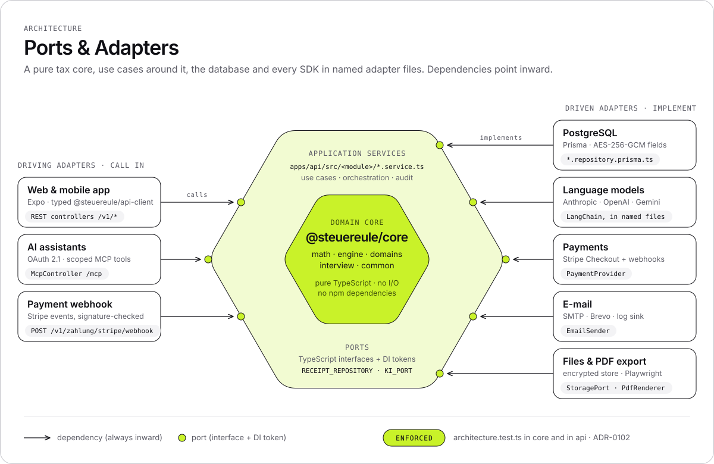
</p>

**Ports & Adapters (hexagonal architecture), checked by tools rather than by review.**

- **Domain core.** [`@steuereule/core`](packages/core/) holds every tax rule as pure TypeScript with no I/O. It has no runtime dependencies, so a framework import does not even resolve. [`architecture.test.ts`](packages/core/src/architecture.test.ts) pins the allowed import directions between its folders and forbids import cycles between files.
- **Application ring.** The services in `apps/api` depend on the core and on *ports*: an interface plus a DI token, such as `ReceiptRepository` / `RECEIPT_REPOSITORY`, `SingleShotModel`, `PaymentProvider` or `EmailSender`.
- **Adapters.** The database client and each external SDK may be imported only by the files named for it: Prisma in `*.prisma.ts` and `src/prisma/`, LangChain in eight files of `src/ki/`, Stripe in `stripe-payment-provider.ts`. [`apps/api/test/architecture.test.ts`](apps/api/test/architecture.test.ts) fails on any other import, and on any new import between feature modules ([ADR-0102](docs/adr/0102-ports-and-adapters-enforced-by-architecture-tests.md)).
- **Why.** The tax rules are tested and fuzzed without a database. Three LLM vendors and a CI fake sit behind one factory. Field encryption sits in the Prisma adapter, so services never see it.

The full write-up is in [`docs/architecture.md` §4.1](docs/architecture.md#41-architecture-style-ports--adapters). It covers the rings, the port inventory, what is enforced and how, the known limits, and a recipe for adding a dependency.

Steuereule is structured as a modular TypeScript monorepo powered by `pnpm` and `Turborepo`:

```text
├── apps/
│   ├── mobile-web       # React Native Web + Expo (TanStack Query, i18n, Funke UI)
│   ├── website          # Public website
│   └── api              # NestJS + Fastify REST API (/v1/*), Prisma ORM on PostgreSQL
├── packages/
│   ├── core             # Pure, deterministic German tax calculation engine (§ 32a EStG):
│   │   ├── math/        # Pure statutory formulas & tax tariffs (§ 32a, Soli)
│   │   ├── engine/      # Assessment orchestrators & optimal filing comparison
│   │   ├── domains/     # Regulatory verticals (cross-border, rental, capital, pension)
│   │   ├── interview/   # Combinatorial state machine & dynamic quiz guidance
│   │   └── common/      # Tax ID validators, PII masking, workday calendar
│   ├── ui               # Neobrutalist "Funke" design system component library
│   ├── tokens           # Style Dictionary tokens (colors, typography, geometry)
│   └── api-client       # Generated type-safe client SDK (OpenAPI via Orval)
├── e2e/                 # Playwright (Chromium) scenarios against the containerized stack
├── infra/               # OpenTofu infrastructure definitions (Google Cloud Run, Cloud SQL)
└── docs/
    ├── arc42/           # arc42 architecture specification and PlantUML diagrams
    └── adr/             # 100+ Architecture Decision Records (ADRs)
```

---

## ✨ Domain Capabilities

| Domain Area | Technical & Regulatory Implementation |
|:---|:---|
| 🇨🇭 **Cross-Border Workers (CH ⇄ DE)** | Swiss salary certificate (*Lohnausweis*), custom currency exchange rate tracking, non-return days (*Nichtrückkehrtage*), Annex N-Gre, AHV/ALV pension matching, and child allowance difference matching (*Differenzkindergeld*). |
| 👫 **Married Couples & Joint Filing** | Joint assessment (*Zusammenveranlagung*) with income-splitting formula (§ 32a Abs. 5 EStG). Partner B can be entered directly or collaborate via an invitation code with their own account. |
| 🏡 **Rental Properties (Annex V)** | Multi-unit properties, cost apportionments (*Umlagen*), mortgage interest deductions (*Schuldzinsen*), ongoing operating expenses, and straight-line depreciation (*AfA*). |
| 📈 **Capital Gains (Annex KAP)** | German and international brokerages, saver's allowance (*Sparer-Pauschbetrag*), split depot accounting, and automatic favorable tax assessment check (*Günstigerprüfung*). |
| 🚗 **Commuter Allowance & Travel** | Distance deductions (*Entfernungspauschale*) with accurate working-day models; automatic public holiday mapping across German federal states and Swiss cantons. |
| 📄 **Official PDF Form Calibration** | ESt 1 A, Annexes N, N-Gre, Child (*Kind*), KAP, V, and Vorsorgeaufwand rendered onto official BMF templates with sub-millimeter coordinate calibration verified in CI. |
| 🔒 **Enterprise-Grade Privacy** | Field-level AES-256-GCM encryption, granular session revocation, zero tracking scripts, full GDPR Article 15/17/20 data export and deletion workflows. |
| 🎨 **"Funke" Neobrutalist UI** | High-contrast, tactile design system focused on high readability, strict visual hierarchy, and one cognitive decision per screen. |

---

## 🚀 Quickstart in 60 Seconds

### Prerequisites
* Docker & Docker Compose
* Node.js `>= 22` and `pnpm` 10 for working in the workspace

### Running the Full Local Stack
```bash
# Clone the repository
git clone https://github.com/NexusHero/Steuereule.git
cd Steuereule

# Spin up all containerized services (Postgres, Redis, Mailpit, NestJS API, Web UI)
scripts/local.sh

# Or start in hot-reload development mode
scripts/local.sh dev
```

### Local Endpoints
Every port can be moved, so two checkouts run side by side: `API_PORT` (3000), `WEB_PORT` (8080), `DEV_WEB_PORT`
(8081, `dev` mode), `MAILPIT_PORT` (8025) and `POSTGRES_PORT` (5432). Export them or put them in `.env`;
`scripts/local.sh` and docker-compose read the same names. The SMTP port 1025 is fixed.

* **Web Application:** [http://localhost:8080](http://localhost:8080) (or `8081` in dev mode)
* **REST API:** `http://localhost:3000/v1`, Swagger UI at [http://localhost:3000/docs](http://localhost:3000/docs)
* **Mailpit (Local Email Sandbox):** [http://localhost:8025](http://localhost:8025) (catches verification emails locally; zero external network egress). The API delivers to it over SMTP with implicit TLS only (`smtps://…:1025`), verifying a certificate from a local CA that `scripts/mail-tls.sh` generates into `.local/mail-tls` (needs `openssl`; `scripts/local.sh` runs it, the files are never committed). The web UI on 8025 stays plain HTTP and listens on loopback only.
* **Redis:** `localhost:6379`, used by default in both modes (shared answer runs and rate limits, as in production). `REDIS_URL=` (empty) switches the API back to in-process.

> [!NOTE]
> **Apple Silicon (arm64) Native:** All container images, PostgreSQL instances, Prisma migrations, and headless Chromium PDF engines run natively on Apple Silicon.

---

## 🏆 Quality Assurance & Testing

The codebase enforces a multi-tiered testing and verification pipeline:

* **Exhaustive State-Machine Fuzzing ([`matrix-fuzzing.test.ts`](packages/core/src/interview/matrix-fuzzing.test.ts)):**
  Traverses all **144 combinatorial gate variations** across user employment, cross-border status, children, and marital configurations. Validates mathematical invariants up to €100,000,000 without numeric exceptions.
* **Deterministic Unit Tests:** 155 test files with about 2,000 tests in `@steuereule/core`, none of which needs a database (as of 2026-11-22).
* **Integration Tests:** 53 integration and acceptance test files in `@steuereule/api` run against a real PostgreSQL in CI.
* **Architecture Tests:** two tests fail the build when a module imports an SDK it may not, when a new dependency between feature modules appears, or when the core gains an import cycle.
* **Contract Verification:** Automated verification that runtime API schemas match generated client DTOs.
* **End-to-End Gates:** Playwright browser automation simulating end-to-end user journeys (guest mode, multi-step interview, tax calculations, PDF export validation).
* **Continuous Security:** Mandatory CI gates running `gitleaks` (secret scanning), `semgrep` (SAST), and `trivy` (container & dependency vulnerability scanner).

---

## 📄 License

This repository is source-available under the **[PolyForm Noncommercial License 1.0.0](LICENSE)**.

* **Personal Use:** Free to inspect, execute, customize, and submit your personal tax returns.
* **Commercial Use:** Commercial exploitation, commercial SaaS hosting, or utilization by commercial tax advisories requires an explicit commercial licensing agreement.
