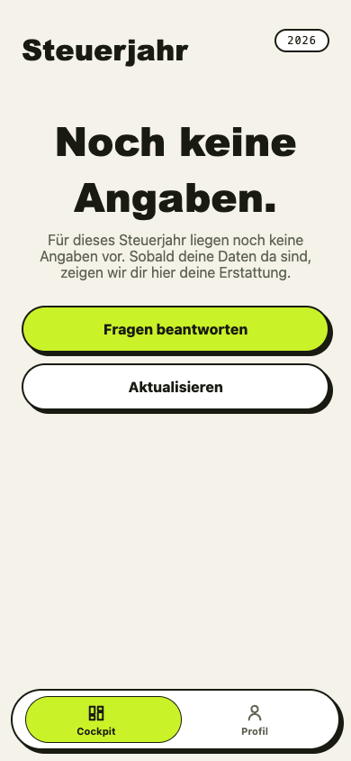
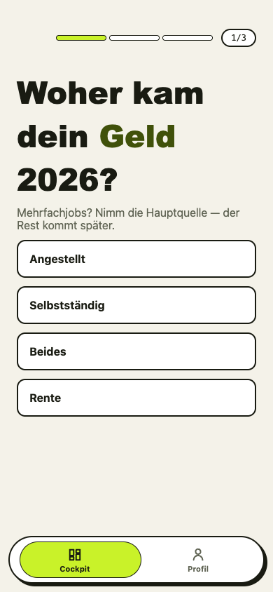
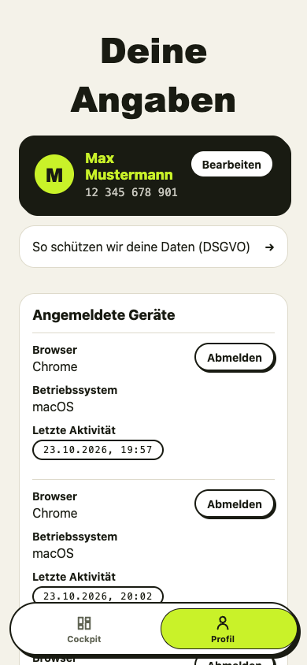
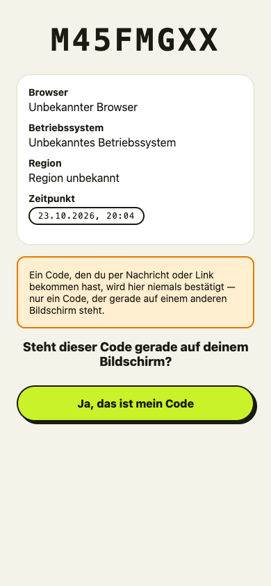
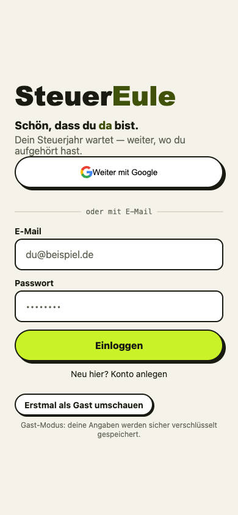

<p align="center">
  
</p>

# Steuereule 🦉

<p align="center">
  <b>Advisory over form-filling: The deterministic, privacy-first tax platform for employees, families, and cross-border workers.</b><br>
  Built with a verified pure-TypeScript calculation engine, zero LLM hallucinations in financial math, and AES-256-GCM field-level encryption.
</p>

<p align="center">
  <a href="https://demo.steuereule.de"></a>
  <a href="docs/arc42/README.md"></a>
  <a href="docs/adr/"></a>
  
  
  
</p>

<p align="center">
  <a href="#-codebase-tour-for-engineers">Codebase Tour</a> •
  <a href="#-engineering-highlights">Engineering Highlights</a> •
  <a href="#-high-throughput-benchmarks">Performance</a> •
  <a href="#-architecture--system-design">Architecture</a> •
  <a href="#-production-sre--reliability">SRE & Security</a> •
  <a href="#-domain-capabilities">Domain Capabilities</a> •
  <a href="#-quickstart-in-60-seconds">Quickstart</a> •
  <a href="#-license">License</a>
</p>

---

## 🧭 Codebase Tour for Engineers

*If you are reviewing this repository and only have 3 minutes, inspect these high-signal implementation files:*

| File | Focus Area | Why It Matters |
|:---|:---|:---|
| [`packages/core/src/tarif.ts`](packages/core/src/tarif.ts) | **Pure Deterministic Math** | Pure TypeScript implementation of the German progressive income tax formula (§ 32a EStG) and splitting tariff. Zero dependencies, zero I/O, runs in **~64 nanoseconds** ($>15.6\text{M}$ ops/sec). |
| [`packages/core/src/matrix-fuzzing.test.ts`](packages/core/src/matrix-fuzzing.test.ts) | **Combinatorial Fuzzing & Invariants** | Exhaustively traverses all **144 permutations** of the interview state machine and proves mathematical boundary invariants up to €100M (non-negativity, tariff monotonicity, absence contradiction gates). |
| [`apps/api/src/prisma/encrypted-prisma.provider.ts`](apps/api/src/prisma/encrypted-prisma.provider.ts) | **Zero-Trust Field Encryption** | Transparent server-side **AES-256-GCM** encryption extension for Prisma, with zero-leak key rotation policies ([ADR-0008](docs/adr/0008-steuer-id-verschluesselung-aes-256-gcm.md)). |
| [`apps/api/src/health/health.controller.ts`](apps/api/src/health/health.controller.ts) | **SRE Health Probes** | Cloud-native `/v1/health/live` and `/v1/health/ready` probes with active pooled database reachability checks and graceful shutdown hooks (`app.enableShutdownHooks()`). |

---

## ⚡ Product Mission

Traditional tax software presents dense tabular forms without proactive guidance, while commercial tax accountants often reduce their service to mechanical data entry. Meanwhile, many consumer apps market deceptive fixed returns that fail under scrutiny by tax authorities.

**Steuereule changes this with software-driven advisory:**
1. **Intelligent Advisory:** Instead of blank forms, Steuereule conducts an adaptive interview, deriving legal deductions (home office lump sums, commute deductions, childcare, education costs) directly cited with the governing statutory paragraph (§ EStG).
2. **Deterministic Engine vs. AI Hallucination:** All financial computations are executed strictly by a pure, deterministic, open-source calculation kernel ([`@steuereule/core`](packages/core/)). AI assists solely in narrative explanation and contextual suggestions; it is strictly prohibited from mutating financial figures ([ADR-0038](docs/adr/0038-berechnungs-kern-ki-port.md)).
3. **Transparent Range over Deceptive Promises:** Potential refunds are displayed as an honest, uncommitted range until every relevant legal variable is confirmed ([ADR-0032](docs/adr/0032-nothing-on-screen-promises-what-the-slice-does-not-deliver.md)).
4. **Verifiable Paper Trail:** Outputs are calibrated directly onto official Federal Ministry of Finance (BMF) tax forms down to the millimeter, making every figure auditable by tax professionals.

---

## 📸 Interactive Walkthrough & Preview

> *Screen recording walkthrough demo: Showing guest onboarding, dynamic interview guidance, and instant range calculation in under 15 seconds.*

<!-- Replace with demo.gif once generated -->
<p align="center">
  
</p>

| Honest Refund Range Cockpit | 1-Question-per-Screen Interview | Privacy-First Onboarding |
|:---:|:---:|:---:|
|  |  |  |
| *Transparent refund range, zero ungrounded guarantees.* | *Focused, rapid quiz interface free of tax jargon.* | *Data-parsimonious, field-encrypted, GDPR-compliant.* |

| Device Management | Passwordless QR Handoff | Guest Mode & Instant Login |
|:---:|:---:|:---:|
|  |  |  |
| *Active session overview with individual remote revoke.* | *Seamless desktop login via mobile camera verification.* | *Zero-friction guest exploration without forced signup.* |

---

## 🛠️ Engineering Highlights

* **Purely Deterministic Calculation Core ([`packages/core`](packages/core/)):**
  Financial calculation logic (§ 32a EStG income tax brackets, solidarity surcharge, child allowances, split-tariff formulas) is encapsulated in an isolated, pure-TypeScript engine completely free of UI, database, or I/O dependencies. Over 45 dedicated test suites continuously benchmark against official statutory test vectors.
* **Separation of AI & Calculation ([ADR-0038](docs/adr/0038-berechnungs-kern-ki-port.md)):**
  Large language models offer advice, summarize legal paragraphs, and propose interview topics, but have zero write access to calculation state. A user must explicitly accept a suggestion before parameters feed into the deterministic core.
* **Zero-Trust Security & Field-Level Encryption:**
  Sensitive Personal Identifiable Information (PII) and Tax Identification Numbers are encrypted server-side using **AES-256-GCM** with authenticated key management. PII is never stored in browser local storage or persistent client-side state.
* **Rigorous Architecture Discipline:**
  Over **56 Architecture Decision Records ([docs/adr/](docs/adr/))** document every technical decision, trade-off, and alternative considered. Comprehensive architectural blueprints follow the international **[arc42](docs/arc42/README.md)** standard with PlantUML component models.
* **Contract-First API Design:**
  The REST API (NestJS + Fastify) generates an OpenAPI specification that compiles into end-to-end typed TypeScript SDKs via Orval, guaranteeing compile-time type safety across frontend and backend boundaries.
* **Automated Hardened CI/CD ([`.github/workflows/ci.yml`](.github/workflows/ci.yml)):**
  A 1,100+ line pipeline enforcing synthetic linting (`oxlint`), strict TypeScript checking, security vulnerability scanning (`trivy`, `semgrep`, `gitleaks`), Docker Compose deployment validation, and Playwright end-to-end browser testing. Infrastructure is managed via OpenTofu for deployment to **Google Cloud Run** ([`infra/gcp`](infra/gcp/)).

---

## ⚡ High-Throughput Benchmarks

The core mathematical engine is continuously benchmarked using Vitest Bench (`pnpm --filter @steuereule/core bench`):

```text
 ✓ src/tarif.bench.ts (4)
   ✓ Tarif & Tax Engine Throughput Benchmark
     · incomeTax (§ 32a EStG Grundtarif single)      15,641,833 ops/sec  (mean: 0.064 µs)
     · splittingTariff (§ 32a Abs. 5 married)         10,372,813 ops/sec  (mean: 0.096 µs)
     · solidaritaetszuschlag (Surcharge)              32,637,683 ops/sec  (mean: 0.030 µs)
     · full calculation loop (100 income tiers)          209,643 loops/sec (>20.9M evaluations/sec)
```

* **Zero Heap Allocations:** Hot evaluation loops operate strictly with native primitives and stack variables.
* **Scale-to-Zero Cloud Run Friendly:** Instant cold-start and sub-microsecond latency permit running under minimal CPU resource quotas.

---

## 🛡️ Production SRE & Reliability

* **Cloud-Native Health Probes:** Granular `/v1/health/live` and `/v1/health/ready` endpoints allow container orchestrators (Google Cloud Run / Kubernetes) to differentiate process liveness from downstream database pool readiness.
* **Graceful Termination:** Process lifecycle hooks (`app.enableShutdownHooks()`) capture `SIGTERM` and `SIGINT` signals, ensuring in-flight transactions drain cleanly before container teardown.
* **Adaptive Connection Pooling:** Dynamic pool sizing (`withAdaptiveDatabasePoolUrl`) adjusts connection limits adaptively to the provisioned container CPU quota, preventing database saturation under horizontal autoscale spikes.
* **Least-Privilege Non-Root Containers:** Production Docker images enforce least privilege by switching execution to `USER node` (UID 10001) after compilation.
* **Continuous DevSecOps Gates:** Mandatory pull request gates scan for hardcoded secrets (`gitleaks`), static vulnerabilities (`semgrep`), and base-image CVEs (`trivy`).

---

## 🏗️ Architecture & System Design

Steuereule is structured as a modular TypeScript monorepo powered by `pnpm` and `Turborepo`:

```text
├── apps/
│   ├── mobile-web       # React Native Web + Expo (TanStack Query, i18n, Funke UI)
│   └── api              # NestJS + Fastify REST API (/v1/*), Prisma ORM on PostgreSQL
├── packages/
│   ├── core             # Pure, deterministic German tax calculation engine (§ 32a EStG)
│   ├── ui               # Neobrutalist "Funke" design system component library
│   ├── tokens           # Style Dictionary tokens (colors, typography, geometry)
│   └── api-client       # Generated type-safe client SDK (OpenAPI via Orval)
├── e2e/                 # Playwright cross-browser test suites against containerized stack
├── infra/               # OpenTofu infrastructure definitions (Google Cloud Run, Cloud SQL)
└── docs/
    ├── arc42/           # arc42 architecture specification and PlantUML diagrams
    └── adr/             # 56 Architecture Decision Records (ADRs)
```

---

## ✨ Domain Capabilities

| Domain Area | Technical & Regulatory Implementation |
|:---|:---|
| 🇨🇭 **Cross-Border Workers (CH ⇄ DE)** | Swiss salary certificate (*Lohnausweis*), custom currency exchange rate tracking, non-return days (*Nichtrückkehrtage*), Annex N-Gre, AHV/ALV pension matching, and child allowance difference matching (*Differenzkindergeld*). |
| 👫 **Married Couples & Joint Filing** | Joint assessment (*Zusammenveranlagung*) with income-splitting formula (§ 32a Abs. 5 EStG). Partner B can be entered directly or collaborate via an invitation code with their own account. |
| 🏡 **Rental Properties (Annex V)** | Multi-unit properties, cost apportionments (*Umlagen*), mortgage interest deductions (*Schuldzinsen*), ongoing operating expenses, and straight-line depreciation (*AfA*). |
| 📈 **Capital Gains (Annex KAP)** | German and international brokerages, saver's allowance (*Sparer-Pauschbetrag*), split depot accounting, and automatic favorable tax assessment check (*Günstigerprüfung*). |
| 🚗 **Commuter Allowance & Travel** | Distance deductions (*Entfernungspauschale*) with accurate working-day models; automatic public holiday mapping across German federal states and Swiss cantons. |
| 📄 **Official PDF Form Calibration** | ESt 1 A, Annexes N, N-Gre, Child (*Kind*), KAP, V, and Vorsorgeaufwand rendered onto official BMF templates with sub-millimeter coordinate calibration verified in CI. |
| 🔒 **Enterprise-Grade Privacy** | Field-level AES-256-GCM encryption, granular session revocation, zero tracking scripts, full GDPR Article 15/17/20 data export and deletion workflows. |
| 🎨 **"Funke" Neobrutalist UI** | High-contrast, tactile design system focused on high readability, strict visual hierarchy, and one cognitive decision per screen. |

---

## 🚀 Quickstart in 60 Seconds

### Prerequisites
* Docker & Docker Compose
* Node.js `>= 20.10.0` (or `pnpm >= 9.0.0` for local workspace hacking)

### Running the Full Local Stack
```bash
# Clone the repository
git clone https://github.com/suhaysevinc/Steuereule.git
cd Steuereule

# Spin up all containerized services (Postgres, Mailpit, NestJS API, Web UI)
scripts/local.sh

# Or start in hot-reload development mode
scripts/local.sh dev
```

### Local Endpoints
* **Web Application:** [http://localhost:8080](http://localhost:8080) (or `8081` in dev mode)
* **REST API & Swagger:** [http://localhost:3000/v1](http://localhost:3000/v1)
* **Mailpit (Local Email Sandbox):** [http://localhost:8025](http://localhost:8025) (catches verification emails locally; zero external network egress)

> [!NOTE]
> **Apple Silicon (arm64) Native:** All container images, PostgreSQL instances, Prisma migrations, and headless Chromium PDF engines run natively on Apple Silicon.

---

## 🏆 Quality Assurance & Testing

The codebase enforces a multi-tiered testing and verification pipeline:

* **Exhaustive State-Machine Fuzzing ([`matrix-fuzzing.test.ts`](packages/core/src/matrix-fuzzing.test.ts)):**
  Traverses all **144 combinatorial gate variations** across user employment, cross-border status, children, and marital configurations. Validates mathematical invariants up to €100,000,000 without numeric exceptions.
* **Deterministic Unit Tests:** 45+ isolated test suites in `@steuereule/core` (660+ unit tests executing in under 500ms) covering exact statutory tax formulas.
* **Integration Tests:** 75+ test suites in `@steuereule/api` running against ephemeral real PostgreSQL instances with test database isolation.
* **Contract Verification:** Automated verification that runtime API schemas match generated client DTOs.
* **End-to-End Gates:** Playwright browser automation simulating end-to-end user journeys (guest mode, multi-step interview, tax calculations, PDF export validation).
* **Continuous Security:** Mandatory CI gates running `gitleaks` (secret scanning), `semgrep` (SAST), and `trivy` (container & dependency vulnerability scanner).

---

## 📄 License

This repository is source-available under the **[PolyForm Noncommercial License 1.0.0](LICENSE)**.

* **Personal Use:** Free to inspect, execute, customize, and submit your personal tax returns.
* **Commercial Use:** Commercial exploitation, commercial SaaS hosting, or utilization by commercial tax advisories requires an explicit commercial licensing agreement.
