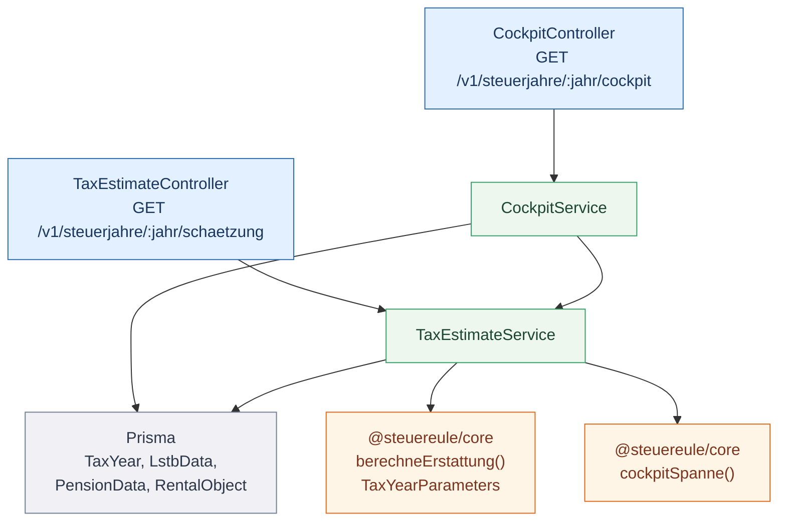
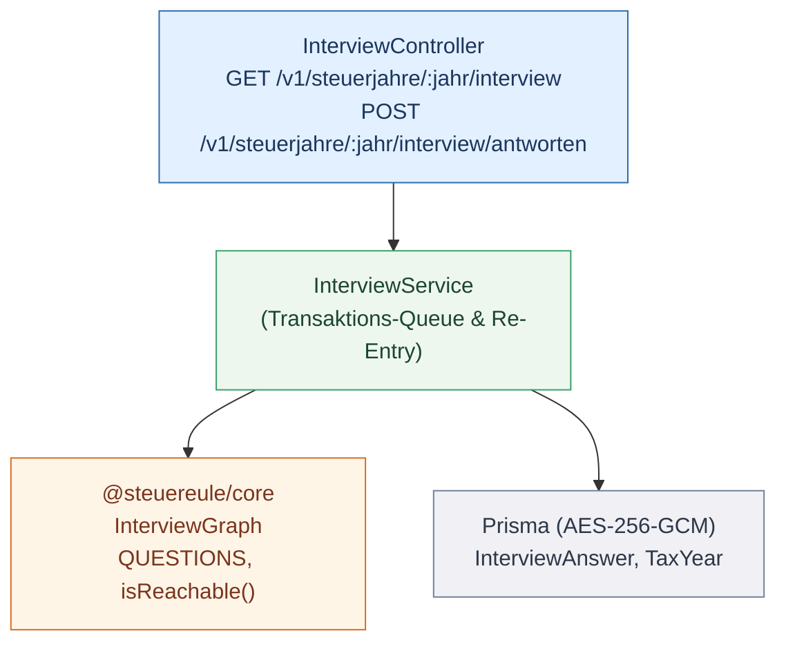
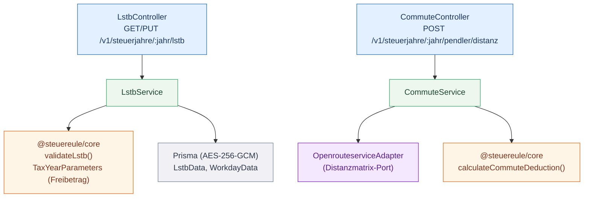
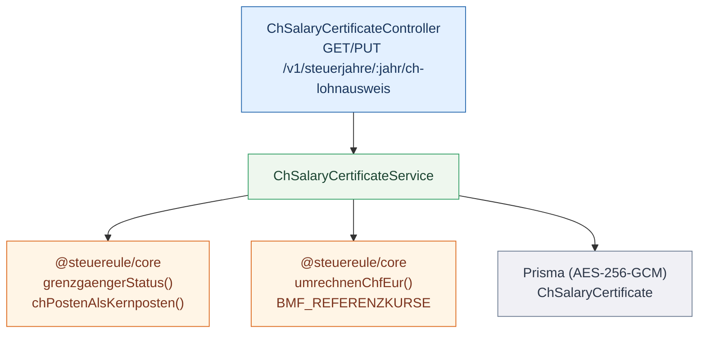
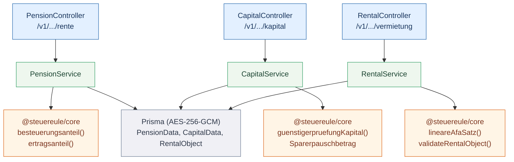
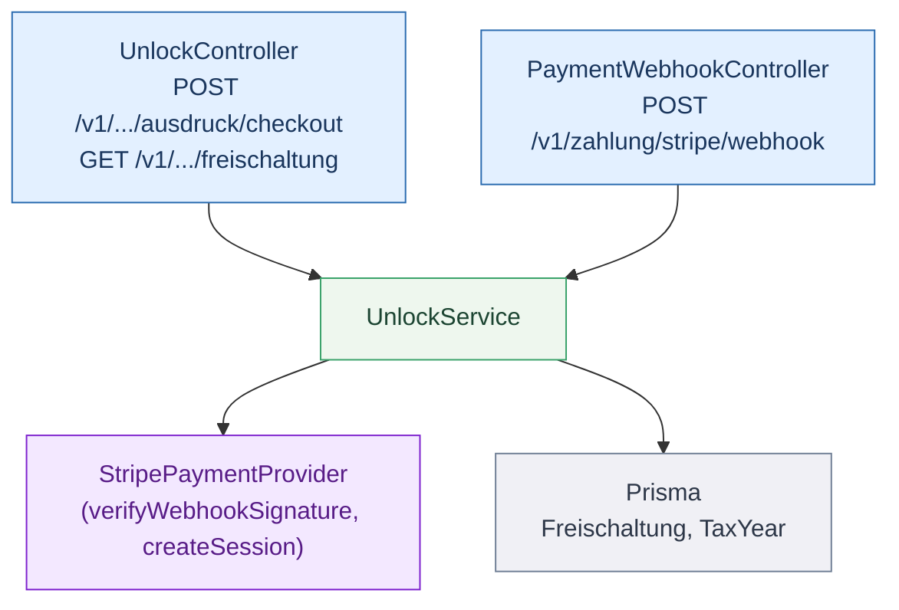
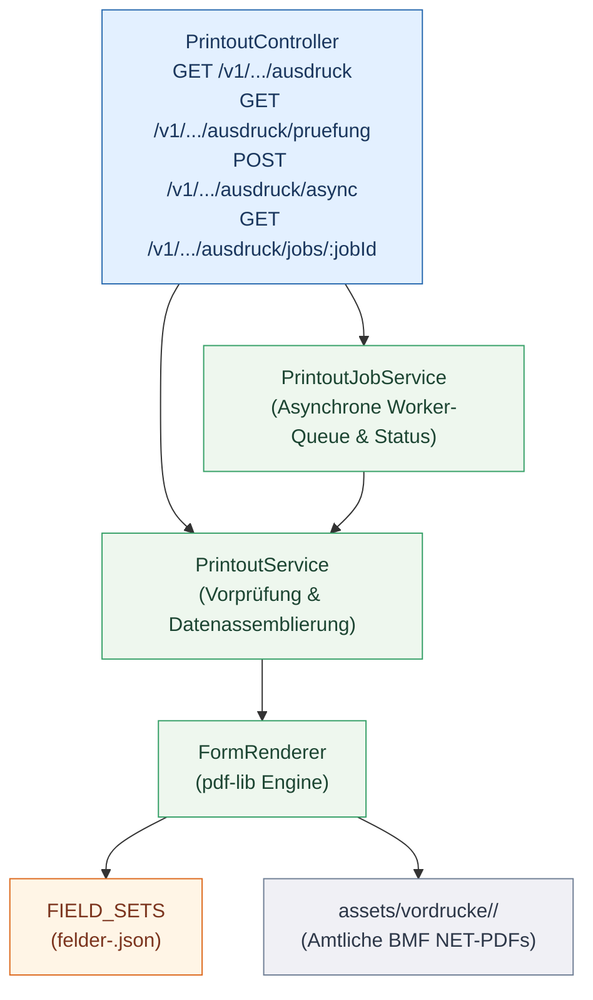
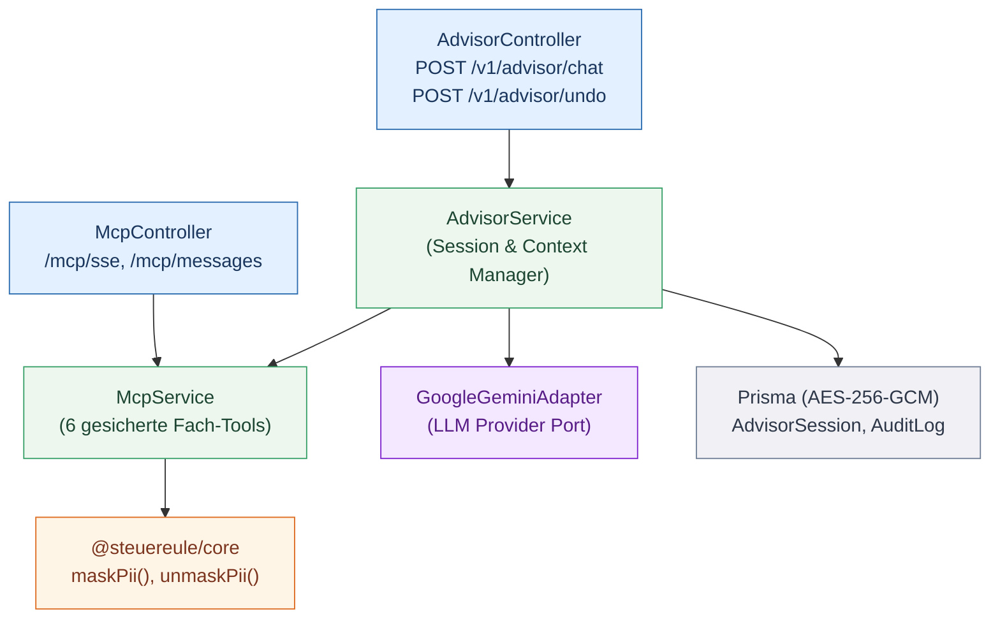
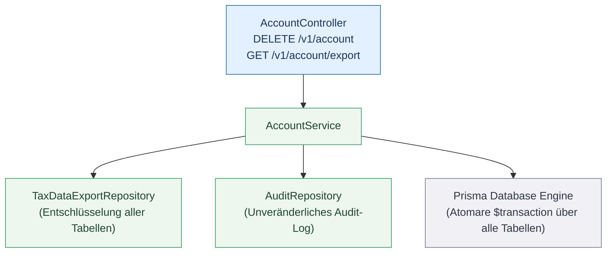
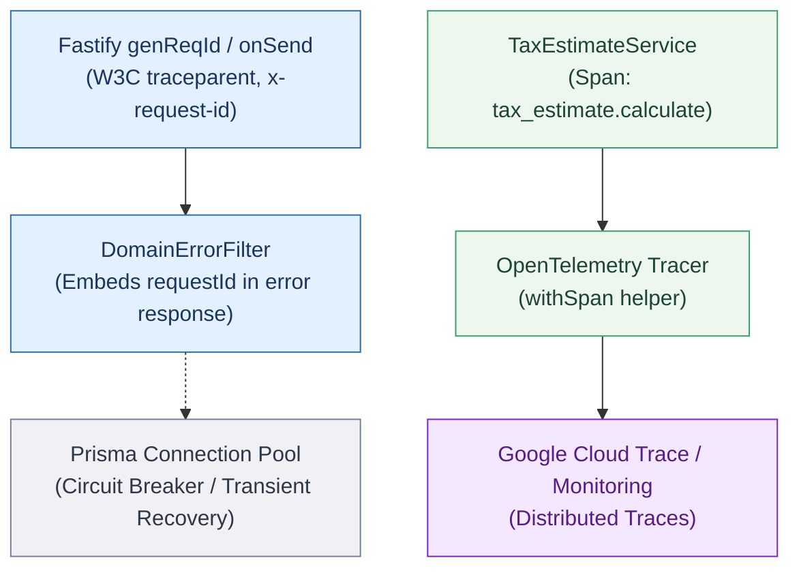

# Backend Subsystems — Component View (C4 Level 3)

Dieses Dokument ist der **C4 Level-3 (Komponenten-) Begleiter** zur zentralen Architektur-Dokumentation [`architecture.md`](./architecture.md).

Während die Building Block View in `architecture.md` das Gesamtsystem auf Container- und Paketebene (Level 1 und 2) umreißt, zoomt dieses Dokument in jedes **Backend-Subsystem in Isolation** und beschreibt dessen innere Struktur und Verdrahtung unter `apps/api/src/`.

---

## Architektur-Vertrag der Subsysteme

Jedes Subsystem in Steuereule unterliegt denselben strengen Architektur-Garantien:

1. **Echtes Modul-Scoping & Tenant-Isolation:**
   Jeder Controller sitzt hinter `UserContextGuard` bzw. `RequiresAccountGuard`. Das Scoping auf `userId` und `Steuerjahr` wird serverseitig garantiert — kein Client kann Daten fremder Mandanten adressieren oder manipulieren.
2. **Delegation an den deterministischen Kern (`@steuereule/core`):**
   Kein Controller und kein Service erfindet steuerliche Berechnungen oder Tarife. Sämtliche Beträge, Tarife (§ 32a EStG), Freibeträge, AfA-Sätze, Besteuerungsanteile und Verjährungsfristen werden von rein funktionalen, zustandslosen Funktionen in `@steuereule/core` berechnet ([ADR-0005](adr/0005-deterministic-core-llm-assist.md)). Der Kern ist streng in fünf Schichten unterteilt (`math/`, `engine/`, `domains/`, `interview/`, `common/`) und wird durch automatisierte Architektur-Linter (`architecture.test.ts`) gegen zyklische Abhängigkeiten geschützt.
3. **Feldverschlüsselung im Ruhezustand (Encryption at Rest, [ADR-0008](adr/0008-keine-erfundenen-daten.md)):**
   Alle steuerlichen Werte, Stammdaten und PII werden vor dem Schreiben in PostgreSQL über AES-256-GCM verschlüsselt. In der Datenbank stehen ausschließlich Chiffre-Texte mit zufälligem Nonce.
4. **Enge Vendor-Seams (Ports & Adapters):**
   Externe Drittanbieter (Stripe, Brevo, Openrouteservice, Google Gemini, HIBP) werden ausschließlich über schmale Provider-Interfaces angesprochen. Kein Domänencode importiert Vendor-Typen.

### Diagramm-Legende (Shared Mermaid `classDef`)
* **ctrl** (Blau): HTTP Controller Surface (`apps/api/src/<modul>/*.controller.ts`)
* **svc** (Grün): Orchestrierung & Business-Service (`apps/api/src/<modul>/*.service.ts`)
* **core** (Orange): Reine, zustandslose Kernlogik (`packages/core/src/*.ts`)
* **db** (Grau): PostgreSQL Tabellen & Prisma Repositories
* **port** / **adapter** (Lila): Externe Provider-Seams (Stripe, Brevo, KI, ORS)

---

## 1. Cockpit & Tax Estimate Subsystem

Das `cockpit`- und `tax-estimate`-Subsystem verwaltet den aktuellen Erklärungsstand, die offenen Pflichtpunkte und die Spanne der vorläufigen Steuererstattung.

---

## 2. Interview & Minimal-Gate Subsystem

Das `interview`-Subsystem steuert das dynamische Drei-Fragen-Minimal-Gate und den On-Demand-Lebenslagen-Katalog ([ADR-0031](adr/0031-the-interview-is-three-questions-and-a-catalog.md), [ADR-0045](adr/0045-value-first-funnel.md)).

---

## 3. LStB & Pendler-Subsystem

Verwaltet Lohnsteuerbescheinigungen, Werbungskosten, Entfernungspauschale und Homeoffice-Tage.

---

## 4. Grenzgänger Schweiz (CH-Vertikale)

Abwicklung von Schweizer Lohnausweisen, 60-Tage-Regel nach Art. 15a DBA-CH und amtlicher CHF-Währungsumrechnung.

---

## 5. Renten, Kapital & Vermietung Subsysteme

Die spezialisierten Einkunftsarten für Rentner (§ 22 EStG), Kapitalanleger (§ 20 EStG) und Vermieter (§ 21 EStG / lineare AfA § 7 Abs. 4 EStG).

---

## 6. Freischaltung & Zahlungs-Subsystem (Stripe)

Rechtssicherer Verkauf des Formular-Ausdrucks pro Steuerjahr mit HMAC-geprüften Webhooks und Widerrufs-Zustimmung (§ 356 Abs. 5 BGB).

---

## 7. Formular-Ausdruck Pipeline (Printout)

Schreibt die berechneten Daten exakt an die vermessenen Positionen der amtlichen BMF-NET-Vordrucke ([ADR-0050](adr/0050-papierweg-statt-elster-in-1-0.md)). Unterstützt sowohl synchrones Streaming als auch eine entkoppelte asynchrone Job-Queue ([ADR-0056](adr/0056-asynchronous-pdf-generation-job-queue.md)).

---

## 8. Eulen-Modus (KI-Assistent) & MCP-Server

Sichere KI-Beratung mit PII-Maskierung und Rollback-Mechanismus ([ADR-0051](adr/0051-eulen-ki-modus.md), [ADR-0052](adr/0052-mcp-ki-assistent.md)).

---

## 9. DSGVO & Kontoverwaltung Subsystem

Garantiert die Einhaltung von Art. 15/20 (Datenexport) und Art. 17 (Recht auf Vergessenwerden) über DMMF-gestützte Deckungstests.

---

## 10. Observability, Tracing & Resilience Subsystem

Sichert Systemzuverlässigkeit, Tracing und Fault Isolation gemäß [SRE Reliability Spec](sre/reliability-spec.md).

