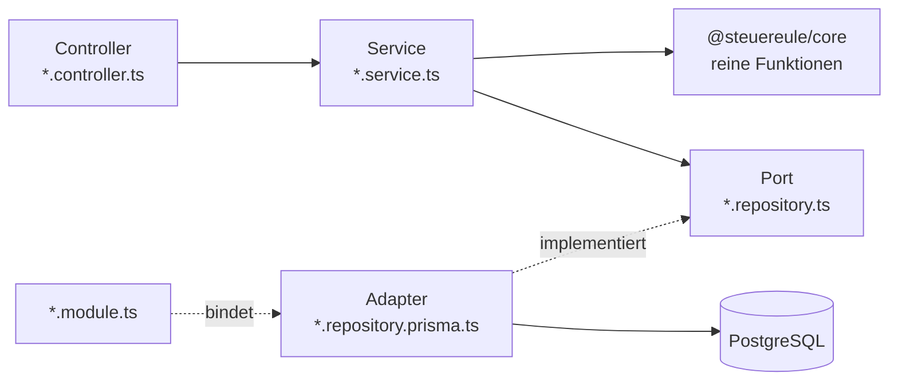
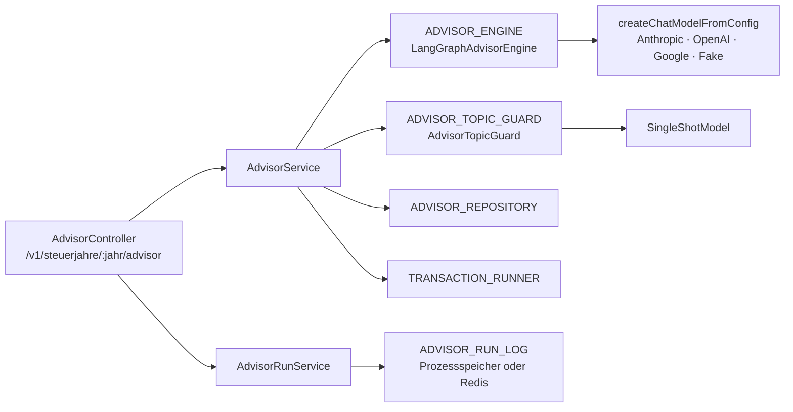

# SteuerEule — Backend-Module von innen

| | |
| :--- | :--- |
| **Stand** | 2026-11-22 |
| **Ebene** | Komponenten (C4 Level 3) zu [`architecture.md`](architecture.md) |
| **Geltungsbereich** | ausgewählte Module unter `apps/api/src` |

Dieses Dokument zeigt für die wichtigsten Module, wer hereinkommt, welcher Service arbeitet, welche Ports er braucht und welche Funktionen des Kerns er ruft. Es ist keine Routenliste: Die vollständige und maßgebliche Liste aller Routen ist `apps/api/openapi.json`, zur Laufzeit unter `/docs`.

Jeder Name hier ist gegen den Code geprüft. Kernfunktionen sind Exporte aus `packages/core/src`, Tabellen sind Modelle aus `apps/api/prisma/schema.prisma`.

## Das gemeinsame Muster

Was für jedes Modul gilt:

1. **Identität.** Die Nutzer-ID einer Anfrage setzt allein der `UserContextGuard`. Routen mit `@RequiresAccount()` lehnen Gäste ab. Ohne Guard arbeiten nur `HealthController`, `CapabilitiesController`, `AuthCapabilitiesController`, `OAuthDiscoveryController`, `DeviceController` und die Webhook-Route von Stripe.
2. **Rechnen im Kern.** Kein Service berechnet einen Steuerbetrag selbst ([ADR-0038](adr/0038-berechnungs-kern-ki-port.md)).
3. **Persistenz über Ports.** Ein Service kennt sein Repository als Interface. Der Prisma-Adapter verschlüsselt die Felder, die im Schema mit `/// @encrypted` markiert sind. Nicht jedes Feld ist verschlüsselt, siehe [`architecture.md` §8.2](architecture.md#82-verschlüsselung).
4. **Geprüfte Grenzen.** Datenbank-Client und externe SDKs dürfen nur die dafür benannten Dateien importieren. Das prüft `apps/api/test/architecture.test.ts` ([ADR-0102](adr/0102-ports-und-adapter-per-architekturtest.md)).

In den Tabellen unten steht `…` für das Präfix `/v1/steuerjahre/:jahr`.

---

## 1. Cockpit und Steuerschätzung

Das Cockpit zeigt die Erstattungsspanne und die offenen Punkte eines Steuerjahrs. Die Steuerschätzung liefert die detaillierte Rechnung.

| | Cockpit | Steuerschätzung |
| :--- | :--- | :--- |
| Eingang | `CockpitController`: `GET …/cockpit` | `TaxEstimateController`: `GET …/steuerschaetzung`, nur mit Konto |
| Service | `CockpitService` | `TaxEstimateService` |
| Kern | `cockpitRangeFromInputs` | `taxEstimateEmployee`, `taxEstimatePensioner`, `taxEstimateCrossBorder`, `taxEstimateSelfEmployed`, `estimateMarriedCouple` |
| Ports | `TAX_YEAR_REPOSITORY`, `WAGE_TAX_CERTIFICATE_REPOSITORY`, `INTERVIEW_ANSWER_REPOSITORY`, `PROVENANCE_REPOSITORY`, `PENSION_REPOSITORY`, `CAPITAL_REPOSITORY`, `RENTAL_REPOSITORY`, `CROSS_BORDER_SALARY_STATEMENT_REPOSITORY` | die Repositories der Fachmodule, deren Daten in die Schätzung eingehen |

Die beiden Services rufen einander nicht auf. Beide lesen dieselben Fachdaten und rechnen jeweils im Kern. `CockpitService` nutzt zusätzlich `SubmissionService` und `BusinessService`; das Cockpit ist damit eines der am stärksten gekoppelten Module (25 eingehende Modulkanten).

## 2. Interview

| | |
| :--- | :--- |
| Eingang | `InterviewController`: `GET …/interview`, `POST …/interview/antworten`. Beide auch für Gäste. |
| Service | `InterviewService` |
| Kern | `ENTRIES` (Fragenkatalog), `isValidAnswer`, `isReachableFor`, `nextStepFor` |
| Ports | `INTERVIEW_ANSWER_REPOSITORY` |
| Weitere Abhängigkeiten | `AuditService`, `LinkService` |
| Tabelle | `InterviewAnswer`; verschlüsselt ist das Feld `value` |

Die Antwort auf eine Frage liefert den nächsten Schritt und die Zahl der offenen Punkte. Die Erstattungsspanne kommt nicht von hier, sondern aus dem Cockpit.

## 3. Lohnsteuerbescheinigung und Arbeitsweg

| | Lohnsteuerbescheinigung | Arbeitsweg |
| :--- | :--- | :--- |
| Eingang | `LstbController`: `GET …/lstb`, `PUT …/lstb/:feld`, dazu je `GET` und `PUT` für `lstb-kirchensteuer`, `lstb-zeilen`, `lstb-arbeitgeber`, `lstb-zuschuesse`. `LstbScanController`: `PUT …/lstb` für eine gelesene Bescheinigung als Ganzes. | `CommuteController`: `GET …/arbeitsweg`, `PUT …/arbeitsweg` |
| Service | `LstbService`, `LstbScanService` | `CommuteService`, Hilfsfunktionen in `commute/ways-to-work.ts` |
| Kern | `wageTaxCertificateStatus`, `setWageTaxCertificateField` | `calculateWorkdays`, `commuterAllowanceByWay` |
| Ports | `WAGE_TAX_CERTIFICATE_REPOSITORY`, `PROVENANCE_REPOSITORY` | `COMMUTE_REPOSITORY` |
| Tabellen | `Lstb` | `Commute` |

Alle Routen verlangen ein Konto. Die Entfernung zur Arbeit gibt der Nutzer ein; es gibt keinen Routing-Dienst.

## 4. Grenzgänger Schweiz

| | |
| :--- | :--- |
| Eingang | `ChSalaryCertificateController`: `GET …/ch-lohnausweis`, `PUT …/ch-lohnausweis/:feld`, dazu `PUT` für `bemerkungen`, `vorsorge`, `n-gre`, `wechselkurs`, `grenzgaenger` |
| Service | `ChSalaryCertificateService` |
| Kern | `crossBorderStatus`, `chItemsAsCoreItems`, `chfToEur`, `officialMonthlyRate` |
| Ports | `CROSS_BORDER_SALARY_STATEMENT_REPOSITORY` |
| Tabelle | `ChSalaryCertificate` |

Entscheidung: [ADR-0042](adr/0042-grenzgaenger-ch-vertikale.md), ergänzt durch [ADR-0072](adr/0072-n-gre-pensionskasse-aufteilung-krankentaggeld-jahreskurs.md).

## 5. Rente, Kapital, Vermietung

| | Rente | Kapital | Vermietung |
| :--- | :--- | :--- | :--- |
| Eingang | `PensionController`: `GET …/rente`, `PUT …/rente/art`, `PUT …/rente/:feld` | `CapitalController`: `GET …/kapital`, `PUT …/kapital/inhaber`, `PUT …/kapital/:feld`, `GET …/kapital/guenstigerpruefung` | `RentalController`: `GET …/vermietung`, `POST …/vermietung/objekte`, `PUT …/vermietung/objekte/:objektId/:feld`, `PUT …/vermietung/objekte/:objektId/adresse` |
| Service | `PensionService` | `CapitalService` | `RentalService` |
| Kern | `pensionStatus`, `pensionAsCoreLineItem` | `classifyCapitalDepot`, `capitalAsCoreLineItem`, `mostFavourableCheckOnEstimate` | `classifyRental`, `rentalStatus`, `rentalPropertyFacts` |
| Ports | `PENSION_REPOSITORY` | `CAPITAL_REPOSITORY` | `RENTAL_REPOSITORY` |
| Tabellen | `Pension` | `Capital` | `RentalProperty` |

## 6. Freischaltung und Zahlung

| | |
| :--- | :--- |
| Eingang | `UnlockController`: `GET …/freischaltung` und der Webhook `POST /v1/zahlung/stripe/webhook`. Den Checkout startet `PrintoutController` (§7). |
| Service | `UnlockService` |
| Ports | `PAYMENT_PROVIDER` (`PaymentProvider` mit `createCheckout` und `verifyEvent`), `UNLOCK_REPOSITORY` |
| Adapter | `StripePaymentProvider` in `unlock/stripe-payment-provider.ts`, die einzige Datei mit dem Stripe-SDK |
| Tabelle | `Unlock` |

Der Webhook steht nicht hinter dem `UserContextGuard`. Er weist sich über die Signatur aus, die `verifyEvent` prüft. Der Ablauf steht in [`architecture.md` §6.2](architecture.md#62-freischalten-und-drucken).

## 7. Ausdruck

| | |
| :--- | :--- |
| Eingang | `PrintoutController`: `GET …/ausdruck/pruefung`, `GET …/ausdruck/werte`, `POST …/ausdruck/checkout`, `GET …/ausdruck`, `GET …/ausdruck/vorlage/:formular`, dazu `POST …/ausdruck/async` und `GET …/ausdruck/jobs/:jobId` |
| Services | `PrintoutService` stellt die Werte zusammen und startet den Checkout über `UnlockService`. `PrintoutJobService` führt asynchrone Aufträge. |
| Rendern | Funktion `renderForms` in `printout/form-renderer.ts`, die einzige Datei mit `pdf-lib` |
| Daten | Feldpositionen `FIELD_SETS` in derselben Datei (2024 und 2025), Vordrucke unter `apps/api/assets/vordrucke/<jahr>/`, Prüfsummen in `printout/vordrucke-<jahr>.json` |

`PrintoutJobService` hält Aufträge in einer `Map` im Prozessspeicher und startet sie mit `setImmediate`. Es gibt keinen Worker und keinen dauerhaften Speicher. Das ist als Schuld in [`architecture.md` §11](architecture.md#11-risiken-und-technische-schulden) geführt.

## 8. Eule

| | |
| :--- | :--- |
| Eingang | `AdvisorController` mit 27 Routen, darunter `POST chat`, `POST stream`, `GET runs/:runId/events`, `GET models` |
| Services | `AdvisorService` (Gespräche, Entwürfe, Anwenden und Rückgängigmachen), `AdvisorRunService` (Antwortläufe, [ADR-0064](adr/0064-eulen-chat-antwortlaeufe-und-wiederaufnahme.md)), `AdvisorModelsService` |
| Kern | Fachlogik der Eule in `packages/core/src/interview/advisor*.ts`; `scrubUserMessagePii` vor jedem Modellaufruf |
| Ports | `ADVISOR_ENGINE` (Interface `AdvisorEnginePort` im Kern), `ADVISOR_TOPIC_GUARD`, `ADVISOR_REPOSITORY`, `ADVISOR_RUN_LOG`, `TRANSACTION_RUNNER` |
| Adapter | `LangGraphAdvisorEngine` und die übrigen LangChain-Dateien in `ki/`; `advisor/run/advisor-run-log.redis.ts` |
| Tabellen | `AdvisorConversation`, `AdvisorChatMessage` und weitere mit Präfix `Advisor` |

`AdvisorService` ist das Modul mit den meisten ausgehenden Kanten (24): Die Eule liest und entwirft in fast jedem Fachmodul. Die Werkzeuge der Eule liegen in `ki/tools/` (23 Dateien, Stand 2026-11-22).

## 9. MCP-Server

Über MCP arbeitet nicht die Eule, sondern ein fremder Assistent des Nutzers ([ADR-0052](adr/0052-agenten-zugang-mcp.md)).

| | |
| :--- | :--- |
| Eingang | `McpController`: `POST /mcp` (Streamable HTTP), dazu `GET /mcp`, `DELETE /mcp`, `GET /mcp/sse`, `POST /mcp/messages` |
| Identität | Bearer-Token, geprüft vom `UserContextGuard` über `BEARER_TOKEN_REPOSITORY`. Nur dieser Controller akzeptiert Assistenten-Token. |
| Services | `McpService` registriert die Werkzeuge aus `mcp/tools/` (45 Registrierungen, Stand 2026-11-22). `McpReportService` liefert Berichte und Simulationen. |
| Ports | `TRANSACTION_RUNNER`: Eine Simulation schreibt über den normalen Schreibweg in einer Transaktion, die immer zurückgerollt wird. Sie läuft nur, wenn der Runner `rollsBack` meldet. |

## 10. Belege

| | |
| :--- | :--- |
| Eingang | `ReceiptController` (Ablage), `ReceiptParseController`: `POST /v1/belege/parse`, `POST /v1/belege/:id/inhaber` |
| Services | `ReceiptService`, `ReceiptParseService`, `ReceiptReassignService` |
| Strategien | `DocumentParseRegistry` wählt nach Belegart: `AutoReceiptParseStrategy`, `LstbScanParseStrategy`, `ChCertificateScanParseStrategy` und weitere für Schweizer Schreiben |
| Kern | feste Leseregeln je Belegart, `scrubDocumentTextPii` |
| Ports | `RECEIPT_REPOSITORY`, `STORAGE_PORT`, `SINGLE_SHOT_MODEL_FACTORY` |
| Adapter | `PostgresByteaStorageAdapter` mit `EnvelopeCryptoService`; Schlüssel je Nutzer über `USER_KEY_STORE` ([ADR-0059](adr/0059-beleg-keystore-crypto-shredding.md)) |
| Tabellen | `Receipt`, `ReceiptFile` |

Der Ablauf steht in [`architecture.md` §6.3](architecture.md#63-einen-beleg-lesen). Lebenszyklus eines Belegs: [ADR-0097](adr/0097-beleg-lebenszyklus.md).

## 11. Konto: Export und Löschung

| | Export | Löschung |
| :--- | :--- | :--- |
| Eingang | `AccountExportController`: `GET /v1/account/export` | `AccountDeletionController`: `DELETE /v1/account` |
| Service | `AccountExportService` | `AccountDeletionService` |
| Ports | `TAX_DATA_EXPORT_REPOSITORY`, `PDF_RENDERER` | `ACCOUNT_DELETION_REPOSITORY` |
| Adapter | `PlaywrightPdfRenderer` | `account-deletion.repository.prisma.ts`, Transaktion in `delete-account-transaction.prisma.ts` |

Die Löschung läuft in einer Datenbank-Transaktion. Einträge im Zugriffsprotokoll bleiben anonymisiert erhalten, Daten unter einer rechtlichen Aufbewahrungspflicht ebenfalls ([ADR-0013](adr/0013-dsgvo-export-and-account-deletion.md)). Belegdateien werden vor der Transaktion vernichtet und sind daher nicht Teil ihrer Atomarität. `apps/api/test/account-deletion-coverage.test.ts` prüft anhand des Prisma-Schemas, dass keine Tabelle mit Nutzerbezug vergessen wird.

## 12. Beobachtbarkeit

| Baustein | Datei | Was er tut |
| :--- | :--- | :--- |
| Request-ID | `common/request-id.ts` | übernimmt `traceparent` oder `x-request-id`, sonst eine neue UUID |
| Fehlerfilter | `common/domain-error.filter.ts` (`DomainErrorFilter`) | einheitlicher Fehlerkörper mit der Request-ID |
| Health | `health/health.controller.ts` | `GET /v1/health/live`, `GET /v1/health/ready` mit Datenbankprüfung |
| Tracing | `telemetry/tracer.ts` (`withSpan`) | zwei Spans: Steuerschätzung und Druckauftrag. Ohne Exporter werden sie nicht gesammelt. |
