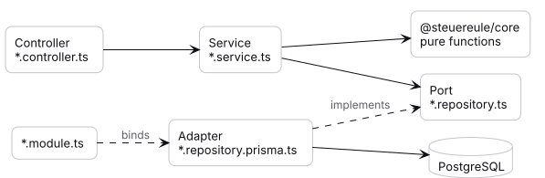
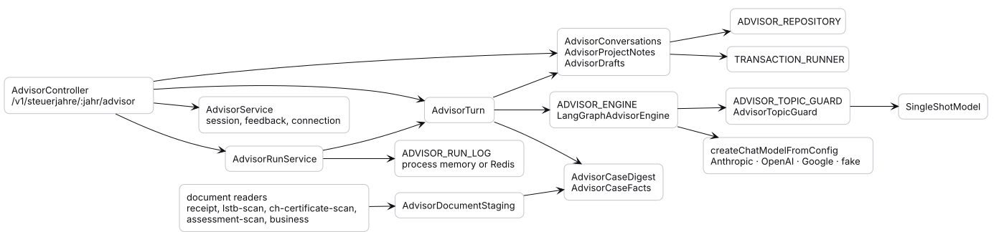

# SteuerEule — Backend modules from the inside

| | |
| :--- | :--- |
| **As of** | 2026-11-22 |
| **Level** | components (C4 level 3), companion to [`architecture.md`](architecture.md) |
| **Scope** | selected modules under `apps/api/src` |

For the most important modules this document shows who calls in, which service does the work, which ports it needs and which core functions it calls. It is not a route list: the complete and authoritative list of routes is `apps/api/openapi.json`, served at `/docs` at runtime.

Every name here has been checked against the code. Core functions are exports of `packages/core/src`; tables are models in `apps/api/prisma/schema.prisma`. Routes are German because the product is; the glossary in [`architecture.md` §12](architecture.md#12-glossary) explains the terms.

## The common pattern

<picture>
  <source media="(prefers-color-scheme: dark)" srcset="diagrams/common-pattern.dark.svg">
  
</picture>

*(source: [`common-pattern.puml`](diagrams/common-pattern.puml))*

What holds for every module:

1. **Identity.** Only `UserContextGuard` sets the user id of a request. Routes marked `@RequiresAccount()` reject guests. Only `HealthController`, `CapabilitiesController`, `AuthCapabilitiesController`, `OAuthDiscoveryController`, `DeviceController` and the Stripe webhook route work without the guard.
2. **Arithmetic in the core.** No service computes a tax amount itself ([ADR-0038](adr/0038-calculation-core-and-ai-port.md)).
3. **Persistence through ports.** A service knows its repository as an interface. The Prisma adapter encrypts the fields marked `/// @encrypted` in the schema. Not every field is encrypted, see [`architecture.md` §8.2](architecture.md#82-encryption).
4. **Checked boundaries.** The database client and external SDKs may be imported only by the files named for them. `apps/api/test/architecture.test.ts` checks that ([ADR-0102](adr/0102-ports-and-adapters-enforced-by-architecture-tests.md)).

In the tables below `…` stands for the prefix `/v1/steuerjahre/:jahr` (tax years / year).

---

## 1. Cockpit and tax estimate

The cockpit shows the refund range and the open items of a tax year. The tax estimate provides the detailed calculation.

| | Cockpit | Tax estimate |
| :--- | :--- | :--- |
| Entry | `CockpitController`: `GET …/cockpit` | `TaxEstimateController`: `GET …/steuerschaetzung`, account required |
| Service | `CockpitService` | `TaxEstimateService` |
| Core | `cockpitRangeFromInputs` | `taxEstimateEmployee`, `taxEstimatePensioner`, `taxEstimateCrossBorder`, `taxEstimateSelfEmployed`, `estimateMarriedCouple` |
| Ports | `TAX_YEAR_REPOSITORY`, `WAGE_TAX_CERTIFICATE_REPOSITORY`, `INTERVIEW_ANSWER_REPOSITORY`, `PROVENANCE_REPOSITORY`, `PENSION_REPOSITORY`, `CAPITAL_REPOSITORY`, `RENTAL_REPOSITORY`, `CROSS_BORDER_SALARY_STATEMENT_REPOSITORY` | the repositories of the feature modules whose data enters the estimate |

The two services do not call each other. Both read the same feature data and each computes in the core. `CockpitService` additionally uses `SubmissionService` and `BusinessService`; the cockpit is one of the most depended-on modules (25 incoming module edges).

## 2. Interview

| | |
| :--- | :--- |
| Entry | `InterviewController`: `GET …/interview`, `POST …/interview/antworten`. Both open to guests. |
| Service | `InterviewService` |
| Core | `ENTRIES` (the question catalogue), `isValidAnswer`, `isReachableFor`, `nextStepFor` |
| Ports | `INTERVIEW_ANSWER_REPOSITORY` |
| Other dependencies | `AuditService`, `LinkService` |
| Table | `InterviewAnswer`; the field `value` is encrypted |

Answering a question returns the next step and the number of open items. The refund range does not come from here; it comes from the cockpit.

## 3. Wage tax certificate and commute

| | Wage tax certificate | Commute |
| :--- | :--- | :--- |
| Entry | `LstbController`: `GET …/lstb`, `PUT …/lstb/:feld`, plus a `GET` and a `PUT` each for `lstb-kirchensteuer`, `lstb-zeilen`, `lstb-arbeitgeber`, `lstb-zuschuesse`. `LstbScanController`: `PUT …/lstb` for a certificate read as a whole. | `CommuteController`: `GET …/arbeitsweg`, `PUT …/arbeitsweg` |
| Service | `LstbService`, `LstbScanService` | `CommuteService`, helpers in `commute/ways-to-work.ts` |
| Core | `wageTaxCertificateStatus`, `setWageTaxCertificateField` | `calculateWorkdays`, `commuterAllowanceByWay` |
| Ports | `WAGE_TAX_CERTIFICATE_REPOSITORY`, `PROVENANCE_REPOSITORY` | `COMMUTE_REPOSITORY` |
| Tables | `Lstb` | `Commute` |

All routes require an account. The user enters the distance to work; there is no routing service.

## 4. Cross-border commuters to Switzerland

| | |
| :--- | :--- |
| Entry | `ChSalaryCertificateController`: `GET …/ch-lohnausweis`, `PUT …/ch-lohnausweis/:feld`, plus `PUT` for `bemerkungen`, `vorsorge`, `n-gre`, `wechselkurs`, `grenzgaenger` |
| Service | `ChSalaryCertificateService` |
| Core | `crossBorderStatus`, `chItemsAsCoreItems`, `chfToEur`, `officialMonthlyRate` |
| Ports | `CROSS_BORDER_SALARY_STATEMENT_REPOSITORY` |
| Table | `ChSalaryCertificate` |

Decision: [ADR-0042](adr/0042-grenzgaenger-ch-vertical.md), extended by [ADR-0072](adr/0072-n-gre-pension-fund-split-krankentaggeld-annual-rate.md).

## 5. Pensions, capital income, rental

| | Pensions | Capital income | Rental |
| :--- | :--- | :--- | :--- |
| Entry | `PensionController`: `GET …/rente`, `PUT …/rente/art`, `PUT …/rente/:feld` | `CapitalController`: `GET …/kapital`, `PUT …/kapital/inhaber`, `PUT …/kapital/:feld`, `GET …/kapital/guenstigerpruefung` | `RentalController`: `GET …/vermietung`, `POST …/vermietung/objekte`, `PUT …/vermietung/objekte/:objektId/:feld`, `PUT …/vermietung/objekte/:objektId/adresse` |
| Service | `PensionService` | `CapitalService` | `RentalService` |
| Core | `pensionStatus`, `pensionAsCoreLineItem` | `classifyCapitalDepot`, `capitalAsCoreLineItem`, `mostFavourableCheckOnEstimate` | `classifyRental`, `rentalStatus`, `rentalPropertyFacts` |
| Ports | `PENSION_REPOSITORY` | `CAPITAL_REPOSITORY` | `RENTAL_REPOSITORY` |
| Tables | `Pension` | `Capital` | `RentalProperty` |

## 6. Unlock and payment

| | |
| :--- | :--- |
| Entry | `UnlockController`: `GET …/freischaltung` and the webhook `POST /v1/zahlung/stripe/webhook`. The checkout is started by `PrintoutController` (§7). |
| Service | `UnlockService` |
| Ports | `PAYMENT_PROVIDER` (`PaymentProvider` with `createCheckout` and `verifyEvent`), `UNLOCK_REPOSITORY` |
| Adapter | `StripePaymentProvider` in `unlock/stripe-payment-provider.ts`, the only file with the Stripe SDK |
| Table | `Unlock` |

The webhook is not behind `UserContextGuard`. It authenticates by the signature that `verifyEvent` checks. The sequence is in [`architecture.md` §6.2](architecture.md#62-unlocking-and-printing).

## 7. Printout

| | |
| :--- | :--- |
| Entry | `PrintoutController`: `GET …/ausdruck/pruefung`, `GET …/ausdruck/werte`, `POST …/ausdruck/checkout`, `GET …/ausdruck`, `GET …/ausdruck/vorlage/:formular`, plus `POST …/ausdruck/async` and `GET …/ausdruck/jobs/:jobId` |
| Services | `PrintoutService` assembles the values and starts the checkout through `UnlockService`. `PrintoutJobService` runs asynchronous jobs. |
| Rendering | the function `renderForms` in `printout/form-renderer.ts`, the only file with `pdf-lib` |
| Data | field positions `FIELD_SETS` in the same file (2024 and 2025), the forms under `apps/api/assets/vordrucke/<year>/`, checksums in `printout/vordrucke-<year>.json` |

`PrintoutJobService` keeps jobs in a `Map` in process memory and starts them with `setImmediate`. There is no worker and no durable store. This is listed as debt in [`architecture.md` §11](architecture.md#11-risks-and-technical-debt).

## 8. The owl

<picture>
  <source media="(prefers-color-scheme: dark)" srcset="diagrams/owl.dark.svg">
  
</picture>

*(source: [`owl.puml`](diagrams/owl.puml))*

| | |
| :--- | :--- |
| Entry | `AdvisorController` with 27 routes, among them `POST chat`, `POST stream`, `GET runs/:runId/events`, `GET models` |
| Services | Eight parts, each a provider of `AdvisorModule` with its own required dependencies: `AdvisorTurn` (one question and its answer), `AdvisorConversations`, `AdvisorProjectNotes`, `AdvisorOpening`, `AdvisorDrafts` (applying and undoing), `AdvisorCaseDigest` and `AdvisorCaseFacts` (what the owl is told about the case), `AdvisorDocumentStaging` (drafts from read documents). `AdvisorService` keeps the session, clearing a conversation, feedback, the opening state and the connection. `AdvisorRunService` (answer runs, [ADR-0064](adr/0064-owl-chat-answer-runs-and-resumption.md)), `AdvisorModelsService` |
| Draft rows | The rows a draft may create are a registry by screen behind `DRAFT_RECORDS`: `ChildDraftRecords` from `children`, `RentalDraftRecords` from `rental` (interface `DraftRecordSource` in `common/`) |
| Core | the owl's domain logic in `packages/core/src/interview/advisor*.ts`; `scrubUserMessagePii` before every model call |
| Ports | `ADVISOR_ENGINE` (interface `AdvisorEnginePort` in the core), `ADVISOR_TOPIC_GUARD`, `ADVISOR_REPOSITORY`, `ADVISOR_RUN_LOG`, `TRANSACTION_RUNNER` |
| Adapters | `LangGraphAdvisorEngine` and the other LangChain files in `ki/` and `llm/`; `run-log/run-log.redis.ts` (bound for the owl in `advisor/run/advisor-run-log.redis.ts`) |
| Tables | `AdvisorConversation`, `AdvisorChatMessage` and others prefixed `Advisor` |

`advisor` is the module with the most outgoing edges (24): the owl reads and drafts in almost every feature module. The owl's tools are in `ki/tools/` (23 files as of 2026-11-22).

## 9. MCP server

It is not the owl that works through MCP but an external assistant of the user ([ADR-0052](adr/0052-agent-access-mcp.md)).

| | |
| :--- | :--- |
| Entry | `McpController`: `POST /mcp` (Streamable HTTP), plus `GET /mcp`, `DELETE /mcp`, `GET /mcp/sse`, `POST /mcp/messages` |
| Identity | a bearer token, checked by `UserContextGuard` through `BEARER_TOKEN_REPOSITORY`. Only this controller accepts assistant tokens. |
| Services | `McpService` registers the tools from `mcp/tools/` (45 registrations as of 2026-11-22). `McpReportService` provides reports and simulations. |
| Ports | `TRANSACTION_RUNNER`: a simulation writes through the normal write path inside a transaction that is always rolled back. It runs only if the runner reports `rollsBack`. |

## 10. Receipts

| | |
| :--- | :--- |
| Entry | `ReceiptController` (the filing cabinet), `ReceiptParseController`: `POST /v1/belege/parse`, `POST /v1/belege/:id/inhaber` |
| Services | `ReceiptService`, `ReceiptParseService`, `ReceiptReassignService` |
| Strategies | `DocumentParseRegistry` picks by document kind: `AutoReceiptParseStrategy`, `LstbScanParseStrategy`, `ChCertificateScanParseStrategy` and further ones for Swiss letters |
| Core | fixed reading rules per document kind, `scrubDocumentTextPii` |
| Ports | `RECEIPT_REPOSITORY`, `STORAGE_PORT`, `SINGLE_SHOT_MODEL_FACTORY` |
| Adapters | `PostgresByteaStorageAdapter` with `EnvelopeCryptoService`; a key per user through `USER_KEY_STORE` ([ADR-0059](adr/0059-document-keystore-crypto-shredding.md)) |
| Tables | `Receipt`, `ReceiptFile` |

The sequence is in [`architecture.md` §6.3](architecture.md#63-reading-a-receipt). Life cycle of a receipt: [ADR-0097](adr/0097-document-lifecycle.md).

## 11. Account: export and deletion

| | Export | Deletion |
| :--- | :--- | :--- |
| Entry | `AccountExportController`: `GET /v1/account/export` | `AccountDeletionController`: `DELETE /v1/account` |
| Service | `AccountExportService` | `AccountDeletionService` |
| Ports | `TAX_DATA_EXPORT_REPOSITORY`, `PDF_RENDERER` | `ACCOUNT_DELETION_REPOSITORY` |
| Adapters | `PlaywrightPdfRenderer` | `account-deletion.repository.prisma.ts`, the transaction in `delete-account-transaction.prisma.ts` |

Deletion runs in one database transaction. Entries in the access log are kept in anonymised form, as is data under a legal retention duty ([ADR-0013](adr/0013-dsgvo-export-and-account-deletion.md)). Receipt files are destroyed before the transaction and are therefore not part of its atomicity. `apps/api/test/account-deletion-coverage.test.ts` uses the Prisma schema to check that no table referencing a user is forgotten.

## 12. Observability

| Element | File | What it does |
| :--- | :--- | :--- |
| Request id | `common/request-id.ts` | adopts `traceparent` or `x-request-id`, otherwise a new UUID |
| Error filter | `common/domain-error.filter.ts` (`DomainErrorFilter`) | one error body format carrying the request id |
| Health | `health/health.controller.ts` | `GET /v1/health/live`, `GET /v1/health/ready` with a database check |
| Tracing | `telemetry/tracer.ts` (`withSpan`) | two spans: tax estimate and print job. Without an exporter they are not collected. |
