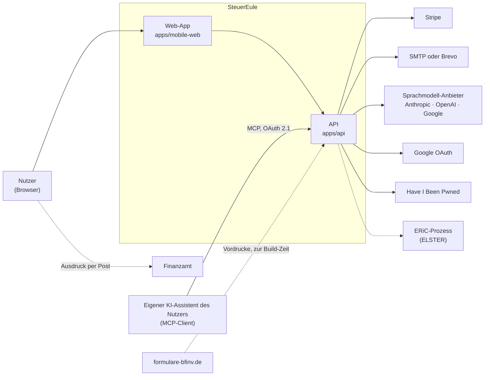
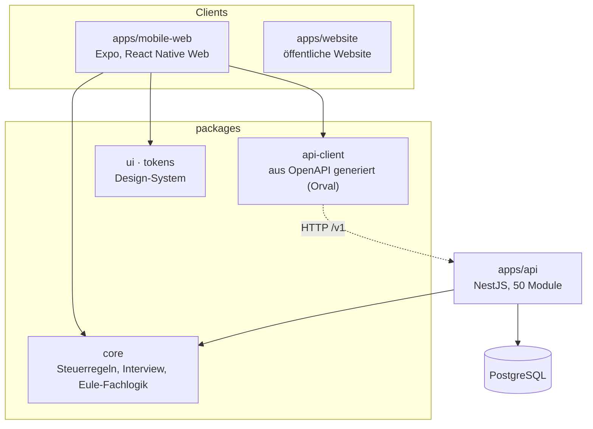
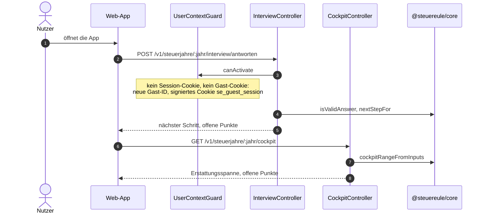
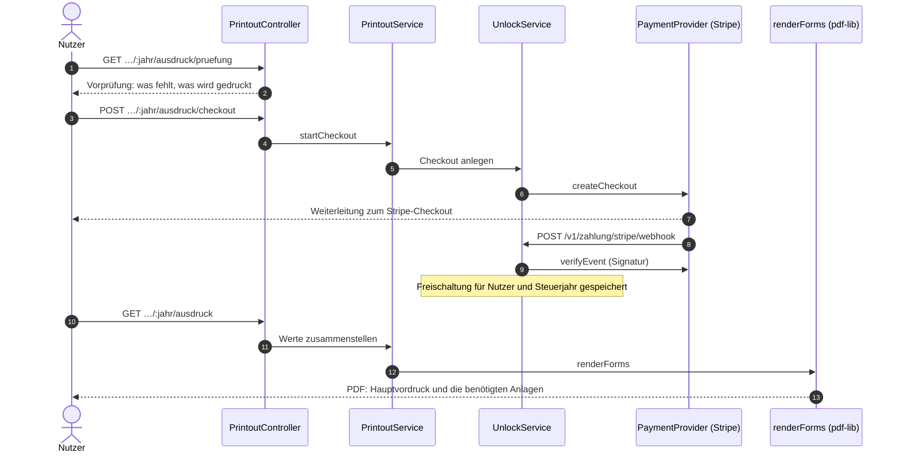
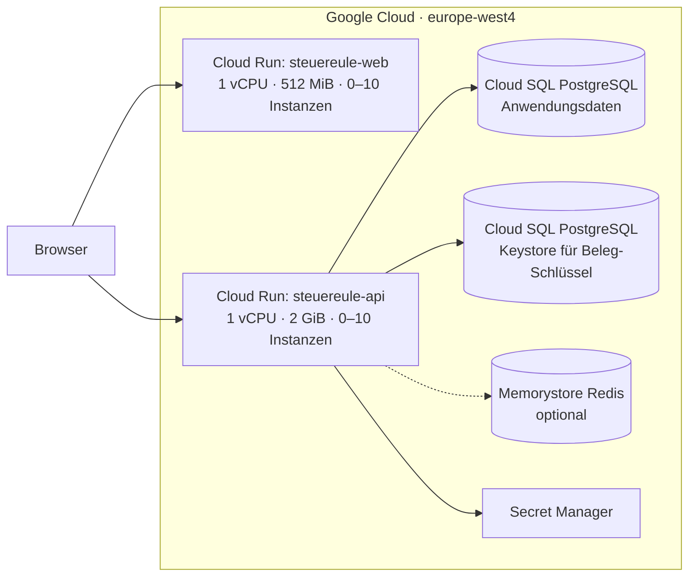

# SteuerEule — Architektur

| | |
| :--- | :--- |
| **Stand** | 2026-11-22 |
| **Gliederung** | arc42, zwölf Abschnitte |
| **Geltungsbereich** | das Monorepo: `apps/api`, `apps/mobile-web`, `packages/*`, `infra/gcp` |
| **Quelle der Entscheidungen** | [`docs/adr/`](adr/index.md). Dieses Dokument zeigt die Struktur, die ADRs begründen sie. |

**Wie dieses Dokument wahr bleibt.** Eine Regel nennt den Test, der sie prüft. Eine Zahl nennt ihr Datum und woher sie stammt. Was geplant, aber nicht gebaut ist, steht in §11 und nirgends sonst. Namen von Dateien, Klassen und Routen sind gegen den Code geprüft. Wer hier einen Namen findet, den es nicht gibt, hat einen Fehler gefunden.

**Verwandte Dokumente.** [`architecture-subsystems.md`](architecture-subsystems.md) zeigt einzelne Backend-Module von innen. [`arc42/README.md`](arc42/README.md) beschreibt Werkzeugkette und Boot-Reihenfolge im Detail. [`sre/reliability-spec.md`](sre/reliability-spec.md) nennt die Zielwerte für den Betrieb.

---

# 1. Einführung und Ziele

## 1.1 Aufgabe

SteuerEule führt Privatpersonen in Deutschland durch ihre Einkommensteuererklärung. Die App fragt in einem Interview, rechnet die voraussichtliche Erstattung als Spanne, liest Belege, und druckt die Erklärung auf die amtlichen Vordrucke. Eine KI-Assistentin, die Eule, berät im Chat und bereitet Einträge als Entwürfe vor.

Das tragende Prinzip ([ADR-0038](adr/0038-berechnungs-kern-ki-port.md)):

> **Der Kern rechnet, das Sprachmodell formuliert.** Jeder Steuerbetrag entsteht in reinen Funktionen von `@steuereule/core`. Ein Sprachmodell schlägt vor und erklärt. Es schreibt nie selbst in die Erklärung: Aus einem Vorschlag wird erst durch die Bestätigung des Nutzers ein Eintrag.

**Wer bedient wird**

| Gruppe | Umfang | Entscheidung |
| :--- | :--- | :--- |
| Angestellte | Lohnsteuerbescheinigung, Arbeitsweg, Homeoffice, Sonderausgaben, haushaltsnahe Leistungen | [ADR-0041](adr/0041-lstb-angestellte-vertikale.md) |
| Grenzgänger Schweiz | Lohnausweis, 60-Tage-Regel, Wechselkurse, Anlage N-Gre | [ADR-0042](adr/0042-grenzgaenger-ch-vertikale.md) |
| Rentner | gesetzliche und private Renten | [ADR-0044](adr/0044-rentner-vertikale.md) |
| Kapitalanleger, Vermieter | Depots, Günstigerprüfung, Mietobjekte mit AfA | [ADR-0048](adr/0048-kapital-vertikale.md), [ADR-0046](adr/0046-vermietung-vertikale.md) |
| Ehepaare | eine gemeinsame Erklärung, Vergleich der Veranlagungsarten | [ADR-0054](adr/0054-zusammenveranlagung-eine-erklaerung.md), [ADR-0034](adr/0034-veranlagungsartenvergleich-returns-a-bounded-comparison.md) |
| Selbstständige | EÜR, Buchhaltung, Bilanz, Umsatz- und Gewerbesteuer | [ADR-0101](adr/0101-selbststaendige.md) |

**Abgabeweg.** Die Erklärung wird gedruckt und per Post abgegeben ([ADR-0050](adr/0050-papierweg-statt-elster-in-1-0.md)). Vordrucke liegen für die Steuerjahre 2022 bis 2025 vor, der Kern rechnet 2022 bis 2026. Für Selbstständige, die elektronisch abgeben müssen, gibt es Code für die Übermittlung über einen ERiC-Prozess (`apps/api/src/business/elster-transmission.ts`). Er braucht ein Zertifikat des Betreibers und ist in §11 als offen geführt.

## 1.2 Qualitätsziele

| # | Ziel | Was das konkret heißt | Wie es geprüft wird |
| :-: | :--- | :--- | :--- |
| 1 | **Rechnerische Richtigkeit** | Tarif, Soli, Freibeträge und Fristen stimmen je Steuerjahr mit dem Gesetz überein. Kein geschätzter Betrag im Rechen- oder Druckpfad. | Unit-Tests des Kerns gegen gesetzliche Werte; Fuzzing über alle Interview-Pfade (`packages/core/src/interview/matrix-fuzzing.test.ts`) |
| 2 | **Vertraulichkeit** | Als `@encrypted` markierte Felder stehen nur verschlüsselt in der Datenbank. Belegdateien sind je Nutzer verschlüsselt und lassen sich durch Löschen des Schlüssels vernichten. | Akzeptanztests gegen echtes PostgreSQL (`req-003-encryption-at-rest.test.ts`, `req-003-key-rotation.test.ts`); `account-deletion-coverage.test.ts` prüft, dass die Löschung jede Tabelle mit Nutzerbezug abdeckt |
| 3 | **Drucktreue** | Jeder Wert steht im richtigen Kasten des amtlichen Vordrucks. Ein Wert, der nicht passt, bricht den Druck ab. | Vermessungs-Gates im CI-Workflow *Quality* (`scripts/vordrucke/vermessen.mjs --check`) |
| 4 | **Nutzbar ohne Konto** | Ein Gast beantwortet die ersten Fragen und sieht das Cockpit. Beim Anlegen des Kontos wandern die Antworten mit. | Akzeptanztest `req-006-guest-upgrade.test.ts`, E2E-Szenario 23 |
| 5 | **Änderbarkeit** | Datenbank und externe SDKs sind nur an benannten Stellen erreichbar. Neue Kopplung zwischen Modulen ist eine sichtbare Entscheidung. | zwei Architekturtests, §4.1.3 |

## 1.3 Stakeholder

| Wer | Erwartung |
| :--- | :--- |
| Nutzer | eine richtige Erklärung, verständliche Fragen, Kontrolle über jeden Eintrag |
| Product Owner | ein verkaufbares Produkt: bezahlt wird beim Ausdruck, je Steuerjahr |
| Finanzamt | formrichtige Vordrucke mit lesbaren Werten |
| Entwicklung und Betrieb | klare Grenzen, schnelle Tests, nachvollziehbare Entscheidungen |

---

# 2. Randbedingungen

## 2.1 Technisch

| Bereich | Festlegung | Quelle |
| :--- | :--- | :--- |
| Sprache | TypeScript 7, `strict`, `noUncheckedIndexedAccess`, `exactOptionalPropertyTypes` | `tsconfig.base.json` |
| Laufzeit | Node.js ≥ 22 (CI und Images: 24), pnpm 10 | `package.json` |
| Monorepo | pnpm-Workspaces mit Turborepo | `pnpm-workspace.yaml`, `turbo.json` |
| API | NestJS 11 auf Fastify 5 | `apps/api/package.json` |
| Datenbank | PostgreSQL über Prisma 6, 58 Modelle | `apps/api/prisma/schema.prisma` |
| Client | Expo 53 mit React Native Web; ausgeliefert wird die Web-App | `apps/mobile-web` |
| Kern | keine npm-Laufzeitabhängigkeiten; drei Dateien nutzen `node:crypto` | `packages/core/package.json` |
| Statische Prüfung | oxlint ([ADR-0019](adr/0019-oxlint-replaces-eslint.md)), `tsc --noEmit` | `.oxlintrc.json` |

## 2.2 Rechtlich

| Vorgabe | Folge für die Architektur |
| :--- | :--- |
| DSGVO Art. 9 | Die Religionszugehörigkeit wird nur mit eigener Einwilligung gespeichert. |
| DSGVO Art. 15, 17, 20 | Export als JSON und PDF; Kontolöschung in einer Transaktion, das Zugriffsprotokoll wird dabei anonymisiert statt gelöscht ([ADR-0013](adr/0013-dsgvo-export-and-account-deletion.md)). |
| BMF-Schreiben vom 12.08.2022 zu Internet-Vordrucken | Druck im Maßstab 1:1, serifenlose Schrift ab 10 pt, Formularschlüssel mit `NET`. |
| § 356 Abs. 5 BGB | Der Checkout holt die Zustimmung zum vorzeitigen Erlöschen des Widerrufsrechts ein. |
| Steuerberatungsgesetz | Die App ist ein Werkzeug und leistet keine Steuerberatung im Sinne des Gesetzes. |

---

# 3. Kontext und Abgrenzung



| Nachbarsystem | Wozu | Adapter im Code | Was die API dorthin gibt |
| :--- | :--- | :--- | :--- |
| Stripe | Bezahlung des Ausdrucks, Webhook | `unlock/stripe-payment-provider.ts` hinter `PaymentProvider` | Nutzer-ID, Steuerjahr, Preis-ID |
| SMTP, Brevo | Bestätigungs- und Sicherheitsmails | `auth/smtp-email-sender.ts`, `auth/brevo-email-sender.ts` hinter `EmailSender`; ohne Konfiguration ein Log-Ersatz | E-Mail-Adresse, Mailtext |
| Sprachmodell-Anbieter | Eule-Chat, Lesehilfe für Belege, Themenwächter | `ki/chat-model.factory.ts` (LangChain) | Chatverlauf und Falldaten; Belegtext nach Entfernen von Namen, Adressen und Kennungen. Persönliche Daten nur mit Einwilligung ([ADR-0091](adr/0091-eule-persoenliche-daten-mit-einwilligung.md)). |
| Google OAuth | Anmeldung mit Google-Konto | `auth/better-auth.ts` | OAuth-Protokolldaten |
| Have I Been Pwned | Prüfung neuer Passwörter auf bekannte Lecks | better-auth-Plugin, `auth/breach-check.ts` | einen Teil des Passwort-Hashes (k-Anonymität), nie das Passwort |
| MCP-Clients | Der Assistent des Nutzers liest die Erklärung und füllt Entwürfe | `mcp/` als eingehender Adapter ([ADR-0052](adr/0052-agenten-zugang-mcp.md)) | nur, was der Nutzer per OAuth-Scope freigegeben hat |
| formulare-bfinv.de | Quelle der amtlichen Vordrucke | `scripts/vordrucke/download-vordrucke.mjs`, nicht zur Laufzeit | nichts |
| ERiC | elektronische Übermittlung für Selbstständige | `business/elster-transmission.ts` | die Übermittlungsdaten; siehe §11 |

---

# 4. Lösungsstrategie

1. **Ein reiner Rechenkern.** Steuerregeln sind Funktionen ohne Ein- und Ausgabe in `packages/core`. API und Web-App nutzen denselben Kern, die Regel existiert genau einmal.
2. **Parameter je Steuerjahr.** Freibeträge, Pauschalen und Fristen stehen in `math/tax-parameters.ts`, Tarif- und Soli-Tabellen in `math/tarif.ts`. Einzelne Fachmodule tragen noch eigene Jahreskonstanten, siehe §11.
3. **Ports & Adapters um den Kern.** Datenbank und externe SDKs sind nur an benannten Stellen erreichbar. §4.1 beschreibt das im Detail.
4. **Entwurf vor Eintrag.** Was Eule, Beleg-Leser oder ein fremder Assistent vorschlagen, ist ein Entwurf mit berechneter Wirkung. Erst die Bestätigung schreibt ([ADR-0066](adr/0066-eule-feldkatalog-und-ein-schreibweg.md)).
5. **Verschlüsselung am Rand der Persistenz.** Felder verschlüsselt der Prisma-Adapter, Belegdateien der Speicher-Adapter. Services sehen Klartext und wissen nichts vom Verfahren.
6. **Amtliche Vordrucke als Daten.** 18 Vordrucke je Steuerjahr (2022 bis 2025) liegen unverändert im Repository, ihre Prüfsummen sind in `apps/api/src/printout/vordrucke-<jahr>.json` gepinnt.

## 4.1 Architekturstil: Ports & Adapters


Drei Ringe und eine Regel: **Jede Abhängigkeit zeigt nach innen.** Der Kern weiß nichts von HTTP, Datenbank oder Sprachmodell. Die Anwendungsservices kennen den Kern und Ports. Ein SDK kennt nur die Datei, die dafür benannt ist.

### 4.1.1 Die drei Ringe

| Ring | Wo | Darf abhängen von | Darf nicht abhängen von |
| :--- | :--- | :--- | :--- |
| **Kern** | `packages/core/src/{math,common,domains,engine,interview}` | sich selbst und `node:crypto` | npm-Paketen, `apps/*` |
| **Anwendung** | `apps/api/src/<modul>/`: Services, Guards, Parse-Strategien und die Ports (`*.repository.ts`, `common/transaction-runner.ts`, `ki/single-shot-model.ts`, `unlock/payment-provider.ts`, `auth/email-sender.ts`) | Kern, Ports, NestJS | Datenbank-Client, externen SDKs |
| **Adapter** | eingehend: `*.controller.ts`, `mcp/`; ausgehend: `*.prisma.ts`, `prisma/`, die LangChain-Dateien in `ki/`, `unlock/stripe-payment-provider.ts`, `auth/smtp-email-sender.ts`, `account/export/pdf-renderer.playwright.ts`, `receipt/storage/postgres-bytea-storage.adapter.ts` | Ports, Kern, ihrem eigenen SDK | den SDKs anderer Adapter |

Die Nest-Module (`*.module.ts`) sind der **Composition Root**. Nur dort wird ein Port an einen Adapter gebunden:

```ts
// apps/api/src/receipt/receipt-storage.module.ts
{ provide: STORAGE_PORT, useExisting: PostgresByteaStorageAdapter },
{ provide: RECEIPT_REPOSITORY, useClass: PrismaReceiptRepository },
```

```ts
// ein Service sieht nur das Interface
constructor(@Inject(RECEIPT_REPOSITORY) private readonly receipts: ReceiptRepository) {}
```

### 4.1.2 Die wichtigsten Ports

| Fähigkeit | Port · DI-Token | Adapter in Produktion | Ersatz in Tests |
| :--- | :--- | :--- | :--- |
| Persistenz je Fachmodul (33 Repositories, Stand 2026-11-22) | z. B. `ReceiptRepository` · `RECEIPT_REPOSITORY` | `PrismaReceiptRepository` in `*.repository.prisma.ts` | `apps/api/test/fakes/fake-*.repository.ts` |
| Transaktion über mehrere Repositories | `TransactionRunner` · `TRANSACTION_RUNNER` | `PrismaTransactionRunner` | `passThroughTransactionRunner` |
| Beratungsrunde der Eule | `AdvisorEnginePort` (im Kern) · `ADVISOR_ENGINE` | `LangGraphAdvisorEngine` | `FakeKiChatModel`, `test/fakes/scripted-model.ts` |
| Einzelner Modellaufruf | `SingleShotModel` · `SINGLE_SHOT_MODEL_FACTORY` | `ki/langchain-single-shot.adapter.ts` | `noSingleShotModel` |
| Fachliche KI-Fähigkeiten | `KiPort` (im Kern) · `KI_PORT` | `RagKiAdapter` | |
| Zahlung | `PaymentProvider` · `PAYMENT_PROVIDER` | `StripePaymentProvider` | `FakeProvider` in `unlock.service.test.ts` |
| E-Mail | `EmailSender` · `EMAIL_SENDER` | `SmtpEmailSender`, `BrevoEmailSender` | `LoggingEmailSender` |
| Belegdateien | `StoragePort` · `STORAGE_PORT` | `PostgresByteaStorageAdapter` | In-Memory-Adapter der Beleg-Tests |
| PDF des DSGVO-Exports | `PdfRenderer` · `PDF_RENDERER` | `PlaywrightPdfRenderer` | |
| Assistenten-Token prüfen | `BearerTokenRepository` · `BEARER_TOKEN_REPOSITORY` | `PrismaBearerTokenRepository` | Fake im Guard-Test |

### 4.1.3 Was geprüft wird

| Invariante | Test | Wie er beweist, dass er rot werden kann |
| :--- | :--- | :--- |
| Datenbank-Client und elf weitere SDK-Gruppen werden nur von den dafür benannten Dateien importiert. Das schließt `src/prisma/**` und Adapterklassen `*.prisma.ts` ein. | `apps/api/test/architecture.test.ts` | zwölf konstruierte Verstöße im Test, je einer muss genau einen Befund liefern |
| Eine namentliche Ausnahme, die ihr SDK nicht mehr importiert, ist ein Fehler. | derselbe Test | fand beim ersten Lauf eine überflüssige Ausnahme |
| Die Menge der Importe *Modul → Modul* in `apps/api/src` entspricht der Baseline (352 Kanten zwischen 50 Ordnern, Stand 2026-11-22). | derselbe Test, Baseline `apps/api/test/architecture-module-edges.json` | Abweichung in beide Richtungen schlägt fehl |
| Im Kern: `math` importiert nichts, `common` nur `math`, `engine` nie `interview`; keine neue Richtung zwischen den Ordnern. | `packages/core/src/architecture.test.ts` | am 2026-11-22 mit Probe-Dateien gebrochen ([ADR-0102](adr/0102-ports-und-adapter-per-architekturtest.md)) |
| Im Kern: Die Dateien, die gegen die gewollte Ordnung importieren, sind genau die bekannten 23. | derselbe Test | wie oben |
| Im Kern: kein Zyklus von Wert-Importen zwischen Dateien. | derselbe Test | wie oben |
| Der Kern hat keine npm-Abhängigkeit. | pnpm löst nicht deklarierte Pakete nicht auf; `pnpm -r typecheck` | `packages/core/package.json` ohne `dependencies` |

Beide Tests laufen im CI-Job `test` des Workflows *Quality*.

### 4.1.4 Bekannte Grenzen

- **LangChain liegt in acht Dateien, nicht hinter einem Port.** Die Beratungsrunde der Eule ist in LangChain-Typen geschrieben: Prompt-Aufbau (`ki/advisor-prompt.ts`), Werkzeugrunde (`ki/advisor-tool-round.ts`, `ki/advisor-tools.ts`) und Werkzeugkontext (`ki/tools/tool-call-context.ts`). Ein Wechsel des Frameworks hieße, diese Dateien neu zu schreiben. Ein Wechsel des *Anbieters* ist dagegen Konfiguration.
- **`mcp/` lädt LangChain mit**, weil es `TOOL_ARG_SCHEMAS` aus `ki/advisor-tools.ts` importiert.
- **`pdf-lib` hat keinen Port.** Nur `printout/form-renderer.ts` importiert es, Services rufen `renderForms` aber direkt.
- **better-auth ist auf zwei Module begrenzt, nicht auf eine Datei.** Zwölf Dateien in `auth/` und `device/` nutzen es, darunter der Guard für die JWT-Prüfung.
- **Module koppeln stark.** 352 Kanten, 16 Modulpaare importieren sich gegenseitig. Die Ratsche verhindert Zuwachs, sie baut nichts ab.
- **Der Kern hat zwei Zyklen auf Ordnerebene**, siehe §5.2.
- **DI-Tokens sind nicht typgeprüft.** Eine fehlende Bindung fällt beim Start auf, eine falsche erst im Integrationstest.
- **Importe werden per Muster gefunden.** Ein zur Laufzeit berechneter Importpfad bleibt unsichtbar.

### 4.1.5 Rezept: eine externe Abhängigkeit anbinden

1. **Port** im Modul, das ihn braucht: Interface, DI-Token, Ergebnistypen. Kein SDK-Import. Die Typen gehören dem Port.
2. **Adapter** in einer eigenen Datei. Für Prisma ist die Endung `.prisma.ts` Pflicht.
3. **Tabelle** in `apps/api/test/architecture.test.ts` um das SDK und die Adapterdatei ergänzen, dazu einen konstruierten Verstoß.
4. **Bindung** im `*.module.ts`: `{ provide: FOO_PORT, useClass: TechFooAdapter }`.
5. **Fake** unter `apps/api/test/fakes/` für Unit-Tests; ein Integrationstest prüft den echten Adapter.

### 4.1.6 Abwägung

| Gewinn | Preis |
| :--- | :--- |
| Der Kern ist ohne Infrastruktur testbar: 2067 Tests in 155 Dateien laufen ohne Datenbank (Stand 2026-11-22). | Je externer Abhängigkeit vier Artefakte: Interface, Token, Adapter, Fake. |
| Drei Modell-Anbieter und ein Fake für CI hinter einer Factory. | Eine Indirektion beim Lesen: Was hinter `RECEIPT_REPOSITORY` steht, sagt erst das Modul. |
| Feldverschlüsselung sitzt im Prisma-Adapter, Services sehen sie nicht. | DI-Tokens prüft der Compiler nicht. |
| Ein Verstoß kostet einen roten Testlauf statt eines Architektur-Reviews. | Ausnahmelisten und die Kanten-Baseline müssen gepflegt werden. |

---

# 5. Bausteinsicht

## 5.1 Pakete



| Paket | Aufgabe | Abhängigkeiten im Workspace |
| :--- | :--- | :--- |
| `packages/core` | Steuerrecht als reine Funktionen, Interview-Regeln, Fachlogik der Eule | keine |
| `packages/api-client` | typisierter Client, aus `apps/api/openapi.json` generiert | keine |
| `packages/tokens`, `packages/ui` | Design-Tokens und Komponenten | `ui` nutzt `tokens` |
| `apps/api` | REST-API unter `/v1`, MCP-Server unter `/mcp`, Authentifizierung, Persistenz | `core` |
| `apps/mobile-web` | die Anwendung im Browser | `core`, `api-client`, `ui`, `tokens` |
| `apps/website` | öffentliche Website | keine |

Die API ist in 50 Ordner unter `apps/api/src` gegliedert, je Fachthema einer (`lstb`, `rental`, `receipt`, `advisor`, …) plus Querschnitt (`auth`, `prisma`, `audit`, `common`, `config`, `telemetry`). [`architecture-subsystems.md`](architecture-subsystems.md) zeigt die wichtigsten von innen.

## 5.2 Der Kern von innen

Die fünf Ordner sind nach Thema geschnitten:

| Ordner | Inhalt | Dateien |
| :--- | :--- | :-: |
| `math/` | Tarif nach § 32a EStG, Soli, Parameter je Steuerjahr | 3 |
| `common/` | Arbeitstage und Feiertage, Postleitzahlen, Finanzämter, Bankleitzahlen, Prüfung der Steuer-ID, PII-Maskierung | 17 |
| `domains/` | Fachvertikalen: Lohn, Rente, Kapital, Vermietung, Grenzgänger, Kirchensteuer, Vorsorge, Selbstständige (`business/`, `ledger/`), Belege, Jahresverlauf | 83 |
| `engine/` | Steuerschätzung, Veranlagungsvergleich, Bescheidabgleich, Rechenmodell `berechnung.ts` | 10 |
| `interview/` | Fragenkatalog und Erreichbarkeit, Cockpit-Spanne, Fachlogik und Ports der Eule | 42 |

Gemessene Importe zwischen den Ordnern (Anzahl Import-Anweisungen, ohne Tests, Stand 2026-11-22):

| von ↓ nach → | math | common | engine | domains | interview |
| :--- | :-: | :-: | :-: | :-: | :-: |
| **math** | | 0 | 0 | 0 | 0 |
| **common** | 2 | | 0 | 0 | 0 |
| **engine** | 13 | 3 | | 18 | 0 |
| **domains** | 19 | 8 | **15** | | **10** |
| **interview** | 8 | 6 | 7 | 25 | |

`math` und `common` sind saubere Fundamente. Darüber gibt es zwei Zyklen auf Ordnerebene: `engine` orchestriert Fachregeln aus `domains`, während Fachvertikalen in `domains` das Rechenmodell aus `engine` nutzen; und `domains` greift auf das Antwortmodell in `interview` zu. Die gewollte Ordnung ist `interview → engine → domains → common → math`. Die fett gesetzten Felder sind die Importe dagegen. Der Architekturtest führt die 23 betroffenen Dateien als Liste, die nur kürzer werden darf. Zwischen einzelnen Dateien gibt es keinen Zyklus von Wert-Importen.

---

# 6. Laufzeitsicht

## 6.1 Vom Gast zum Cockpit



Der Guard ist die einzige Stelle, die die Nutzer-ID einer Anfrage festlegt (`auth/user-context.guard.ts`). Es gibt keine Route, die eine Gastsitzung ausstellt: Die erste geschützte Anfrage ohne Cookie erzeugt sie. Routen mit `@RequiresAccount()` lehnen Gäste ab, darunter die Lohnsteuerbescheinigung und die detaillierte Steuerschätzung. Legt der Gast ein Konto an, überträgt `auth/guest-account-upgrade.prisma.ts` seine Daten in einer Transaktion ([ADR-0012](adr/0012-session-guard-coexistence-and-guest-upgrade.md), [ADR-0045](adr/0045-value-first-funnel.md)).

## 6.2 Freischalten und drucken



Der Preis steht nicht im Code, sondern als Preis-ID in der Konfiguration. `renderForms` schreibt mit `pdf-lib` in die amtlichen PDF-Vorlagen und wirft einen Fehler, wenn ein Wert nicht in seinen Kasten passt.

## 6.3 Einen Beleg lesen

```mermaid
sequenceDiagram
  autonumber
  actor U as Nutzer
  participant W as Web-App
  participant C as ReceiptParseController
  participant S as Parse-Strategie
  participant K as @steuereule/core
  participant M as SingleShotModel

  U->>W: lädt PDF oder Foto hoch
  Note over W: Text entsteht im Browser:<br/>PDF-Textebene oder On-Device-OCR (ADR-0060)
  W->>C: POST /v1/belege/parse (Text, keine Bilddaten)
  C->>S: Strategie nach Belegart
  S->>K: feste Regeln lesen, was sie sicher erkennen
  S->>K: scrubDocumentTextPii
  S->>M: ein Aufruf mit dem bereinigten Text
  M-->>S: JSON
  Note over S: Schema-Prüfung; bei Fehler, Zeitüberschreitung<br/>oder Ablehnung bleibt das Ergebnis der Regeln
  S-->>W: Entwurf mit Feldern und Herkunft
  U->>W: bestätigt Feld für Feld
```

Drei Schutzlinien liegen vor dem Modell. Beim Lohnausweis und der Lohnsteuerbescheinigung verlässt nur eine Positivliste von Zeilen den Server ([ADR-0058](adr/0058-lstb-textfallback-allowlist.md)), und das Modell wird nur gefragt, wenn die festen Regeln ein Feld leer gelassen haben. Dann entfernt `scrubDocumentTextPii` Namen, Adressen und Kennungen. Zuletzt bricht `checkPiiFree` ab, wenn im Text noch eine IBAN oder Steuer-ID steht. Werte aus OCR gelten nie als sicher gelesen und müssen bestätigt werden.

---

# 7. Verteilungssicht



| Baustein | Festlegung | Quelle |
| :--- | :--- | :--- |
| Zwei Dienste | `steuereule-api` und `steuereule-web`, je ein Container, skalieren auf null | `.github/workflows/deploy.yml` |
| Datenbank | Cloud SQL, eine Zone, automatische Sicherung mit Point-in-Time-Recovery | `infra/gcp/main.tf` |
| Keystore | eigene Cloud-SQL-Instanz nur für die Schlüssel der Belegdateien: Wer einen Schlüssel löscht, macht den Beleg auch in alten Sicherungen unlesbar | [ADR-0059](adr/0059-beleg-keystore-crypto-shredding.md) |
| Redis | optional (`enable_redis`): Laufprotokoll der Eule über mehrere Instanzen und Rate-Limit der Anmeldung | [ADR-0064](adr/0064-eulen-chat-antwortlaeufe-und-wiederaufnahme.md) |
| Auslieferung | Images bauen, vor dem Rollout eine Sicherung anlegen, neue Revision, bei Fehlschlag Verkehr zurück auf die vorige | `deploy.yml` |
| Infrastruktur als Code | OpenTofu/Terraform | `infra/gcp/` |

Hosting-Entscheidung: [ADR-0053](adr/0053-beta-hosting-cloud-run.md). Unter `infra/terraform`, `infra/k3s` und `infra/manifests` liegt zusätzlich eine ältere Zielumgebung auf Hetzner mit k3s (§11).

Weil die API auf bis zu zehn Instanzen läuft, gilt für jeden Zustand im Prozessspeicher: Er ist je Instanz getrennt und geht beim Herunterskalieren verloren. Das betrifft heute die asynchronen Druckaufträge und einen Teil des Rate-Limits (§11).

---

# 8. Querschnittliche Konzepte

## 8.1 Authentifizierung und Identität

- **better-auth** ist der Auth-Server ([ADR-0009](adr/0009-better-auth-as-auth-server.md)): E-Mail und Passwort, Google, Passkeys, TOTP, Geräte-Freigabe per QR-Code ([ADR-0024](adr/0024-qr-device-authorization-endpoints.md)).
- **Drei Arten von Identität**, alle vom `UserContextGuard` gesetzt: Sitzung eines Kontos, signiertes Gast-Cookie, Bearer-Token eines Assistenten.
- **Ein Assistenten-Token gilt nur am MCP-Endpunkt.** Auf jedem anderen Controller wird es abgelehnt, bevor es nachgeschlagen wird. Ein JWT wird gegen die Schlüssel von better-auth, den Aussteller und die Zielgruppe geprüft; zusätzlich muss die Zustimmung des Nutzers noch bestehen, damit ein Widerruf sofort wirkt.
- **Nicht jeder Controller steht hinter dem Guard.** Ohne Guard sind `v1/health`, `v1/capabilities`, `v1/auth/capabilities`, die OAuth-Discovery, die Geräte-Freigabe und der Stripe-Webhook, der sich über die Signatur ausweist.

## 8.2 Verschlüsselung

| Was | Verfahren | Schlüssel |
| :--- | :--- | :--- |
| Felder mit `/// @encrypted` im Prisma-Schema (190 Markierungen, Stand 2026-11-22) | AES-256-GCM durch `prisma-field-encryption`, eingehängt in `prisma/encrypted-prisma.provider.ts` | ein Anwendungsschlüssel `PRISMA_FIELD_ENCRYPTION_KEY`; frühere Schlüssel in `PRISMA_FIELD_DECRYPTION_KEYS` bleiben lesbar |
| Belegdateien | Envelope-Verschlüsselung in `receipt/storage/envelope-crypto.service.ts` | ein Schlüssel je Nutzer im Keystore |

Nicht jedes Feld ist verschlüsselt. Klartext sind zum Beispiel der Status eines Steuerjahrs, Entfernungskilometer und Zahlungsbeträge. Ein Schlüsselwechsel verschlüsselt bestehende Werte nicht neu; das geschieht erst beim nächsten Schreiben des Werts.

## 8.3 Grenze zu den Sprachmodellen

- Belegtext wird vor dem Modell bereinigt (§6.3).
- Der Chat der Eule enthält Falldaten. Namen und Kennungen werden maskiert (`packages/core/src/common/pii-masking.ts`); persönliche Daten gehen nur mit Einwilligung an das Modell ([ADR-0091](adr/0091-eule-persoenliche-daten-mit-einwilligung.md)).
- Beträge kommen aus dem Kern: Schätzung, Pauschalen und Werbungskosten sind berechnet, bevor das Modell gefragt wird. Jede Antwort wird danach ohne Modell geprüft.
- Ein Themenwächter sortiert jede getippte Frage vor ([ADR-0100](adr/0100-eule-waechter-parallel-und-messung.md)). Fällt er aus, läuft die Frage durch, und die Themenregel im Prompt der Eule bleibt als zweite Linie.
- Welches Modell an welcher Stelle arbeitet, steht in Slots (`ki/ai-runtime-config.service.ts`). Ein Notschalter stellt Modellaufrufe ab; die Beleg-Leser arbeiten dann nur mit den festen Regeln.

## 8.4 Persistenz und Transaktionen

- Jedes Fachmodul hat sein Repository als Port und einen Prisma-Adapter.
- `TransactionRunner.run` fasst mehrere Repository-Aufrufe zu einer Transaktion mit Isolation *Repeatable Read* zusammen. Ein gleichzeitiger Schreibzugriff führt zu einem Konflikt, der als `CONCURRENT_WRITE_CONFLICT` beim Client ankommt, statt zu einem stillen Überschreiben.
- Schemaänderungen folgen *Expand and Contract* ([ADR-0055](adr/0055-zero-downtime-database-migrations-expand-contract.md)). Das ist eine Arbeitsregel; kein Test erzwingt sie.
- Zugriffe auf Steuerdaten protokolliert der `AuditService` in der Tabelle `TaxDataAccessLog`.

## 8.5 Beobachtbarkeit

- **Request-ID.** Fastify übernimmt eine W3C-`traceparent`- oder `x-request-id`-Kopfzeile oder erzeugt eine UUID (`common/request-id.ts`). Der Fehlerfilter schreibt sie in jeden Fehlerkörper. Die Web-App sendet bisher keine eigene ID mit.
- **Tracing.** `telemetry/tracer.ts` kapselt die OpenTelemetry-API. Zwei Stellen erzeugen Spans. Es ist weder ein SDK noch ein Exporter eingebunden, die Spans werden also derzeit nirgends gesammelt (§11).
- **Health.** `GET /v1/health/live` und `GET /v1/health/ready`; Letzteres prüft die Datenbank.
- **Zielwerte.** SLOs, Fehlerbudget und Wiederanlaufziele stehen in [`sre/reliability-spec.md`](sre/reliability-spec.md). Sie sind Ziele; Alarme dazu sind nicht als Code hinterlegt.

## 8.6 Lieferkette

Der Workflow *Security* prüft bei jedem Pull Request auf Geheimnisse (gitleaks), unsichere Muster (semgrep) und Fehlkonfiguration (trivy, hadolint, actionlint). *Build & E2E* scannt die Container-Images und bricht bei hohen und kritischen Funden ab; `.trivyignore` nimmt dabei bekannte Funde aus (120 Einträge, Stand 2026-11-22). Für Repository und beide Images entstehen CycloneDX-SBOMs. Sie werden als Artefakt abgelegt und nicht signiert.

## 8.7 Rate-Limiting

Zwei Mechanismen: der Limiter von better-auth für Anmeldung und Registrierung, der Redis nutzt, wenn `REDIS_URL` gesetzt ist; und `ThrottlerModule` von NestJS für einzelne Routen, das im Prozessspeicher zählt.

---

# 9. Architekturentscheidungen

Das Verzeichnis [`docs/adr/index.md`](adr/index.md) führt alle Entscheidungen (101 Dateien, Stand 2026-11-22). Die folgenden tragen die Struktur:

| ADR | Entscheidung | Status |
| :-- | :--- | :--- |
| [0008](adr/0008-profile-persistence-encryption.md) | Profil serverseitig, sensible Felder verschlüsselt | Accepted |
| [0009](adr/0009-better-auth-as-auth-server.md) | better-auth als Auth-Server | Accepted |
| [0012](adr/0012-session-guard-coexistence-and-guest-upgrade.md) | Guard für Gast oder Sitzung, Übernahme der Gastdaten in einer Transaktion | Accepted |
| [0013](adr/0013-dsgvo-export-and-account-deletion.md) | DSGVO-Export und Kontolöschung; das Zugriffsprotokoll wird anonymisiert und behalten | Accepted |
| [0019](adr/0019-oxlint-replaces-eslint.md) | oxlint als Lint-Gate | Accepted |
| [0021](adr/0021-controls-are-proven-by-breaking-them.md) | Eine Kontrolle wird durch Brechen bewiesen | Accepted |
| [0034](adr/0034-veranlagungsartenvergleich-returns-a-bounded-comparison.md) | Der Veranlagungsvergleich liefert einen begrenzten Vergleich, kein Urteil | Accepted |
| [0038](adr/0038-berechnungs-kern-ki-port.md) | Deterministischer Rechenkern, KI hinter einem Port | Accepted |
| [0045](adr/0045-value-first-funnel.md) | Gäste dürfen die ersten Fragen beantworten, das Konto übernimmt sie | Accepted |
| [0050](adr/0050-papierweg-statt-elster-in-1-0.md) | Abgabe auf Papier, bezahlt je Steuerjahr beim Ausdruck | Accepted |
| [0052](adr/0052-agenten-zugang-mcp.md) | Zugang für den eigenen Assistenten des Nutzers über MCP und OAuth | Accepted |
| [0053](adr/0053-beta-hosting-cloud-run.md) | Hosting auf Cloud Run und Cloud SQL | Accepted |
| [0055](adr/0055-zero-downtime-database-migrations-expand-contract.md) | Migrationen nach Expand and Contract | Accepted |
| [0059](adr/0059-beleg-keystore-crypto-shredding.md) | Eigener Keystore für Beleg-Schlüssel | Accepted |
| [0064](adr/0064-eulen-chat-antwortlaeufe-und-wiederaufnahme.md) | Antwortläufe der Eule, von der Verbindung gelöst | Accepted |
| [0066](adr/0066-eule-feldkatalog-und-ein-schreibweg.md) | Ein Feldkatalog, ein Schreibweg, Entwurf vor Eintrag | Accepted |
| [0101](adr/0101-selbststaendige.md) | Selbstständige: EÜR, Buchhaltung, Bilanz, Umsatz- und Gewerbesteuer | Accepted |
| [0102](adr/0102-ports-und-adapter-per-architekturtest.md) | Ports & Adapters, durch zwei Architekturtests erzwungen | Accepted |

Die Entscheidungen zu Vermietung, Kapital und Jahresübernahme (0046, 0048, 0049) haben noch den Status *Draft*, obwohl der Code dazu ausgeliefert wird (§11).

---

# 10. Qualität und Tests

| Ebene | Werkzeug | Was sie beweist | Umfang am 2026-11-22 | CI |
| :--- | :--- | :--- | :--- | :--- |
| Kern | Vitest | Steuerregeln, Interview-Regeln, Architekturregeln des Kerns | 155 Dateien, 2067 Tests | *Quality* · `test` |
| API, ohne Datenbank | Vitest mit Fakes | Services, Guards, Parser, Architekturregeln der API | 205 Dateien, 2247 Tests | *Quality* · `test` |
| API, mit Datenbank | Vitest gegen PostgreSQL als CI-Dienst ([ADR-0010](adr/0010-ci-postgres-and-boot-smoke.md)) | Verschlüsselung, Zugriffsprotokoll, Akzeptanztests der Anforderungen | 53 Dateien | *Quality* · `integration` |
| Web-App | Vitest, Testing Library, MSW | Screens und Komponenten | 233 Dateien | *Quality* · `test` |
| Start | gebautes `dist/` über echtes HTTP | Verdrahtungsfehler, die Tests im Prozess nicht sehen | | *Build & E2E* · `smoke` |
| Ende zu Ende | Playwright mit Chromium gegen den Compose-Stack | 28 Szenarien aus Nutzersicht, dazu Einzel-Gates für Belege, Eule und Verlauf | `e2e/scenarios/` | *Build & E2E* |
| Last | Lasttest mit vielen Nutzern | klein bei jedem Pull Request, voll in der Nacht | | *Load* |
| KI-Qualität | Auswertungen gegen echte Anbieter | Antwortqualität der Eule und des Themenwächters | | *AI eval (nightly)* |

Die Zahlen stammen aus einem lokalen Testlauf und aus der Zählung der Testdateien. Sie veralten; maßgeblich ist der jeweils letzte CI-Lauf.

Zwei Regeln für Gates: Ein Gate zählt nur, wenn es in CI gegen das Echte läuft ([ADR-0010](adr/0010-ci-postgres-and-boot-smoke.md)), und jedes Gate muss einmal absichtlich rot gemacht worden sein ([ADR-0021](adr/0021-controls-are-proven-by-breaking-them.md)).

---

# 11. Risiken und technische Schulden

| # | Befund | Folge | Nächster Schritt |
| :-: | :--- | :--- | :--- |
| 1 | **Asynchrone Druckaufträge leben im Prozessspeicher.** `printout/printout-job.service.ts` hält sie in einer `Map` und startet sie mit `setImmediate`. Es gibt keinen Worker und keine Begrenzung gleichzeitiger Aufträge. [ADR-0056](adr/0056-asynchronous-pdf-generation-job-queue.md) beschreibt eine Warteschlange, die so nicht gebaut ist. | Auf zehn Instanzen findet eine Statusabfrage den Auftrag nur zufällig. Ein Neustart verliert ihn. Die Web-App nutzt den Weg derzeit nicht. | Aufträge in die Datenbank oder nach Redis legen, oder den Weg entfernen und ADR-0056 als nicht umgesetzt kennzeichnen. |
| 2 | **Tracing ohne Exporter.** | Es gibt keine verteilten Traces, auch wenn der Code Spans erzeugt. | OpenTelemetry-SDK mit Exporter einbinden. |
| 3 | **SLOs ohne Alarme.** Die Zielwerte in `sre/reliability-spec.md` sind nicht als Monitoring-Ressourcen hinterlegt. | Eine Verletzung fällt niemandem automatisch auf. | Alarmregeln in `infra/gcp` anlegen. |
| 4 | **Zwei Ordner-Zyklen im Kern** (§5.2). | Änderungen an `engine/berechnung.ts` oder am Antwortmodell wirken in viele Fachvertikalen. | Rechenmodell und Antwortmodell in eine untere Schicht ziehen; die Liste im Architekturtest zeigt den Fortschritt. |
| 5 | **Starke Kopplung der API-Module** (§4.1.4). | Ein Modul lässt sich selten allein ändern oder testen. | Die 16 gegenseitigen Paare einzeln auflösen; die Baseline schrumpft mit. |
| 6 | **LangChain durchzieht die Beratungsrunde** (§4.1.4). | Bindung an ein Framework. | Akzeptiert, solange der Anbieterwechsel Konfiguration bleibt. |
| 7 | **Rate-Limit teils im Prozessspeicher** (§8.7). | Bei mehreren Instanzen gilt das Limit je Instanz. | `ThrottlerModule` an Redis anbinden. |
| 8 | **ELSTER-Übermittlung nicht betriebsbereit.** Der Code ruft einen ERiC-Prozess auf, das Zertifikat des Betreibers fehlt. | Selbstständige, die elektronisch abgeben müssen, können das nicht über die App. | Zertifikat beschaffen, Betrieb des ERiC-Prozesses klären ([ADR-0101](adr/0101-selbststaendige.md)). |
| 9 | **Vordrucke ändern sich jährlich.** | Ein verschobenes Feld macht den Ausdruck unbrauchbar. | Besteht als Gate: Prüfsummen und Vermessung brechen den Build. Für 2026 fehlen die Vordrucke noch. |
| 10 | **Jahreskonstanten außerhalb der Parameter-Registry**, zum Beispiel in `domains/business/payroll.ts`. | Ein neues Steuerjahr braucht Änderungen an mehreren Stellen. | Beim nächsten Jahreswechsel in `tax-parameters.ts` zusammenführen. |
| 11 | **Zweite Zielumgebung in `infra/`.** Neben `infra/gcp` liegen Definitionen für Hetzner mit k3s. | Wer das Repository liest, sieht zwei Zielumgebungen und weiß nicht, welche gilt. | Entfernen oder als Archiv kennzeichnen. |
| 12 | **ADRs im Status *Draft* zu ausgeliefertem Code** (0046, 0048, 0049). | Die Entscheidung ist nicht formal abgenommen. | Status klären. |
| 13 | **Zwei arc42-Dokumente.** Dieses Dokument und `arc42/README.md` überschneiden sich; Letzteres beschreibt in §5 und §5.1 einen frühen Stand. | Leser wissen nicht, welches gilt. | Maßgeblich ist dieses Dokument. `arc42/README.md` auf Werkzeugkette und Boot-Reihenfolge kürzen. |

---

# 12. Glossar

| Begriff | Bedeutung |
| :--- | :--- |
| **Adapter** | Implementierung eines Ports gegen ein Framework oder SDK. Eingehende Adapter rufen die Anwendung auf (Controller, MCP), ausgehende werden von ihr aufgerufen (Datenbank, Sprachmodell, Stripe). |
| **Composition Root** | Der Ort, an dem Ports an Adapter gebunden werden: die Nest-Module `*.module.ts`. |
| **Cockpit** | Startseite eines Steuerjahrs: Erstattungsspanne und offene Punkte. |
| **Entwurf** | Ein vorgeschlagener Eintrag mit berechneter Wirkung, der erst durch Bestätigung geschrieben wird. |
| **Eule** | Die KI-Assistentin im Chat der App. Nicht zu verwechseln mit dem MCP-Zugang, über den ein *fremder* Assistent des Nutzers arbeitet. |
| **Formularschlüssel** | Amtlicher Code auf jeder Vordruckseite, zum Beispiel `2024AnlN031NET`. |
| **Günstigerprüfung** | Gesetzlicher Vergleich zweier Besteuerungswege, etwa Abgeltungsteuer gegen tarifliche Steuer. Etwas anderes als der Veranlagungsvergleich. |
| **LStB** | Lohnsteuerbescheinigung. |
| **Minimal-Gate** | Die ersten Fragen des Interviews (`job`, `ausland`, `kinder`, `familienstand`), die auch ein Gast beantworten darf. |
| **N-Gre** | Anlage für Grenzgänger. |
| **Port** | TypeScript-Interface mit DI-Token, über das der Anwendungsring etwas von außen braucht, zum Beispiel `ReceiptRepository` mit `RECEIPT_REPOSITORY`. |
| **Veranlagungsvergleich** | Vergleich von Einzel- und Zusammenveranlagung für Ehepaare ([ADR-0034](adr/0034-veranlagungsartenvergleich-returns-a-bounded-comparison.md)). |
| **Vordruck** | Amtliches Formular der Finanzverwaltung als PDF. |
| **zvE** | Zu versteuerndes Einkommen, Bemessungsgrundlage des Tarifs nach § 32a EStG. |
