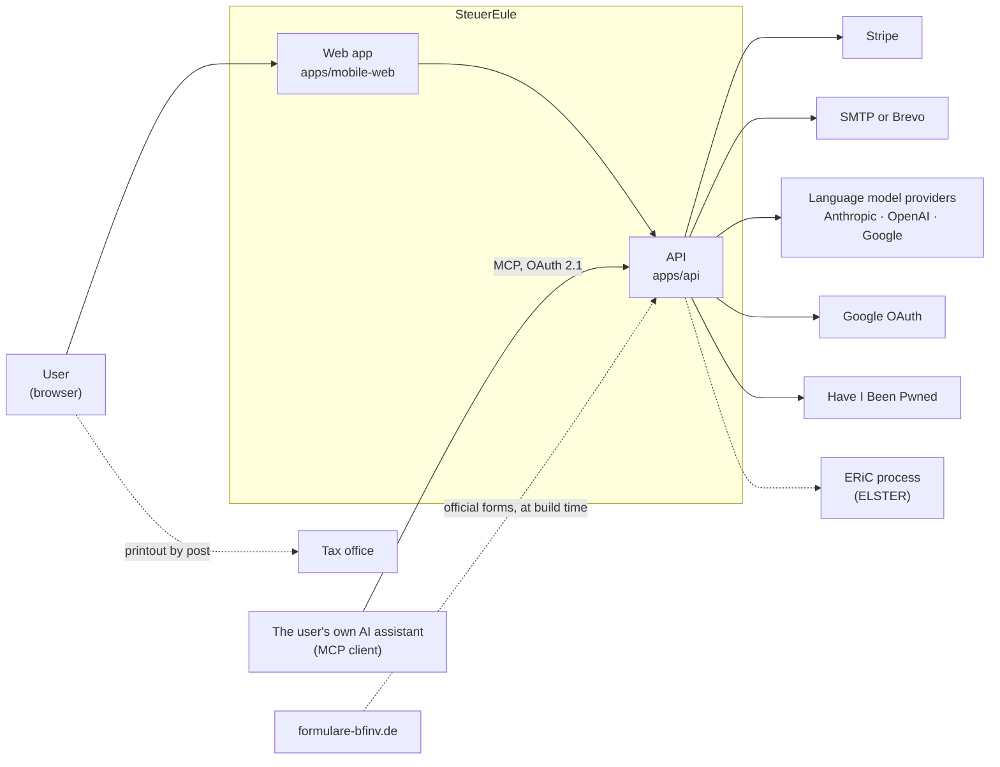
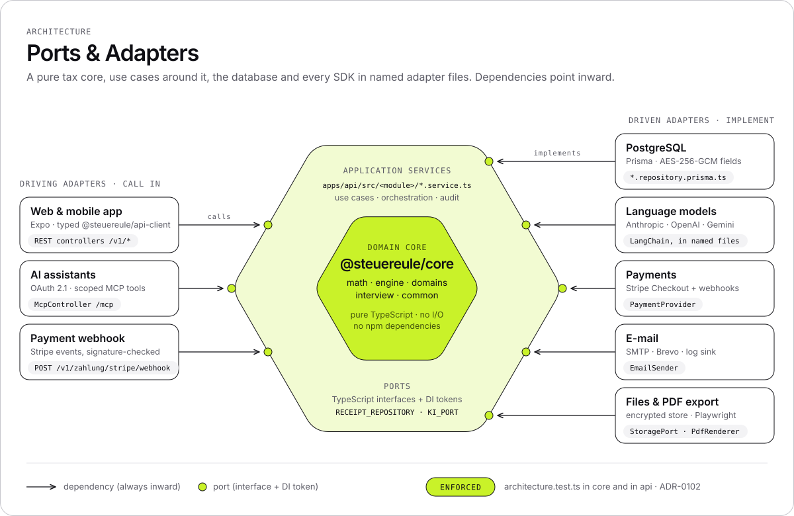
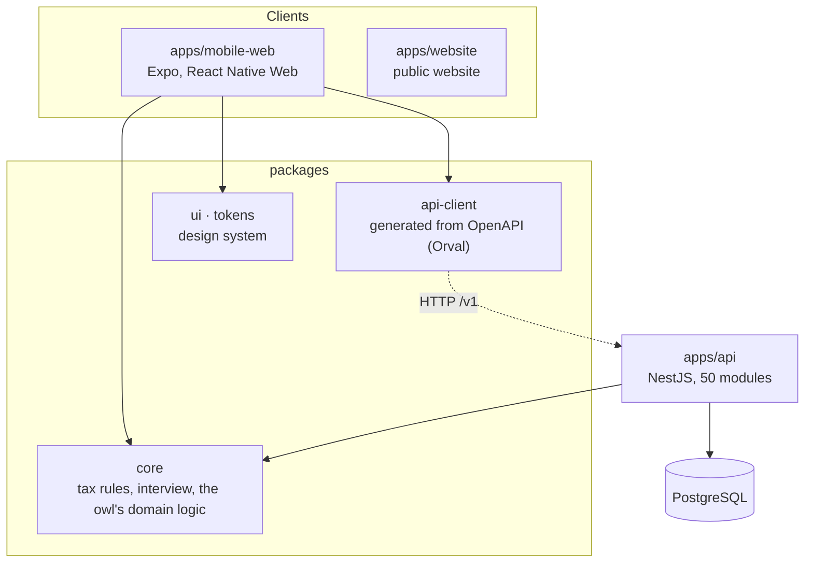
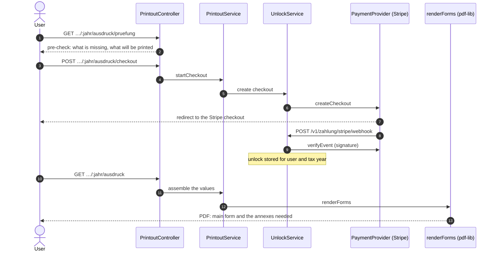
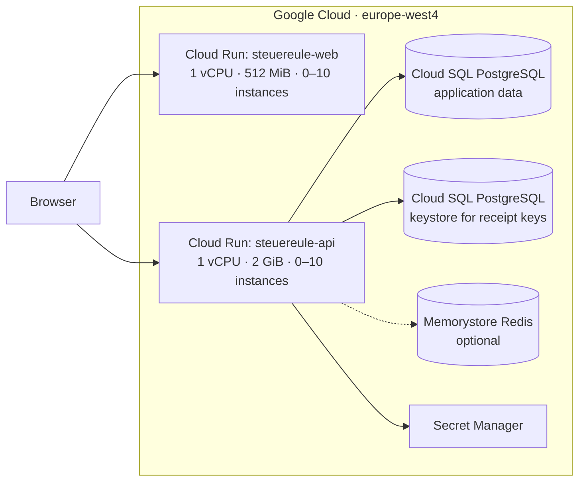

# SteuerEule — Architecture

| | |
| :--- | :--- |
| **As of** | 2026-11-22 |
| **Structure** | arc42, twelve sections |
| **Scope** | the monorepo: `apps/api`, `apps/mobile-web`, `packages/*`, `infra/gcp` |
| **Source of decisions** | [`docs/adr/`](adr/index.md). This document shows the structure; the ADRs justify it. |

**How this document stays true.** A rule names the test that checks it. A number carries its date and says where it comes from. What is planned but not built is listed in §11 and nowhere else. Names of files, classes and routes have been checked against the code. If you find a name here that does not exist, you have found a bug.

**Related documents.** [`architecture-subsystems.md`](architecture-subsystems.md) shows individual backend modules from the inside. [`arc42/README.md`](arc42/README.md) covers the toolchain and the boot order in detail. [`sre/reliability-spec.md`](sre/reliability-spec.md) states the operational targets.

**A note on language.** The product serves German taxpayers, so routes, form names and some domain terms are German. Each is explained on first use and in the glossary (§12).

---

# 1. Introduction and goals

## 1.1 Purpose

SteuerEule guides private individuals in Germany through their income tax return. The app asks questions in an interview, computes the expected refund as a range, reads receipts, and prints the return onto the official tax forms. An AI assistant, the owl (*Eule*), advises in a chat and prepares entries as drafts.

The governing principle ([ADR-0038](adr/0038-calculation-core-and-ai-port.md)):

> **The core computes, the language model phrases.** Every tax amount is produced by pure functions in `@steuereule/core`. A language model proposes and explains. It never writes to the return itself: a proposal becomes an entry only when the user confirms it.

**Who is served**

| Group | Scope | Decision |
| :--- | :--- | :--- |
| Employees | wage tax certificate (*Lohnsteuerbescheinigung*), commute, home office, special expenses, household services | [ADR-0041](adr/0041-employee-vertical-lstb.md) |
| Cross-border commuters to Switzerland | Swiss salary certificate, the 60-day rule, exchange rates, the form *Anlage N-Gre* | [ADR-0042](adr/0042-grenzgaenger-ch-vertical.md) |
| Pensioners | statutory and private pensions | [ADR-0044](adr/0044-pensioner-vertical.md) |
| Investors, landlords | securities accounts, the most-favourable-taxation check, rental properties with depreciation | [ADR-0048](adr/0048-capital-income-vertical.md), [ADR-0046](adr/0046-rental-vertical.md) |
| Married couples | one joint return, comparison of filing types | [ADR-0054](adr/0054-joint-assessment-one-return.md), [ADR-0034](adr/0034-veranlagungsartenvergleich-returns-a-bounded-comparison.md) |
| Self-employed | cash-basis accounting, bookkeeping, balance sheet, VAT and trade tax | [ADR-0101](adr/0101-self-employed.md) |

**How a return is filed.** The return is printed and sent by post ([ADR-0050](adr/0050-paper-filing-instead-of-elster-in-1-0.md)). Official forms are available for tax years 2022 to 2025; the core computes 2022 to 2026. For self-employed users who must file electronically there is code that transmits through an ERiC process (`apps/api/src/business/elster-transmission.ts`). It needs an operator certificate and is listed as open in §11.

## 1.2 Quality goals

| # | Goal | What that means | How it is checked |
| :-: | :--- | :--- | :--- |
| 1 | **Correct arithmetic** | Tariff, solidarity surcharge, allowances and deadlines match the law for each tax year. No estimated amount on the calculation or print path. | Unit tests of the core against statutory values; fuzzing across all interview paths (`packages/core/src/interview/matrix-fuzzing.test.ts`) |
| 2 | **Confidentiality** | Fields marked `@encrypted` are stored only as ciphertext. Receipt files are encrypted per user and can be destroyed by deleting the key. | Acceptance tests against a real PostgreSQL (`req-003-encryption-at-rest.test.ts`, `req-003-key-rotation.test.ts`); `account-deletion-coverage.test.ts` checks that deletion covers every table that references a user |
| 3 | **Print fidelity** | Every value sits in the right box of the official form. A value that does not fit aborts the print. | Measurement gates in the CI workflow *Quality* (`scripts/vordrucke/vermessen.mjs --check`) |
| 4 | **Usable without an account** | A guest answers the first questions and sees the cockpit. On sign-up the answers move to the account. | Acceptance test `req-006-guest-upgrade.test.ts`, E2E scenario 23 |
| 5 | **Changeability** | The database and external SDKs are reachable only from named places. New coupling between modules is a visible decision. | two architecture tests, §4.1.3 |

## 1.3 Stakeholders

| Who | Expectation |
| :--- | :--- |
| Users | a correct return, questions they understand, control over every entry |
| Product owner | a product that sells: payment is taken at print time, per tax year |
| Tax office | formally correct forms with legible values |
| Engineering and operations | clear boundaries, fast tests, traceable decisions |

---

# 2. Constraints

## 2.1 Technical

| Area | Constraint | Source |
| :--- | :--- | :--- |
| Language | TypeScript 7, `strict`, `noUncheckedIndexedAccess`, `exactOptionalPropertyTypes` | `tsconfig.base.json` |
| Runtime | Node.js ≥ 22 (CI and images: 24), pnpm 10 | `package.json` |
| Monorepo | pnpm workspaces with Turborepo | `pnpm-workspace.yaml`, `turbo.json` |
| API | NestJS 11 on Fastify 5 | `apps/api/package.json` |
| Database | PostgreSQL through Prisma 7 (driver adapter over `pg`), 59 models | `apps/api/prisma/schema.prisma` |
| Client | Expo 53 with React Native Web; what ships is the web app | `apps/mobile-web` |
| Core | no npm runtime dependencies; three files use `node:crypto` | `packages/core/package.json` |
| Static analysis | oxlint ([ADR-0019](adr/0019-oxlint-replaces-eslint.md)), `tsc --noEmit` | `.oxlintrc.json` |

## 2.2 Legal

| Requirement | Consequence for the architecture |
| :--- | :--- |
| GDPR Art. 9 | Religious affiliation is stored only with separate consent. |
| GDPR Art. 15, 17, 20 | Export as JSON and PDF; account deletion in one transaction, in which the access log is anonymised rather than deleted ([ADR-0013](adr/0013-dsgvo-export-and-account-deletion.md)). |
| Federal Ministry of Finance letter of 2022-08-12 on internet forms | Printed at 1:1 scale, sans-serif type of at least 10 pt, form keys ending in `NET`. |
| § 356 (5) BGB (German Civil Code) | The checkout collects consent to the early expiry of the right of withdrawal. |
| Tax Advisory Act (*Steuerberatungsgesetz*) | The app is a tool and does not provide tax advice within the meaning of the act. |

---

# 3. Context and scope



| Neighbour | Purpose | Adapter in the code | What the API sends there |
| :--- | :--- | :--- | :--- |
| Stripe | payment for the printout, webhook | `unlock/stripe-payment-provider.ts` behind `PaymentProvider` | user id, tax year, price id |
| SMTP, Brevo | confirmation and security mail | `auth/smtp-email-sender.ts`, `auth/brevo-email-sender.ts` behind `EmailSender`; without configuration a logging stand-in | e-mail address, mail text |
| Language model providers | the owl's chat, reading aid for receipts, topic guard | `llm/chat-model.factory.ts` (LangChain) | chat history and case data; receipt text after names, addresses and identifiers have been removed. Personal data only with consent ([ADR-0091](adr/0091-owl-personal-data-with-consent.md)). |
| Google OAuth | sign-in with a Google account | `auth/better-auth.ts` | OAuth protocol data |
| Have I Been Pwned | checks new passwords against known breaches | better-auth plugin, `auth/breach-check.ts` | part of the password hash (k-anonymity), never the password |
| MCP clients | the user's assistant reads the return and fills drafts | `mcp/` as a driving adapter ([ADR-0052](adr/0052-agent-access-mcp.md)) | only what the user released through an OAuth scope |
| formulare-bfinv.de | source of the official forms | `scripts/vordrucke/download-vordrucke.mjs`, not at runtime | nothing |
| ERiC | electronic transmission for the self-employed | `business/elster-transmission.ts` | the transmission data; see §11 |

---

# 4. Solution strategy

1. **A pure calculation core.** Tax rules are functions without input or output in `packages/core`. The API and the web app use the same core, so each rule exists exactly once.
2. **Parameters per tax year.** Allowances, lump sums and deadlines are in `math/tax-parameters.ts`, the tariff and surcharge tables in `math/tarif.ts`. Every year in which a rule changes is named there too (`RULE_CHANGE_YEARS`, the `*_STEPS` tables, §5.2). A few feature modules still carry their own per-year tables, see §11.
3. **Ports & Adapters around the core.** The database and external SDKs are reachable only from named places. §4.1 describes this in detail.
4. **Draft before entry.** Whatever the owl, a receipt reader or an external assistant proposes is a draft with a computed effect. Only confirmation writes ([ADR-0066](adr/0066-owl-field-catalog-and-one-write-path.md)).
5. **Encryption at the edge of persistence.** The Prisma adapter encrypts fields, the storage adapter encrypts receipt files. Services see plaintext and know nothing of the mechanism.
6. **Official forms as data.** 18 forms per tax year (2022 to 2025) are stored unmodified in the repository; their checksums are pinned in `apps/api/src/printout/vordrucke-<year>.json`.

## 4.1 Architecture style: Ports & Adapters



Three rings and one rule: **every dependency points inward.** The core knows nothing about HTTP, the database or a language model. The application services know the core and ports. An SDK is known only to the file named for it.

### 4.1.1 The three rings

| Ring | Where | May depend on | Must not depend on |
| :--- | :--- | :--- | :--- |
| **Core** | `packages/core/src/{math,common,domains,engine,interview}` | itself and `node:crypto` | npm packages, `apps/*` |
| **Application** | `apps/api/src/<module>/`: services, guards, parse strategies and the ports (`*.repository.ts`, `common/transaction-runner.ts`, `llm/single-shot-model.ts`, `unlock/payment-provider.ts`, `auth/email-sender.ts`) | core, ports, NestJS | the database client, external SDKs |
| **Adapters** | driving: `*.controller.ts`, `mcp/`; driven: `*.prisma.ts`, `prisma/`, the LangChain files in `ki/` and `llm/`, `unlock/stripe-payment-provider.ts`, `auth/smtp-email-sender.ts`, `account/export/pdf-renderer.playwright.ts`, `receipt/storage/postgres-bytea-storage.adapter.ts` | ports, core, their own SDK | the SDKs of other adapters |

The Nest modules (`*.module.ts`) are the **composition root**. Only there is a port bound to an adapter:

```ts
// apps/api/src/receipt/receipt-storage.module.ts
{ provide: STORAGE_PORT, useExisting: PostgresByteaStorageAdapter },
{ provide: RECEIPT_REPOSITORY, useClass: PrismaReceiptRepository },
```

```ts
// a service sees only the interface
constructor(@Inject(RECEIPT_REPOSITORY) private readonly receipts: ReceiptRepository) {}
```

### 4.1.2 The main ports

| Capability | Port · DI token | Adapter in production | Stand-in for tests |
| :--- | :--- | :--- | :--- |
| Persistence per feature module (33 repositories as of 2026-11-22) | e.g. `ReceiptRepository` · `RECEIPT_REPOSITORY` | `PrismaReceiptRepository` in `*.repository.prisma.ts` | `apps/api/test/fakes/fake-*.repository.ts` |
| A transaction across repositories | `TransactionRunner` · `TRANSACTION_RUNNER` | `PrismaTransactionRunner` | `passThroughTransactionRunner` |
| The owl's advisory turn | `AdvisorEnginePort` (in the core) · `ADVISOR_ENGINE` | `LangGraphAdvisorEngine` | `FakeKiChatModel`, `test/fakes/scripted-model.ts` |
| A single model call | `SingleShotModel` · `SINGLE_SHOT_MODEL_FACTORY` | `llm/langchain-single-shot.adapter.ts` | `noSingleShotModel` |
| Domain-level AI capabilities | `KiPort` (in the core) · `KI_PORT` | `RagKiAdapter` | |
| Payment | `PaymentProvider` · `PAYMENT_PROVIDER` | `StripePaymentProvider` | `FakeProvider` in `unlock.service.test.ts` |
| E-mail | `EmailSender` · `EMAIL_SENDER` | `SmtpEmailSender`, `BrevoEmailSender` | `LoggingEmailSender` |
| Receipt files | `StoragePort` · `STORAGE_PORT` | `PostgresByteaStorageAdapter` | the in-memory adapter of the receipt tests |
| PDF of the GDPR export | `PdfRenderer` · `PDF_RENDERER` | `PlaywrightPdfRenderer` | |
| Checking assistant tokens | `BearerTokenRepository` · `BEARER_TOKEN_REPOSITORY` | `PrismaBearerTokenRepository` | a fake in the guard test |
| The tax case of a person and year, for the seven services that compute on a return (estimate, printout, Cockpit, Abgabe, Verlauf, Bescheid, Veranlagungsvergleich) | `TaxCaseReader` · `TAX_CASE_READER` (`tax-case/`) | `RepositoryTaxCaseReader` | `taxCaseReaderOver({ … })` over the fake repositories |
| The estimate, for modules the estimate itself reads | `HouseholdEstimate` · `HOUSEHOLD_ESTIMATE` (owned by `capital/`), `PrintoutEstimate` · `PRINTOUT_ESTIMATE` (owned by `printout/`) | `TaxEstimateService`, bound by the global `TaxEstimatePortsModule` that only `AppModule` imports | the service over fakes, or a stub |

### 4.1.3 What is checked

| Invariant | Test | How it proves that it can fail |
| :--- | :--- | :--- |
| The database client and eleven further SDK groups are imported only by the files named for them. That includes `src/prisma/**` and adapter classes in `*.prisma.ts`. No file imports `ModuleRef` from `@nestjs/core` (no service locator); `Reflector` and `NestFactory` stay allowed. | `apps/api/test/architecture.test.ts` | fourteen constructed violations in the test, two of them imports of `ModuleRef` (named and namespace); each must yield exactly one finding |
| A named exception that no longer imports its SDK is an error. | the same test | found one superfluous exception on its first run |
| The set of *module → module* imports in `apps/api/src` equals the baseline (334 edges between 53 folders as of 2026-11-23, after ADR-0106 removed `auth → config`; 352 between 50 on 2026-11-22). | the same test, baseline `apps/api/test/architecture-module-edges.json` | a difference in either direction fails |
| The modules of `apps/api/src` on an import cycle are exactly the 28 listed in `MODULES_ON_A_CYCLE` (one strongly connected group as of 2026-11-25); none may join it. `account` and `personal-data` are on no cycle; `personal-data` (the personal-data registry, legal holds, the erasure flag) imports only `common` and `prisma`. | the same test | a constructed three-module cycle must be found, a chain must not |
| In the core: `math` imports nothing, `common` only `math`, `engine` never `interview`; no new direction between the folders. | `packages/core/src/architecture.test.ts` | broken with probe files on 2026-11-22 ([ADR-0102](adr/0102-ports-and-adapters-enforced-by-architecture-tests.md)) |
| In the core: the files importing against the intended order are exactly the 23 known ones. | the same test | as above |
| In the core: no cycle of value imports between files. | the same test | as above |
| The core has no npm dependency. | pnpm does not resolve undeclared packages; `pnpm -r typecheck` | `packages/core/package.json` has no `dependencies` |

Both tests run in the CI job `test` of the workflow *Quality*.

### 4.1.4 Known limits

- **LangChain is in eight files, not behind a port.** The owl's advisory turn is written in LangChain types: prompt assembly (`ki/advisor-prompt.ts`), the tool round (`ki/advisor-tool-round.ts`, `ki/advisor-tools.ts`) and the tool context (`ki/tools/tool-call-context.ts`). Changing the framework would mean rewriting those files. Changing the *provider* is configuration.
- **`mcp/` loads LangChain too**, because it imports `TOOL_ARG_SCHEMAS` from `ki/advisor-tools.ts`.
- **`pdf-lib` has no port.** Only `printout/form-renderer.ts` imports it, but services call `renderForms` directly.
- **better-auth is confined to two modules, not one file.** Twelve files in `auth/` and `device/` use it, among them the guard for JWT verification.
- **Modules are still coupled.** 334 edges; 3 pairs of modules import each other (2026-11-23, down from 16 on 2026-11-22). The ratchet prevents growth; removing an edge means rewriting the baseline (§11, finding 4).
- **The core has two folder-level cycles**, see §5.2.
- **DI tokens are not type-checked.** A missing binding fails at start-up, a wrong one only in an integration test.
- **Imports are found by pattern.** An import path computed at runtime is invisible.

### 4.1.5 Recipe: connecting an external dependency

1. **Port** in the module that needs it: interface, DI token, result types. No SDK import. The types belong to the port.
2. **Adapter** in a file of its own. For Prisma the suffix `.prisma.ts` is mandatory.
3. **Table** in `apps/api/test/architecture.test.ts`: add the SDK and the adapter file, plus one constructed violation.
4. **Binding** in the `*.module.ts`: `{ provide: FOO_PORT, useClass: TechFooAdapter }`.
5. **Fake** under `apps/api/test/fakes/` for unit tests; an integration test covers the real adapter.

### 4.1.6 Trade-offs

| Gain | Cost |
| :--- | :--- |
| The core is testable without infrastructure: 2067 tests in 155 files run without a database (as of 2026-11-22). | Four artefacts per external dependency: interface, token, adapter, fake. |
| Three model providers and a fake for CI behind one factory. | One indirection when reading: what stands behind `RECEIPT_REPOSITORY` is stated only in the module. |
| Field encryption sits in the Prisma adapter; services do not see it. | The compiler does not check DI tokens. |
| A violation costs a red test run instead of an architecture review. | Exception lists and the edge baseline have to be maintained. |

---

# 5. Building block view

## 5.1 Packages



| Package | Responsibility | Workspace dependencies |
| :--- | :--- | :--- |
| `packages/core` | tax law as pure functions, interview rules, the owl's domain logic | none |
| `packages/api-client` | typed client, generated from `apps/api/openapi.json` | none |
| `packages/tokens`, `packages/ui` | design tokens and components | `ui` uses `tokens` |
| `apps/api` | REST API under `/v1`, MCP server under `/mcp`, authentication, persistence | `core` |
| `apps/mobile-web` | the application in the browser | `core`, `api-client`, `ui`, `tokens` |
| `apps/website` | public website | none |

The API is split into 50 folders under `apps/api/src`, one per topic (`lstb`, `rental`, `receipt`, `advisor`, …) plus cross-cutting ones (`auth`, `prisma`, `audit`, `common`, `config`, `telemetry`). [`architecture-subsystems.md`](architecture-subsystems.md) shows the most important ones from the inside.

## 5.2 Inside the core

The five folders are layers. Each one imports only the folders below it:

| Folder | Content | Files |
| :--- | :--- | :-: |
| `math/` | the tariff of § 32a EStG (Income Tax Act), solidarity surcharge, parameters per tax year and the years in which rules change | 3 |
| `common/` | working days and public holidays, postal codes, tax offices, bank codes, tax-id check, PII masking, the `Range` of an estimate | 18 |
| `domains/` | verticals: wages, pensions, capital income, rental, cross-border, church tax, pension provision, self-employment (`business/`, `ledger/`), receipts, year history; the calculation model `calculation.ts`, the assessment reconciliation, the filing-type comparison and the answer model `answers.ts` | 89 |
| `engine/` | the tax estimate for one person and for a married couple, business income, the couple comparison | 6 |
| `interview/` | question catalogue and reachability, the cockpit range, the owl's domain logic and ports | 42 |

Measured imports between the folders (number of import statements, tests excluded, as of 2026-11-23):

| from ↓ to → | math | common | domains | engine | interview |
| :--- | :-: | :-: | :-: | :-: | :-: |
| **math** | | 0 | 0 | 0 | 0 |
| **common** | 2 | | 0 | 0 | 0 |
| **domains** | 37 | 13 | | 0 | 0 |
| **engine** | 8 | 5 | 17 | | 0 |
| **interview** | 8 | 7 | 42 | 2 | |

Every cell above the diagonal is 0: the order is `math → common → domains → engine → interview`, and there is no cycle between folders. The architecture test (`packages/core/src/architecture.test.ts`) enforces this without exceptions. Until 2026-11-22, 23 files in `domains` imported from `engine` (the calculation model, the assessment types) or from `interview` (the answer model); those modules now sit in `domains`, and `Range` sits in `common`. Between individual files there is no cycle of value imports either.

The same test forbids a year compared with a bare literal (`year >= 2025`) anywhere in the core except `math/tax-parameters.ts`. A rule that changes with the year names that year there, in `RULE_CHANGE_YEARS` (read with `appliesFrom`) or in a `*_STEPS` table (read with `valueForYear`).

---

# 6. Runtime view

## 6.1 From guest to cockpit


The guard is the only place that sets the user id of a request (`auth/user-context.guard.ts`). No route issues a guest session: the first guarded request without a cookie creates one. Routes marked `@RequiresAccount()` reject guests, among them the wage tax certificate and the detailed tax estimate. When the guest creates an account, `auth/guest-account-upgrade.prisma.ts` moves their data in one transaction ([ADR-0012](adr/0012-session-guard-coexistence-and-guest-upgrade.md), [ADR-0045](adr/0045-value-first-funnel.md)).

## 6.2 Unlocking and printing



The price is not in the code; it is a price id in the configuration. `renderForms` writes into the official PDF templates with `pdf-lib` and throws when a value does not fit its box.

## 6.3 Reading a receipt

```mermaid
sequenceDiagram
  autonumber
  actor U as User
  participant W as Web app
  participant C as ReceiptParseController
  participant S as Parse strategy
  participant K as @steuereule/core
  participant M as SingleShotModel

  U->>W: uploads a PDF or a photo
  Note over W: the text is produced in the browser:<br/>PDF text layer or on-device OCR (ADR-0060)
  W->>C: POST /v1/belege/parse (text, no image data)
  C->>S: strategy by document kind
  S->>K: fixed rules read what they recognise with certainty
  S->>K: scrubDocumentTextPii
  S->>M: one call with the scrubbed text
  M-->>S: JSON
  Note over S: schema check; on error, timeout<br/>or refusal the result of the rules stands
  S-->>W: draft with fields and provenance
  U->>W: confirms field by field
```

Three lines of defence come before the model. For the Swiss salary certificate and the wage tax certificate only an allowlist of rows leaves the server ([ADR-0058](adr/0058-lstb-text-fallback-allowlist.md)), and the model is asked only when the fixed rules left a field empty. Then `scrubDocumentTextPii` removes names, addresses and identifiers. Finally `checkPiiFree` aborts if the text still contains an IBAN or a tax id. Values from OCR never count as read with certainty and have to be confirmed.

Each strategy's `parse()` is a short sequence of named steps: read with the fixed rules, fill gaps with the model, decide whose document it is, stage the drafts, build the response. The steps several strategies share live in `receipt/parse/document-parse-steps.ts`: `resolveVisionModel` (kill switch and `vision_ocr` slot), `isolateGrounding` (`scrubDocumentTextPii`, then `checkPiiFree`), `extractWithModel` (one call through the `SingleShotModel` port with a timeout, then JSON extraction and the zod schema), and the response pieces (`stagingEngine`, `yearConflictOf`, `noTaxYearReason`, `stagedDraftsOf`). The pure steps of the receipt strategy (`kind: 'auto'`) are in `receipt/parse/auto-receipt-steps.ts`.

---

# 7. Deployment view



| Element | Setting | Source |
| :--- | :--- | :--- |
| Two services | `steuereule-api` and `steuereule-web`, one container each, scaling to zero | `.github/workflows/deploy.yml` |
| Database | Cloud SQL, one zone, automated backups with point-in-time recovery | `infra/gcp/main.tf` |
| Keystore | a separate Cloud SQL instance holding only the keys of receipt files: deleting a key makes the receipt unreadable in old backups too | [ADR-0059](adr/0059-document-keystore-crypto-shredding.md) |
| Redis | optional (`enable_redis`): the owl's run log across instances and the sign-in rate limit | [ADR-0064](adr/0064-owl-chat-answer-runs-and-resumption.md) |
| Delivery | build images, take a backup before the rollout, new revision, on failure route traffic back to the previous one | `deploy.yml` |
| Infrastructure as code | OpenTofu/Terraform | `infra/gcp/` |

Hosting decision: [ADR-0053](adr/0053-beta-hosting-cloud-run.md). `infra/terraform`, `infra/k3s` and `infra/manifests` additionally hold an older target environment on Hetzner with k3s (§11).

Because the API runs on up to ten instances, any state in process memory is separate per instance and is lost on scale-down. Today that affects the asynchronous print jobs and part of the rate limiting (§11).

---

# 8. Cross-cutting concepts

## 8.1 Authentication and identity

- **better-auth** is the auth server ([ADR-0009](adr/0009-better-auth-as-auth-server.md)): e-mail and password, Google, passkeys, TOTP, device approval by QR code ([ADR-0024](adr/0024-qr-device-authorization-endpoints.md)).
- **Three kinds of identity**, all set by `UserContextGuard`: the session of an account, a signed guest cookie, the bearer token of an assistant.
- **An assistant token is valid only at the MCP endpoint.** Every other controller rejects it before looking it up. A JWT is verified against better-auth's keys, the issuer and the audience; in addition the user's consent must still exist, so that a revocation takes effect at once.
- **Not every controller sits behind the guard.** Unguarded are `v1/health`, `v1/capabilities`, `v1/auth/capabilities`, OAuth discovery, device approval, and the Stripe webhook, which authenticates by its signature.

## 8.2 Encryption

| What | Mechanism | Keys |
| :--- | :--- | :--- |
| Fields marked `/// @encrypted` in the Prisma schema (190 markers as of 2026-11-22) | AES-256-GCM through `prisma-field-encryption`, installed in `prisma/encrypted-prisma.provider.ts` | one application key, `PRISMA_FIELD_ENCRYPTION_KEY`; earlier keys in `PRISMA_FIELD_DECRYPTION_KEYS` stay readable |
| Receipt files | envelope encryption in `receipt/storage/envelope-crypto.service.ts` | one key per user in the keystore |

Not every field is encrypted. Plaintext are, for example, the status of a tax year, commuting distances and payment amounts. A new key re-encrypts a value when it is next written; `rotate:field-key` (`apps/api/scripts/rotate-field-encryption-key.ts`, procedure in `infra/README.md`) re-encrypts the rest, so the old key can be dropped.

## 8.3 The boundary to the language models

- Receipt text is scrubbed before it reaches a model (§6.3).
- The owl's chat contains case data. Names and identifiers are masked (`packages/core/src/common/pii-masking.ts`); personal data reaches a model only with consent ([ADR-0091](adr/0091-owl-personal-data-with-consent.md)).
- Amounts come from the core: the estimate, lump sums and work-related expenses are computed before the model is asked. Every answer is then checked without a model.
- A topic guard sorts every typed question first ([ADR-0100](adr/0100-owl-guard-alongside-the-model-and-timings.md)). If it fails, the question passes, and the topic rule in the owl's own prompt remains as the second line.
- Which model works where is defined in slots (`llm/ai-runtime-config.service.ts`). A kill switch turns model calls off; the receipt readers then work with the fixed rules alone.

## 8.4 Persistence and transactions

- Every feature module has its repository as a port and a Prisma adapter.
- `TransactionRunner.run` joins several repository calls into one transaction at isolation level *Repeatable Read*. A concurrent write results in a conflict that reaches the client as `CONCURRENT_WRITE_CONFLICT` instead of a silent overwrite.
- Schema changes follow *expand and contract* ([ADR-0055](adr/0055-zero-downtime-database-migrations-expand-contract.md)). That is a working rule; no test enforces it.
- Access to tax data is logged by `AuditService` in the table `TaxDataAccessLog`.

## 8.5 Observability

- **Request id.** Fastify adopts a W3C `traceparent` or an `x-request-id` header, or creates a UUID (`common/request-id.ts`). The error filter writes it into every error body. The web app does not yet send an id of its own.
- **Tracing.** `telemetry/tracer.ts` wraps the OpenTelemetry API. Two places create spans. Neither an SDK nor an exporter is installed, so the spans are currently collected nowhere (§11).
- **Health.** `GET /v1/health/live` and `GET /v1/health/ready`; the latter checks the database.
- **Targets.** SLOs, error budget and recovery objectives are in [`sre/reliability-spec.md`](sre/reliability-spec.md). They are targets; no alerting for them exists as code.

## 8.6 Supply chain

The workflow *Security* checks every pull request for secrets (gitleaks), unsafe patterns (semgrep) and misconfiguration (trivy, hadolint, actionlint). *Build & E2E* scans the container images and fails on high and critical findings; `.trivyignore` exempts known findings (120 entries as of 2026-11-22). CycloneDX SBOMs are produced for the repository and both images. They are stored as artefacts and are not signed.

## 8.7 Rate limiting

Two mechanisms: better-auth's limiter for sign-in and registration, which uses Redis when `REDIS_URL` is set; and NestJS's `ThrottlerModule` for individual routes, which counts in process memory.

---

# 9. Architecture decisions

The index [`docs/adr/index.md`](adr/index.md) lists every decision (101 files as of 2026-11-22). These carry the structure:

| ADR | Decision | Status |
| :-- | :--- | :--- |
| [0008](adr/0008-profile-persistence-encryption.md) | Profile on the server, sensitive fields encrypted | Accepted |
| [0009](adr/0009-better-auth-as-auth-server.md) | better-auth as the auth server | Accepted |
| [0012](adr/0012-session-guard-coexistence-and-guest-upgrade.md) | A guard for guest or session; guest data moves to the account in one transaction | Accepted |
| [0013](adr/0013-dsgvo-export-and-account-deletion.md) | GDPR export and account deletion; the access log is anonymised and kept | Accepted |
| [0019](adr/0019-oxlint-replaces-eslint.md) | oxlint as the lint gate | Accepted |
| [0021](adr/0021-controls-are-proven-by-breaking-them.md) | A control is proven by breaking it | Accepted |
| [0034](adr/0034-veranlagungsartenvergleich-returns-a-bounded-comparison.md) | The filing-type comparison returns a bounded comparison, not a verdict | Accepted |
| [0038](adr/0038-calculation-core-and-ai-port.md) | Deterministic calculation core, AI behind a port | Accepted |
| [0045](adr/0045-value-first-funnel.md) | Guests may answer the first questions; the account takes them over | Accepted |
| [0050](adr/0050-paper-filing-instead-of-elster-in-1-0.md) | Filing on paper, paid per tax year at print time | Accepted |
| [0052](adr/0052-agent-access-mcp.md) | Access for the user's own assistant through MCP and OAuth | Accepted |
| [0053](adr/0053-beta-hosting-cloud-run.md) | Hosting on Cloud Run and Cloud SQL | Accepted |
| [0055](adr/0055-zero-downtime-database-migrations-expand-contract.md) | Migrations by expand and contract | Accepted |
| [0059](adr/0059-document-keystore-crypto-shredding.md) | A separate keystore for receipt keys | Accepted |
| [0064](adr/0064-owl-chat-answer-runs-and-resumption.md) | The owl's answer runs, detached from the connection | Accepted |
| [0066](adr/0066-owl-field-catalog-and-one-write-path.md) | One field catalogue, one write path, draft before entry | Accepted |
| [0101](adr/0101-self-employed.md) | Self-employment: cash-basis accounting, bookkeeping, balance sheet, VAT and trade tax | Accepted |
| [0102](adr/0102-ports-and-adapters-enforced-by-architecture-tests.md) | Ports & Adapters, enforced by two architecture tests | Accepted |

The decisions on rental, capital income and the year takeover (0046, 0048, 0049) still have the status *Draft* although their code ships (§11).

---

# 10. Quality and tests

| Tier | Tooling | What it proves | Size on 2026-11-22 | CI |
| :--- | :--- | :--- | :--- | :--- |
| Core | Vitest | tax rules, interview rules, the core's architecture rules | 155 files, 2067 tests | *Quality* · `test` |
| API without a database | Vitest with fakes | services, guards, parsers, the API's architecture rules | 205 files, 2247 tests | *Quality* · `test` |
| API with a database | Vitest against PostgreSQL as a CI service ([ADR-0010](adr/0010-ci-postgres-and-boot-smoke.md)) | encryption, access log, acceptance tests of the requirements | 53 files | *Quality* · `integration` |
| Web app | Vitest, Testing Library, MSW | screens and components | 233 files | *Quality* · `test` |
| Start-up | the built `dist/` over real HTTP | wiring bugs that in-process tests cannot see | | *Build & E2E* · `smoke` |
| End to end | Playwright with Chromium against the compose stack | 28 scenarios from the user's point of view, plus individual gates for receipts, the owl and the history | `e2e/scenarios/` | *Build & E2E* |
| Load | a load test with many users | small on every pull request, full size at night | | *Load* |
| AI quality | evaluations against real providers | answer quality of the owl and the topic guard | | *AI eval (nightly)* |

The figures come from a local test run and from counting the test files. They go out of date; the latest CI run is authoritative.

Two rules for gates: a gate counts only when it runs in CI against the real thing ([ADR-0010](adr/0010-ci-postgres-and-boot-smoke.md)), and every gate must have been made to fail on purpose once ([ADR-0021](adr/0021-controls-are-proven-by-breaking-them.md)).

---

# 11. Risks and technical debt

| # | Finding | Consequence | Next step |
| :-: | :--- | :--- | :--- |
| 1 | **Asynchronous print jobs live in process memory.** `printout/printout-job.service.ts` keeps them in a `Map` and starts them with `setImmediate`. There is no worker and no limit on concurrent jobs. [ADR-0056](adr/0056-asynchronous-pdf-generation-job-queue.md) describes a queue that was not built that way. | On ten instances a status request finds the job only by chance. A restart loses it. The web app does not use this path at present. | Move the jobs to the database or to Redis, or remove the path and mark ADR-0056 as not implemented. |
| 2 | **Tracing without an exporter.** | There are no distributed traces even though the code creates spans. | Install the OpenTelemetry SDK with an exporter. |
| 3 | **SLOs without alerts.** The targets in `sre/reliability-spec.md` do not exist as monitoring resources. | Nobody is told automatically when one is violated. | Define alert rules in `infra/gcp`. |
| 4 | **Coupling of the API modules** (§4.1.4). On 2026-11-22: 352 edges, 16 mutual pairs. On 2026-11-23, after #562–#565 were merged: 335 edges, 3 mutual pairs. Removed by moving `ParseTaxYearPipe` to `common/`, the tax-year rows to `tax-year/`, the household storage to `household-core/` and the receipt-inbox prompt text to `ki/`, and by replacing the two `ModuleRef` lookups of the estimate with ports. Left: **advisor ↔ business** (the receipt parse strategy of `business/` stages drafts through `advisor/`, the owl reads the book), **advisor ↔ receipt** (receipt services write drafts through `advisor/`, the owl lists the receipts) and **business ↔ confirmation** (`booking-field-access.ts` takes `BOOKING_ACCESS_FIELDS` from `confirmation/field-access.ts`). Each needs a new port in code that #562–#564 have just reshaped. | A module of such a pair cannot be changed or tested without the other. | Give the draft staging a port owned by `receipt/` and `business/`, move `BOOKING_ACCESS_FIELDS` into `business/`, and rewrite the baseline. |
| 5 | **LangChain runs through the advisory turn** (§4.1.4). | Lock-in to a framework. | Accepted as long as changing the provider stays configuration. |
| 6 | **Rate limiting partly in process memory** (§8.7). | With several instances the limit applies per instance. | Back `ThrottlerModule` with Redis. |
| 7 | **ELSTER transmission not operational.** The code calls an ERiC process; the operator certificate is missing. | Self-employed users who must file electronically cannot do so through the app. | Obtain the certificate, decide how the ERiC process is run ([ADR-0101](adr/0101-self-employed.md)). |
| 8 | **The official forms change every year.** | A shifted field makes the printout unusable. | Exists as a gate: checksums and measurements break the build. The forms for 2026 are still missing. Which fact goes into which field is decided per form: `printout/printout-values.ts` only composes one builder per form section or Anlage under `printout/values/`, so a changed form touches its own builder. `test/printout-values.golden.test.ts` pins the whole output for representative cases, including the order of the field ids and of the gaps. |
| 9 | **Per-year tables outside the parameter registry.** Since 2026-11-23 no year comparison remains outside `math/tax-parameters.ts`; four tables remain in their modules: `EARLIER_EMPLOYEE_LUMP_SUMS` (`domains/assessment.ts`), `EARLIER_SAVER_ALLOWANCE` (`domains/history-groups.ts`), `ROOM_CAP_2022_EUR` (`domains/business/profit.ts`) and the Kirchgeld tables (`domains/church-tax.data.ts`). | A new tax year can still need a change outside the registry. | Move them into `tax-parameters.ts` at the next change of year. |
| 10 | **A second target environment in `infra/`.** Next to `infra/gcp` there are definitions for Hetzner with k3s. | A reader of the repository sees two targets and cannot tell which one applies. | Remove them or mark them as an archive. |
| 11 | **ADRs in status *Draft* for shipped code** (0046, 0048, 0049). | The decision has not been formally accepted. | Settle the status. |
| 12 | **Two arc42 documents.** This document and `arc42/README.md` overlap; the latter describes an early state in its §5 and §5.1. | Readers cannot tell which one applies. | This document is authoritative. Cut `arc42/README.md` down to the toolchain and the boot order. |
| 13 | **The receipt strategy chains four fixed rules.** `AutoReceiptParseStrategy` applies the craftsman, donation, medical and childcare rules in a fixed order; each rule checks flags the earlier ones set (`invoice`, `donationRecognised`). | A fifth rule has to know the order and the flags of the four before it. | When a fifth rule comes, give each rule a common signature and keep them in an ordered list. |
| 14 | **Large screen files in the web app.** The seven largest files in `apps/mobile-web/src/screens` (915–1,245 lines: `GlassFormPreview`, `OwlModeScreen`, `CopilotBridgeProvider`, `CrossBorderScreen`, `AdvisorChatPanel`, `ChildrenScreen`, `CockpitScreen`) are now split into a `useXyz` hook for queries, mutations and derived state, components for the visual sections, and pure helpers with unit tests next to the screen. Thirteen files in `screens/` are still over 400 lines, the largest `receipts/ReceiptsScreen.tsx` (742), `printout/AcroFormLiveViewer.tsx` (692) and `workdays/WorkdaysScreen.tsx` (642). No check limits the size of a file. | A large screen mixes fetching, state and layout, so a change to one part means reading all of it, and its logic can only be tested through the rendered screen. | Split the remaining files the same way when they are next changed; consider a size limit in the lint step. |

---

# 12. Glossary

| Term | Meaning |
| :--- | :--- |
| **Adapter** | Implementation of a port against a framework or SDK. Driving adapters call the application (controllers, MCP); driven adapters are called by it (database, language model, Stripe). |
| **Anlage N-Gre** | The annex to the tax return for cross-border commuters. |
| **Cockpit** | The start page of a tax year: refund range and open items. |
| **Composition root** | The place where ports are bound to adapters: the Nest modules, `*.module.ts`. |
| **Draft** | A proposed entry with a computed effect that is written only on confirmation. |
| **ELSTER, ERiC** | The tax administration's electronic filing system and its client library. |
| **Filing-type comparison** (*Veranlagungsvergleich*) | Comparison of individual and joint assessment for married couples ([ADR-0034](adr/0034-veranlagungsartenvergleich-returns-a-bounded-comparison.md)). |
| **Form key** (*Formularschlüssel*) | The official code on every page of a form, for example `2024AnlN031NET`. |
| **Lohnsteuerbescheinigung (LStB)** | Wage tax certificate: the employer's annual statement of wages paid and tax withheld. |
| **Minimal gate** | The first interview questions (`job`, `ausland`, `kinder`, `familienstand`), which a guest may answer too. |
| **Most-favourable-taxation check** (*Günstigerprüfung*) | A statutory comparison of two ways of taxing the same income, for example flat-rate withholding tax against the progressive tariff. Not the same as the filing-type comparison. |
| **Owl** (*Eule*) | The AI assistant in the app's chat. Not to be confused with the MCP access, through which an *external* assistant of the user works. |
| **Port** | A TypeScript interface with a DI token through which the application ring needs something from outside, for example `ReceiptRepository` with `RECEIPT_REPOSITORY`. |
| **Vordruck** | An official form of the tax administration, as a PDF. |
| **zvE** | *Zu versteuerndes Einkommen*, taxable income: the basis of the tariff in § 32a EStG. |
