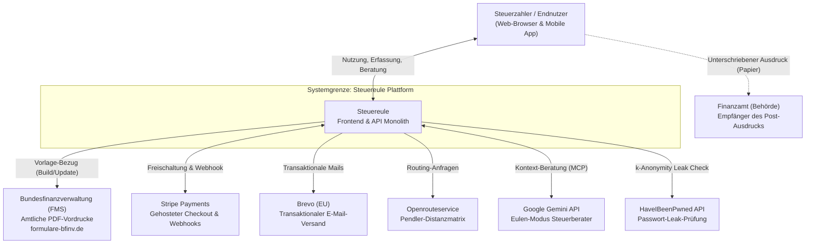
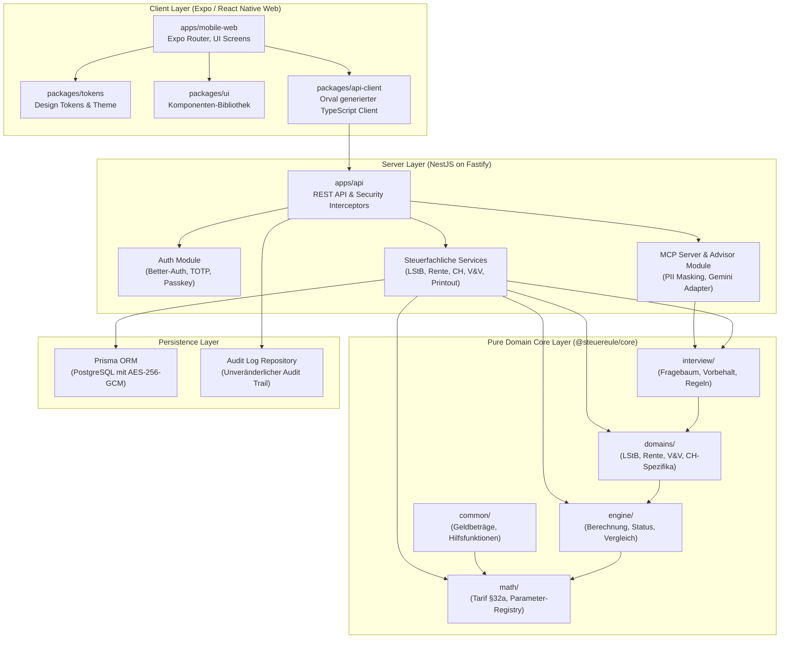
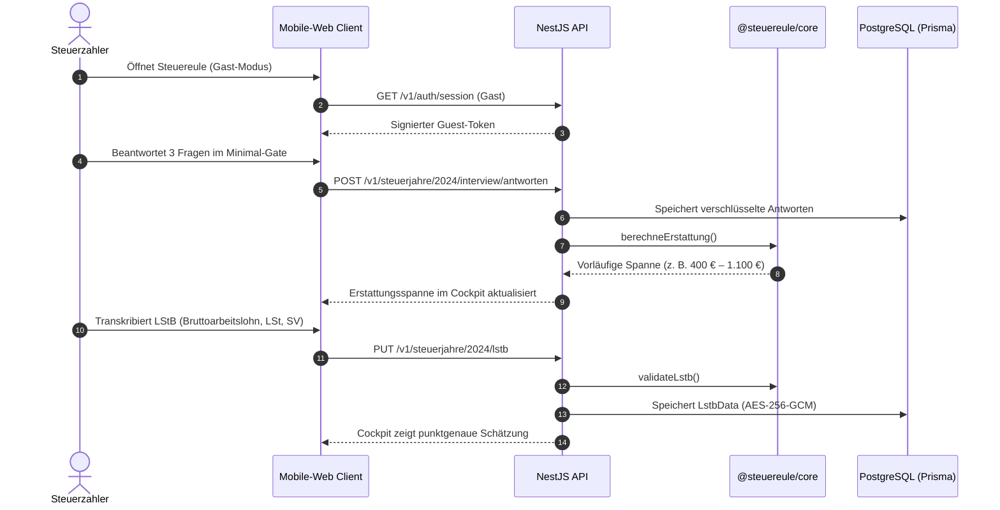
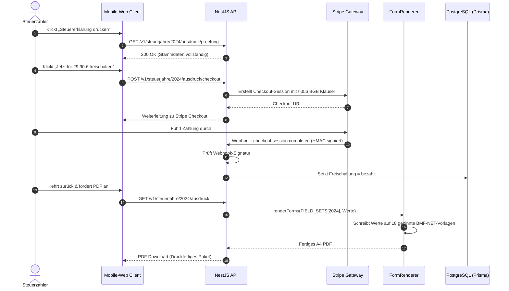
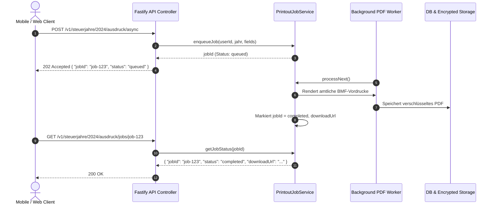
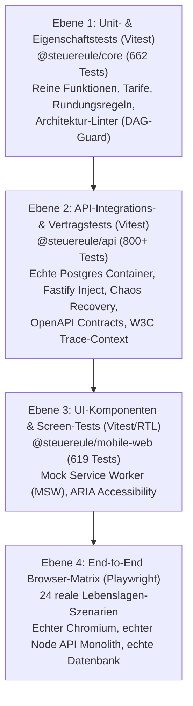

# 1. Einführung und Ziele {#section-introduction-and-goals}

## 1.1 Anforderungsübersicht {#_requirements_overview}

**Steuereule** ist eine plattformübergreifende Steuererklärungs- und Beratungsanwendung für deutsche Steuerzahler, die ab Version 1.0 auf **Web, iOS und Android** bereitgestellt wird. 

### Produkt-These & Leitprinzip ([ADR-0050](adr/0050-papierweg-statt-elster-in-1-0.md), [ADR-0005](adr/0005-deterministic-core-llm-assist.md))
Die Anwendung löst die Diskrepanz zwischen fehleranfälligen manuellen Formularen und undurchsichtigen „Blackbox“-Steuersoftwares durch ein zentrales architektonisches Axiom:

> **Deterministischer Kern entscheidet, KI assistiert:**
> Alle Steuerberechnungen (§ 32a EStG, Tarife, Freibeträge, Pauschalen, Fristen, AfA-Sätze, Besteuerungsanteile) werden **ausschließlich durch pure, zustandslose Funktionen in `@steuereule/core`** berechnet.
> Ein Large Language Model (im „Eulen-Modus“) berät, schlägt vor, strukturiert und formuliert — stets mit protokollierter Herkunft (*Provenance*), niemals eigenmächtig schreibend und ohne Scheinwerte zu erfinden.

### Zielgruppen und Scope in 1.0
1. **Angestellte & Arbeitnehmer:** Lohnsteuerbescheinigung, Homeoffice-Pauschale, Entfernungspauschale, doppelte Haushaltsführung, Sonderausgaben (Vorsorge, Spenden, Kirchensteuer, Riester).
2. **Grenzgänger Schweiz (CH-Vertikale, [ADR-0042](adr/0042-grenzgaenger-ch-vertikale.md)):** CH-Lohnausweis, 60-Tage-Regel nach Art. 15a DBA-CH, Schweizer Quellensteueranrechnung, BMF-Monatsreferenzkurse zur CHF/EUR-Umrechnung, amtliche Anlage N-Gre.
3. **Rentner & Versorgungsempfänger:** Gesetzliche Rente, Privatrente, Witwenrente, Besteuerungsanteil aus gesetzlicher Kohortentabelle nach § 22 EStG.
4. **Kapitalanleger:** Inländische und ausländische Broker, Sparer-Pauschbetrag, Günstigerprüfung nach § 32d Abs. 6 EStG.
5. **Vermieter:** Ganzjährig vermietete Wohnobjekte, Mieteinnahmen, Werbungskosten, lineare Gebäude-AfA nach § 7 Abs. 4 EStG.
6. **Ehepaare:** Zusammenveranlagungs-Vergleich (§ 26 EStG) mit typisierter Empfehlung.

### Nicht-Ziele für 1.0 (Non-Goals)
* **Keine ELSTER-Onlineübermittlung in 1.0 ([ADR-0050](adr/0050-papierweg-statt-elster-in-1-0.md)):** Die elektronische Übermittlung per Behördenzertifikat ist an gewerbliche Gewinneinkünfte gekoppelt. Für Arbeitnehmer, Rentner und Grenzgänger ist der amtliche Papierausdruck rechtlich vollständig zulässig (§ 150 Abs. 1 AO, BMF-Schreiben vom 12.08.2022). 1.0 liefert den druckfertigen, behördengeprüften PDF-Formularsatz (Hauptvordruck ESt 1 A und Anlagen).
* **Keine Gewerbetreibenden oder Freiberufler:** Gewerbliche Einkünfte (Anlage G, S, EÜR) werden durch das *Gewerbe-Gate* transparent abgefangen.

---

## 1.2 Qualitätsziele {#_quality_goals}

| Priorität | Qualitätsziel | Motivation & Messkriterium |
| :---: | :--- | :--- |
| **1** | **Mathematische & Steuerliche Exaktheit** | 100 % Konformität mit BMF-Tarifpolynomen (§ 32a EStG, SolZG) für alle unterstützten Steuerjahre (2022–2026). Keine Schätzwerte oder Scheinbeträge im Berechnungs- und Ausdruckspfad. |
| **2** | **Datenschutz & Vertraulichkeit (DSGVO)** | Durchgängige Feldverschlüsselung im Ruhezustand (AES-256-GCM mit rotierbaren Schlüsseln). Vollständige Einhaltung von Art. 9 (Einwilligung Religionsdaten), Art. 15/20 (Datenexport) und Art. 17 (atomare Löschkaskade). |
| **3** | **Behördenkonforme Drucktreue (BMF-Vordrucke)** | Generierung des Ausdrucks direkt auf den amtlichen BMF-NET-PDFs mit serifenloser 10pt-Schrift, DIN A4 (595 × 842 pt). Jeder Kasten wird vorab vermessen; Kastenüberläufe werden hart verhindert (`OverflowError`). |
| **4** | **Value-First & Reibungsarme UX** | Sofortige Nutzbarkeit ohne Registrierungszwang (*Guest Session*). Berechnung der vorläufigen Erstattungsspanne bereits im Gastmodus. Atomare Datenübernahme beim Account-Upgrade. |
| **5** | **DevSecOps & Supply Chain Security** | Null Hochrisiko-Schwachstellen (Trivy Container Scan), signierte CycloneDX Software Bill of Materials (SBOM) nach CRA / BSI TR-03183, 24 automatisierte Playwright E2E-Szenarien in CI. |

---

## 1.3 Stakeholder {#_stakeholders}

| Rolle / Person | Erwartungshaltung & Hauptinteresse |
| :--- | :--- |
| **Endnutzer (Steuerzahler)** | Maximale, verständliche Steuererstattung, schnelle Eingabe, keine Angst vor Steuerdeutsch, absolute Datensicherheit, stressfreier Ausdruck. |
| **NexusHero (Product Owner / Stakeholder)** | Kommerziell tragfähiges 1.0-Release ohne Abhängigkeit vom verzögerten ELSTER-Zertifikat; Monetarisierung beim PDF-Ausdruck via Stripe; exzellente Code-Qualität. |
| **Finanzamt / Steuerverwaltung** | Ordnungsgemäße, formrichtige Einreichung auf amtlichen Vordrucken mit korrekten Formularschlüsseln (`...NET`) und lesbaren Werten. |
| **Engineering / DevOps Team** | Klare Seams, modularer TypeScript-Monorepo-Stack, deterministische Testbarkeit, automatisierte CI/CD-Pipelines, lückenlose Protokollierung in `progress.db`. |

---

# 2. Architekturbeschränkungen {#section-architecture-constraints}

## 2.1 Technische Beschränkungen
* **Isomorphes TypeScript Monorepo:** Pnpm Workspaces mit Turborepo (`packages/core`, `apps/api`, `apps/mobile-web`, `packages/tokens`, `packages/ui`).
* **Framework-freie Kernlogik:** `@steuereule/core` ist frei von HTTP-, Browser- und Node-Abhängigkeiten. Sämtliche Steuerregeln laufen identisch auf Node.js (API) und im Browser (Mobile-Web).
* **NestJS 11 auf Fastify Adapter:** Maximale Durchsatzleistung und strenge Dependency Injection im Backend (`apps/api`).
* **Prisma ORM mit PostgreSQL:** Datenbank-Persistenz mit Pflicht-Migration-Boot-Guards (`assertDatabaseMigrated`) und Nicht-Dateibasierten Secrets (`assertEnvNotFileSourced`).
* **React Native Web (Expo):** Geteilte UI-Komponenten für Web und Mobile auf Basis des hauseigenen Design-Systems.
* **Poppler-Tools:** `pdftotext` und `pdftocairo` als CI-Gate für die millimetergenaue Vermessung amtlicher Vordrucke.

## 2.2 Regulatorische & Rechtliche Beschränkungen
* **DSGVO Art. 9 Abs. 2 Buchst. a:** Religionsmerkmale (Kirchensteuer) werden ausschließlich nach ausdrücklicher, separat quittierter Einwilligung erfasst und gespeichert.
* **BMF-Schreiben vom 12.08.2022 (IV A 5 - O 1561/19/10001 :004):** Anforderungen an nichtamtliche und Internet-Vordrucke: 100 % A4-Maßstab, serifenlose Schrift ≥ 10 pt, Dezimalkomma, Formularschlüssel mit `NET`.
* **§ 356 Abs. 5 BGB:** Ausdrückliche Zustimmung des Verbrauchers zum vorzeitigen Erlöschen des Widerrufsrechts bei Bereitstellung digitaler Inhalte im Stripe Checkout.
* **Keine Rechts- oder Steuerberatung im Sinne des StBerG:** Transparenter Entwurfshinweis; Berechnungen erfolgen als Software-Werkzeug.

---

# 3. Kontext und Abgrenzung {#section-context-and-scope}

## 3.1 Fachlicher Kontext (C4 Level 1)



---

# 4. Lösungsstrategie {#section-solution-strategy}

1. **Zentrale Temporal Parameter Registry (`TaxYearParameters`):**
   Sämtliche steuerlichen Tarife (§ 32a EStG), Freibeträge, Soli-Grenzen, Höchstbeträge und Abgabefristen sind über die Jahre 2022, 2023, 2024, 2025 und 2026 temporal parametrisiert. Es gibt keine verstreuten Hardcoded-Konstanten.
2. **Umfassende Feldverschlüsselung (Envelope Encryption):**
   Jedes sensible Feld in der PostgreSQL-Datenbank wird mit AES-256-GCM verschlüsselt. Schlüsselrotation wird durch Key-Versionierung im Ciphertext unterstützt.
3. **Vorlagen-Manifeste mit SHA-256-Pins:**
   Die 18 amtlichen BMF-NET-Vordrucke je Steuerjahr liegen unverändert im Repository. Ihre Prüfsummen und offiziellen Formularschlüssel sind in `vordrucke-<jahr>.json` gepinnt. CI verhindert Abweichungen ohne Neuvermessung.
4. **Zwei-Segment-Interview:**
   Segment 1 (Minimal-Gate) grenzt Fälle in 3 Fragen ein. Segment 2 (Katalog) öffnet spezifische Lebenslagen (Lebenslagen, Sonderausgaben, Grenzgänger) nach Bedarf.
5. **Eulen-Modus mit MCP-Architektur:**
   Der KI-Assistent greift über 6 streng authentifizierte, PII-maskierte MCP-Tools auf den Datenstand zu. Jede Änderung ist ein verifizierbarer Vorschlag mit Undo-Garantie.

---

# 5. Bausteinsicht (Building Block View — C4 Level 2)



```

### 5.1 Schichtenarchitektur & Abhängigkeits-DAG in `@steuereule/core`
Der Rechenkern ist streng modularisiert und schützt sich über einen automatisierten Architektur-Test (`packages/core/src/architecture.test.ts`) gegen Regressionsschulden und Schichtenverletzungen:
1. **`math/` (Reine Steuer-Mathematik):** Grundpolynome nach § 32a EStG, Tariftabellen, Temporal Parameter Registry (`tax-parameters.ts`). **Darf keine übergeordneten Module importieren.**
2. **`engine/` (Rechen-Engine & Status):** Aggregation von Einkunftsarten, Berechnung von Summen und Erstattungsspannen, Veranlagungsartenvergleich (§ 26 EStG).
3. **`domains/` (Fachliche Domänen):** Spezifische Steuervertikalen wie LStB, Rente (§ 22 EStG), Vermietung & Verpachtung (§ 21 EStG), Kapitalvermögen (§ 20 EStG), Grenzgänger CH (Art. 15a DBA).
4. **`interview/` (Dynamische Frageführung & Regeln):** Fragebaum (`InterviewGraph`), Erreichbarkeitsprüfung, Progressionsvorbehaltsregeln (§ 32b EStG).
5. **`common/` (Geteilte Basistypen):** Währungsbeträge, gemeinsame Datentypen.

Die Abhängigkeiten fließen ausnahmslos top-down:
$$\text{interview} \longrightarrow \text{domains} \longrightarrow \text{engine} \longrightarrow \text{math}$$

*Für eine detaillierte Aufschlüsselung der Komponenten auf C4 Level 3 siehe [`architecture-subsystems.md`](./architecture-subsystems.md).*

---

# 6. Laufzeitsicht (Runtime View) {#section-runtime-view}

## 6.1 Onboarding, Minimal-Gate & LStB-Erfassung



## 6.2 Freischaltung & Synchroner Ausdruck



## 6.3 Asynchrone Headless-Chromium PDF Queue ([ADR-0056](adr/0056-asynchronous-pdf-generation-job-queue.md))

Zum Schutz vor RAM-Erschöpfung und Blockieren des Fastify-Event-Loops bei hoher Last (z. B. Abgabestichtag) bietet die API ein asynchrones Job-Muster mit vollständiger Fault Isolation:



---

# 7. Querschnittliche Konzepte {#section-concepts}

## 7.1 Temporal Tax Parameter Architecture
Alle gesetzlichen Variablen sind in der temporalen Registry [`packages/core/src/tax-parameters.ts`](../packages/core/src/tax-parameters.ts) zentralisiert:
* **§ 32a EStG Tarife:** Grundfreibetrag (2022: 10.347 €, 2023: 10.908 €, 2024: 11.604 €, 2025: 12.096 €, 2026: 12.348 €), Zonen-Grenzwerte und Polynomkoeffizienten.
* **Solidaritätszuschlag (§ 4 SolZG):** Nullzone (2022: 16.956 €, 2023: 17.543 €, 2024: 18.130 €, ab 2025: 19.950 €) und Milderungszone.
* **Pauschbeträge:** Arbeitnehmerpauschbetrag (1.200 € / 1.230 €), Sparer-Pauschbetrag (801 € / 1.000 €), Homeoffice-Tagespauschale und Jahreshöchstbeträge.
* **Abgabefristen:** Gesetzliche Fristen nach § 149 AO und 4-jährige Verjährungsfristen für freiwillige Antragsveranlagung (§ 169 Abs. 2 Satz 1 Nr. 2 AO).

## 7.2 Datensicherheit & Kryptographie
* **Feldverschlüsselung (AES-256-GCM):** Jeder sensible Tabelleneintrag (Steuer-ID, IBAN, Löhne, Renten, Adressen) wird mit einem 12-Byte Zufalls-Nonce verschlüsselt. Die Nonce-Wiederholung ist rechnerisch ausgeschlossen.
* **Key-Rotation:** Schlüssel tragen einen Versions-Präfix (`k1:`, `k2:`). Beim Rotieren entschlüsselt die API alte Versionen über den Schlüsselbund und re-verschlüsselt mit dem aktiven Schlüssel.
* **Boot-Guards:** Beim Serverstart prüft `assertEnvNotFileSourced`, dass Produktions-Secrets niemals aus `.env`-Dateien auf der Platte stammen, und `assertDatabaseMigrated` erzwingt die vollständige Konsistenz zwischen Prisma-Migrations und der Datenbank.

## 7.3 DevSecOps & Supply Chain Security
* **Statische Sicherheit (Shift-Left):** Gitleaks (Secret Detection), Trivy Config (IaC Scanning), Semgrep (SAST), Hadolint (Dockerfiles) und Actionlint (CI Workflows).
* **Software Supply Chain:** Automatische Generierung von CycloneDX SBOMs für Root-Repo, API- und Web-Container-Images.
* **Container Security:** Blockierender Trivy-Scan auf HIGH/CRITICAL Vulnerabilities für Produktions-Images.
* **End-to-End Verifikation:** 24 vollautomatisierte Playwright-Szenarien testen reale Nutzerreisen im echten Browser.

## 7.4 Request Correlation & W3C Trace-Context
Zur lückenlosen Nachverfolgbarkeit von Fehlern und Latenzen über Frontend, API-Schichten und Logs hinweg nutzt das Backend standardisierte Correlation-IDs:
* **W3C `traceparent` & `x-request-id`:** Fastify extrahiert vorhandene W3C Trace IDs (`00-<trace_id>-<parent_id>-<flags>`) oder `x-request-id`-Header und generiert bei Fehlen eine eindeutige Request-ID ([`apps/api/src/common/request-id.ts`](file:///Users/suhaysevinc/source/Steuereule/apps/api/src/common/request-id.ts)).
* **Log-Präfix & Client Propagation:** Jedes strukturierte Logzeile im Fehlerfilter (`DomainErrorFilter`) wird mit `[requestId]` annotiert. Der Header `x-request-id` wird in jeder HTTP-Antwort zurückgeliefert; Fehler-Payloads enthalten die ID transparent im JSON-Body (`{ "statusCode": 404, "requestId": "req-..." }`).

## 7.5 OpenTelemetry (OTel) Distributed Tracing
* **Vendor-agnostisches Tracing:** Über `@opentelemetry/api` und den Wrapper [`withSpan`](file:///Users/suhaysevinc/source/Steuereule/apps/api/src/telemetry/tracer.ts) werden rechenintensive Operationen (z. B. `tax_estimate.calculate`) transparent in OpenTelemetry-Spans gekapselt.
* **Google Cloud Trace Export:** In Google Cloud Run fließen die Trace-Kontexte automatisch in Cloud Trace und Cloud Monitoring, ohne proprietäre SDK-Abhängigkeiten im Business-Code.

## 7.6 SRE Reliability, SLOs & Chaos Resilience ([`docs/sre/reliability-spec.md`](sre/reliability-spec.md))
* **Service Level Objectives:**
  - Berechnungs-Engine: 99,9 % der Requests $< 150\,\text{ms}$.
  - Asynchrone PDF-Generierung: 99 % der Jobs $< 4\,\text{s}$.
  - System-Verfügbarkeit (Availability): 99,9 % fehlerfreie HTTP-Requests.
* **Error Budget & Burn-Rate Alerts:** 30 Tage rollierendes Fehlerbudget von 0,1 % ($\approx 43{,}2\,\text{Minuten}$ Gesamtausfall). Alerting bei $14{,}4\times$ (1h-Window) und $6\times$ (6h-Window) Budget-Verbrauch.
* **Chaos- & Transient-Recovery:** Automatische CI-Resilience-Tests (`database-chaos-recovery.test.ts`) stellen sicher, dass temporäre PostgreSQL-Verbindungsabbrüche sauber mit `503 Service Unavailable` beantwortet werden und der Pool sich ohne Node-Prozess-Neustart selbstständig erholt.

## 7.7 Zero-Downtime Database Migrations ([ADR-0055](adr/0055-zero-downtime-database-migrations-expand-contract.md))
* **Expand and Contract Pattern:** Schema-Änderungen auf Produktiv-Datenbanken (Cloud SQL) erfolgen immer in zwei separaten Phasen:
  1. *Expand:* Neue Spalten/Tabellen werden rein additiv und nullable angelegt. Alte und neue Container-Instanzen können parallel arbeiten.
  2. *Contract:* Nach vollständigem Rollout und Daten-Backfill werden alte Spalten in einer nachfolgenden Migration sicher entfernt. Keine Downtime bei Rolling Updates.

---

# 8. Architekturentscheidungen (ADR-Register & progress.db) {#section-design-decisions}

Ausführlich begründet in [`docs/adr/`](adr/index.md) und lückenlos protokolliert in `~/.progress/progress.db`:

| ADR | Titel & Kernaussage | Status | Auslöser / Meilenstein in progress.db |
| :---: | :--- | :---: | :--- |
| **ADR-0005** | *Deterministischer Rechenkern statt LLM-Schätzungen:* Steuerrecht erfordert absolute Berechenbarkeit. KI assistiert nur. | Accepted | Kern-Architekturprinzip (#495) |
| **ADR-0008** | *Feldverschlüsselung im Ruhezustand:* AES-256-GCM für Steuer-ID, Stammdaten und Geldbeträge in PostgreSQL. | Accepted | Sicherheits-Standard (#468, #475) |
| **ADR-0011** | *Anonyme Gast-Session:* Value-First-Funnel ohne Zwangs-Registrierung; Erstattungsspanne im Gastmodus. | Accepted | Product Onboarding (#474) |
| **ADR-0013** | *DSGVO Kontolöschung nach Art. 17:* Vollständige Löschung aller Steuerdaten über atomare `$transaction`. | Accepted | Compliance Audit (#482) |
| **ADR-0022** | *Vorjahresübernahme als Vorschlag:* Übernommene Werte bleiben unbestätigt, bis der Nutzer sie prüft. | Accepted | Jahreswechsel (#489) |
| **ADR-0024** | *QR-Code Gerätekopplung:* Sichere Autorisierung des Desktops über das Smartphone ohne Passwortübertragung. | Accepted | Device Auth (#473) |
| **ADR-0031** | *Zwei-Segment-Interview:* Drei-Fragen-Minimal-Gate + On-Demand Lebenslagenkatalog. | Accepted | Interview Engine (#474) |
| **ADR-0034** | *Typisierter Veranlagungsartenvergleich:* `eindeutig`, `zu-knapp`, `unbestimmt` statt falscher Ratschläge. | Accepted | Tariflogik (#492) |
| **ADR-0042** | *Grenzgänger-Schweiz Vertikale:* 60-Tage-Regel, CH-Lohnausweis, BMF-Monatskurse, Anlage N-Gre. | Accepted | CH-Feature Track (#490) |
| **ADR-0045** | *Value-First-Funnel:* Gäste dürfen Minimal-Gate ausfüllen; Daten wandern beim Upgrade mit. | Accepted | Conversion Optimization (#491) |
| **ADR-0050** | *Papierweg statt ELSTER in 1.0:* Amtliche BMF-Vordrucke auf Papier, Bezahlung beim Ausdruck via Stripe. | Accepted | 1.0 Readiness (#496) |
| **ADR-0051** | *Eulen-Modus KI-Architektur:* PII-Maskierung, Tool-Calling, Herkunftsnachweis und Undo-Garantie. | Accepted | AI Advisor (#471) |
| **ADR-0055** | *Zero-Downtime Database Migrations:* Expand & Contract Pattern für unterbrechungsfreie Cloud Run Deployments. | Accepted | FAANG Architecture Hardening (#510) |
| **ADR-0056** | *Asynchronous PDF Generation Job Queue:* Entkoppelte Worker-Queue für rechen- und RAM-intensive BMF-Formular-Renderings. | Accepted | FAANG Architecture Hardening (#510) |

---

# 9. Qualitätsanforderungen und Testmatrix {#section-quality-scenarios}

Die Software-Qualität wird über ein **4-Ebenen-Testmodell** sichergestellt:



Zusätzlich sichern **Vordruck-Vermessungs-Gates** (`scripts/vordrucke/vermessen.mjs --check` und `lagebericht.mjs --check`) ab, dass keine Feldverschiebung auf amtlichen Formularen unbemerkt bleibt.

---

# 10. Risiken und Technische Schulden {#section-technical-risks}

| Risiko / Technische Schuld | Auswirkung & Schwere | Geplante Mitigierungsstrategie |
| :--- | :---: | :--- |
| **Jährliche Layout-Änderungen durch das BMF** | Hoch (Ausdruck unbrauchbar bei verschobenen Feldern) | Automatisiertes Download-Tool ([`download-vordrucke.mjs`](../scripts/vordrucke/download-vordrucke.mjs)) und striktes CI-Vermessungs-Gate für alle Vordruck-Vorlagen. |
| **Verzögerung des ELSTER-Zertifikats** | Mittel (Keine Online-Übermittlung in 1.0) | Vollständig gelöst durch ADR-0050: Zulässiger, rechtskonformer Papierausdruck schließt 1.0 ab; ELSTER folgt in 1.x. |
| **In-Memory Rate Limiting** | Niedrig (Bypass bei horizontaler Pod-Skalierung) | Für 1.0 mit Single-Instance ausreichend; Redis-Anbindung ist als Folge-Task für Multi-Pod-Betrieb vorbereitet. |

---

# 11. Glossar {#section-glossary}

| Begriff | Definition & Fachlicher Kontext |
| :--- | :--- |
| **LStB** | Lohnsteuerbescheinigung: Amtlicher Nachweis des Arbeitgebers über gezahlten Arbeitslohn und einbehaltene Lohnsteuer. |
| **N-Gre** | Spezifische amtliche Anlage für Grenzgänger in die Schweiz zur Besteuerung der Schweizer Einkünfte in Deutschland. |
| **zvE** | Zu versteuerndes Einkommen: Bemessungsgrundlage für den Einkommensteuertarif nach § 32a EStG nach Abzug aller Freibeträge. |
| **Splittingverfahren** | Steuerberechnung für zusammenveranlagte Ehepaare nach § 32a Abs. 5 EStG zur Glättung der Progression. |
| **Günstigerprüfung** | Gesetzlicher Vergleich zweier steuerlicher Alternativen (z. B. Kindergeld vs. Kinderfreibetrag; KapESt-Abgeltungsteuer vs. tarifliche ESt). |
| **Formularschlüssel** | Amtlicher Kenncode auf jeder Seite der BMF-Vordrucke (z. B. `2024AnlN031NET`). |
| **Eulen-Modus** | Dialogbasierter KI-Beratungsmodus mit gesicherten MCP-Tools und automatischer PII-Maskierung. |
