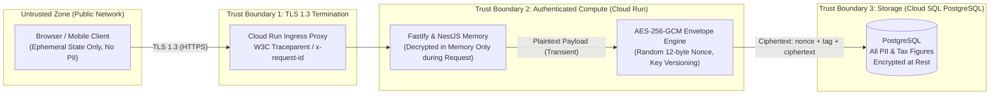

# Steuereule — SRE & Reliability Specification

> **Google SRE Framework Standard:** Service Level Indicators (SLIs), Service Level Objectives (SLOs), Error Budget Policies, and Incident Escalation for Production.

---

## 1. Service Level Indicators (SLIs) & Objectives (SLOs)

Steuereule classifies operations into two distinct critical user journeys (CUJs): **Deterministic Financial Calculations** and **Heavy PDF Document Synthesis**.

| Category | Service Level Indicator (SLI) | Service Level Objective (SLO) | Window |
|:---|:---|:---|:---|
| **API Availability** | $\frac{\text{Successful HTTP 2xx/3xx Requests}}{\text{Total Non-4xx Requests}}$ | **$\ge 99.9\%$** | 30-day rolling |
| **Calculation Latency** | Time spent inside `@steuereule/core` calculation engine | **$p95 \le 50\,\mu\text{s}$, $p99 \le 150\,\mu\text{s}$** | 30-day rolling |
| **HTTP Response Latency** | Total roundtrip for `/v1/steuerjahre/:jahr/cockpit` | **$p95 \le 120\,\text{ms}$, $p99 \le 250\,\text{ms}$** | 30-day rolling |
| **Asynchronous PDF Export** | $\frac{\text{Successful Completed Jobs}}{\text{Total Enqueued Jobs}}$ (ADR-0056) | **$\ge 99.5\%$** | 30-day rolling |
| **PDF Synthesis Latency** | Time from job enqueue to completed AcroForm PDF | **$p95 \le 3.5\,\text{s}$, $p99 \le 6.0\,\text{s}$** | 30-day rolling |

---

## 2. Error Budget Policy

Each 30-day rolling window provides a discrete error budget:

$$\text{Error Budget} = 100\% - 99.9\% = 0.1\% \quad (\approx 43.2 \text{ minutes of downtime per month})$$

### Action Triggers

* **Burn Rate $> 2\times$ (Alerting):**
  * PagerDuty / SRE notification to on-call engineer.
  * Triage of root cause (database pool starvation, memory leak, upstream payment gateway).
* **50% of Monthly Budget Consumed:**
  * Engineering velocity review: non-critical feature pull requests require SRE approval.
  * Bug fixes and reliability hardening prioritized over new domain verticals.
* **100% of Budget Consumed (Exhausted):**
  * Immediate feature deployment freeze on `main`.
  * Mandatory blameless Post-Mortem (Root Cause Analysis, Action Items with tracked GitHub issues).
  * Only P0 hotfixes and security patches permitted.

---

## 3. Fault Isolation & Backpressure Mechanisms

1. **Async Worker Isolation ([ADR-0056](../adr/0056-asynchronous-pdf-generation-job-queue.md)):**  
   Heavy Headless Chromium instances run decoupled from the primary HTTP event loop. CPU/RAM saturation during PDF compilation cannot degrade interactive calculation latency.
2. **Adaptive Database Pool Throttling:**  
   `withAdaptiveDatabasePoolUrl()` dynamically caps maximum active Prisma connections to provisioned container CPU quotas, preventing PostgreSQL connection storms during Cloud Run autoscale spikes.
3. **Graceful Termination (SIGTERM/SIGINT):**  
   `app.enableShutdownHooks()` ensures that in-flight requests and database transactions complete before the container terminates during Cloud Run revision draining.
4. **Resilient Health Probes:**  
   * `/v1/health/live`: Lightweight process check (does not hit the database; prevents container restart loops during transient DB blips).
   * `/v1/health/ready`: Active pooled database reachability check (tells ingress proxy when to pause traffic routing).

---

## 4. Quantitative Capacity Planning & Resource Budgeting (L6 Staff Specification)

To prevent resource exhaustion under non-linear peak loads (e.g., tax filing deadline on July 31st), Steuereule enforces explicit resource envelopes:

### 4.1 Headless Chromium & PDF Synthesis Memory Envelope
A single official BMF tax form compilation (18 pages, DIN A4, vector fonts, field alignment) consumes significant memory and CPU cycles:
* **Base Container Footprint:** $\approx 160\,\text{MB}$ RSS (NestJS, Fastify, Prisma client, OpenTelemetry).
* **Single PDF Compilation Spike:** $180\,\text{MB} - 320\,\text{MB}$ RSS during AcroForm stream rasterization and PDF generation.
* **Worker Concurrency Formula:**
  For a standard Google Cloud Run instance with $M_{\text{total}} = 2048\,\text{MB}$ RAM:
  $$C_{\text{max}} = \left\lfloor \frac{M_{\text{total}} - M_{\text{base}} - M_{\text{buffer}}}{M_{\text{render}}} \right\rfloor = \left\lfloor \frac{2048 - 160 - 512}{320} \right\rfloor = 4$$
* **Backpressure Thresholds:**
  - Maximum concurrent PDF renders per worker container: $C = 3$ (ensures $25\%$ safety headroom).
  - Maximum queue depth before load shedding: $K_{\text{max}} = 50$ queued jobs.
  - If $K > K_{\text{max}}$, the API returns `429 Too Many Requests` with `Retry-After: 30` to prevent memory blow-up.

### 4.2 Database Connection Pool Sizing Math
PostgreSQL connections consume server-side memory ($\approx 10\,\text{MB}$ per backend process for buffers and work memory).
* Cloud Run autoscaling range: 1 to 10 container replicas.
* Google Cloud SQL `db-f1-micro` / `db-custom-2-4096`: max connections capped at $N_{\text{pg}} = 100$.
* **Connection Cap Formula:**
  $$\text{PoolSize}_{\text{instance}} = \min\left(10, \left\lfloor \frac{N_{\text{pg}} - N_{\text{admin}}}{R_{\text{max\_replicas}}} \right\rfloor\right) = \min\left(10, \left\lfloor \frac{100 - 10}{10} \right\rfloor\right) = 9$$
* Steuereule's dynamic pooler defaults to $5$ connections per replica, expanding to at most $9$ under peak load, guaranteeing zero pool exhaustion on the database cluster.

### 4.3 Fastify Event Loop Lag Budget
* **Budget:** $p99 \le 20\,\text{ms}$ event loop delay.
* If event loop lag exceeds $50\,\text{ms}$ continuously for $>5\,\text{s}$, health probes report degraded readiness to divert incoming load to other replicas.

---

## 5. Disaster Recovery (DR), RTO & RPO Specification

| Metric | Target | Technical Mechanism & Verification |
|:---|:---:|:---|
| **Recovery Point Objective (RPO)** | **$< 5\text{ minutes}$** | **Continuous WAL Archiving:** Google Cloud SQL maintains Continuous Write-Ahead Log (WAL) archiving with Point-in-Time Recovery (PITR) up to 7 days. Maximum committed data loss in catastrophic disaster is bounded by the WAL flush interval. |
| **Recovery Time Objective (RTO)** | **$< 15\text{ minutes}$** | **Immutable Declarative IaC:** Complete infrastructure defined in OpenTofu (`infra/`). Cold-region provisioning (Cloud Run service + Cloud SQL restore from PITR snapshot) executes within 12 minutes automated via CI/CD. |

### Disaster Recovery Drills (Operational Readiness)
* **Frequency:** Bi-annual scheduled recovery exercise in staging environment.
* **Test Procedure:** Automated drop of staging database followed by point-in-time recovery to $T_{-15\text{min}}$, running post-restore data integrity validation against test tenant fixtures.

---

## 6. Actionable Incident Response & Operational Runbooks (Playbooks)

### Playbook A: Multi-Window Fast Burn-Rate Alert ($14.4\times$ over 1 Hour)
*Trigger:* $2\%$ of the monthly error budget consumed within 60 minutes ($\approx 50$ consecutive $5\text{xx}$ errors or severe latency spikes).

1. **Step 1: Immediate Triage (L6 Mitigation Phase)**
   - Open Google Cloud Monitoring Dashboard: Check whether errors originate from **Database Pool Starvation**, **Chromium OOM**, or **External Third Parties (Stripe/Gemini)**.
   - Run correlation query:
     ```bash
     gcloud logging read 'resource.type="cloud_run_revision" AND severity>=ERROR' --limit=20 --format="json(httpRequest.status, textPayload, jsonPayload.requestId)"
     ```
2. **Step 2: Traffic Shedding (Backpressure Activation)**
   - If PDF generation is the bottleneck: temporarily disable synchronous printout generation via feature flag `DISABLE_SYNC_PRINTOUT=true` to force all clients into the asynchronous queue ([ADR-0056](../adr/0056-asynchronous-pdf-generation-job-queue.md)).
3. **Step 3: Rollback on Bad Revision**
   - If the spike started immediately following a new deployment, initiate instant traffic roll-back:
     ```bash
     gcloud run services update-traffic steuereule-api \
       --region=europe-west3 \
       --to-revisions=PREVIOUS_KNOWN_GOOD_REVISION=100
     ```

### Playbook B: Slow Burn-Rate Alert ($6\times$ over 6 Hours)
*Trigger:* $5\%$ of monthly error budget consumed within 6 hours (typically memory leaks, slowly degrading database indices, or creeping latency).

1. **Memory Leak Inspection:** Inspect container RSS trajectory via Cloud Monitoring. If slope is linear with request count, grab an in-flight heap snapshot via Node inspector.
2. **Database Query Latency:** Query PostgreSQL `pg_stat_statements` for queries with mean execution time $> 50\,\text{ms}$:
   ```sql
   SELECT query, calls, total_exec_time / calls as avg_time_ms 
   FROM pg_stat_statements 
   ORDER BY avg_time_ms DESC LIMIT 5;
   ```

---

## 7. Cryptographic Trust Boundaries & Zero-Trust Threat Model



* **Zero-Persistence Guarantee:** PII (Steuer-ID, IBAN, wages, health data) is never written to disk unencrypted, never logged to stdout/stderr, and never preserved in client-side localStorage.
* **Deterministic Provenance:** All tax calculations run within the in-memory boundary; no LLM has access to cryptographic decryption keys.
